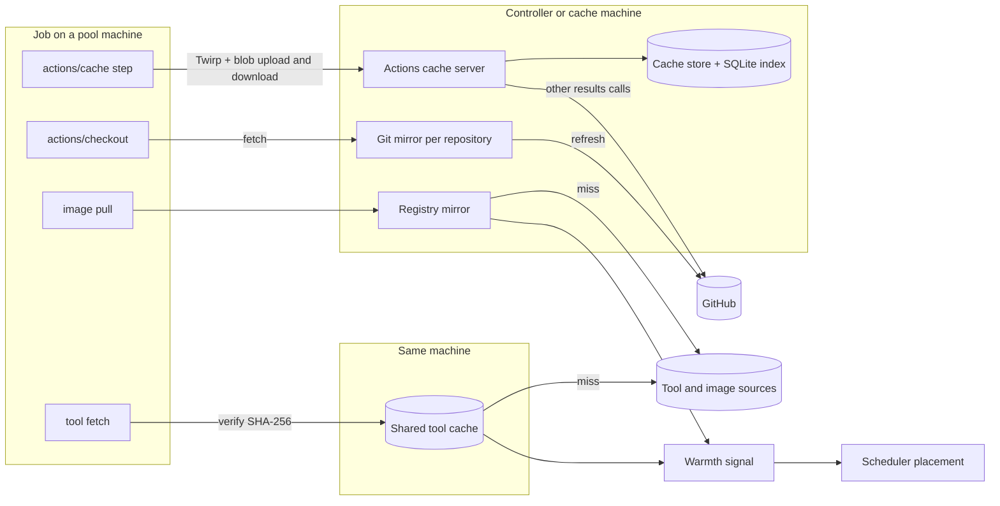
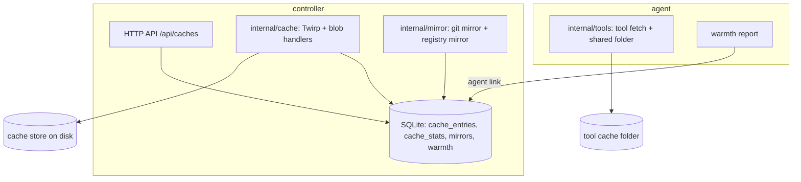

# Caches

The top half (sections 1 to 4) is for every reader. The bottom half (5 to 12) is for engineers.

**PARTLY BUILT (CRSP21, CRSP26).** Milestone 1 builds the per-runner cache quotas with eviction, the disk guard, the per-runner `CI_TOOLS_DIR` and the `vm_check` port (R5.36 to R5.40, built). Every other requirement is **NOT YET IMPLEMENTED**. The shared per-machine tool cache is planned for milestone 2. The Actions cache server, git mirror, registry mirror, cache warmth and wipe are planned for milestone 7. The package proxy has no milestone yet.

## 1. In one paragraph

Jobs on the pool spend much of their time downloading the same things again: `actions/cache` archives, the repository's git history, pinned tools and container images. This feature keeps those on the local network. The pool gets its own Actions cache server that `actions/cache` talks to unchanged, a git mirror per repository, a shared tool cache on each machine with SHA-256 pinned downloads, and a mirror for container images. The console shows what each cache holds and how much it saves. A wipe names what goes, asks for a yes, and waits for running jobs to finish. The scheduler uses a warmth signal from this feature to send a job to the machine that already has its caches.

## 2. Why

**Problem.** A GitHub-hosted job fetches its caches and tools from the internet. On self-hosted machines that is slow on a home or office link, and it counts against GitHub's cache quota (10 GB per repository). The same tool is downloaded once per job and per runner user. Two runner users who race to add the same tool can corrupt it (product brief, learning 11).

**Users.** The pool owner and admins who run CI for many repositories on their own machines. Indirectly, every workflow author whose jobs get faster.

**Goals.**

- `actions/cache` steps work with no workflow change and read and write a store on the local network.
- Checkouts fetch from a local git mirror.
- Pinned tools are downloaded once per machine, verified, and safe under races between runner users.
- Container images are pulled once per pool.
- The owner sees sizes, hit rates and savings, sets a size cap, and wipes safely.
- The scheduler knows which machine is warm for a repository.

**Non-goals.**

- Managing GitHub's own hosted cache.
- Caching between different pools, or sharing a cache between repositories.
- A general CDN or proxy for any URL.
- A package proxy for npm, PyPI, crates and apt in milestones 2 and 7 (see section 11).
- Build-system caches (Bazel remote cache, sccache, Turborepo). Workflows may run their own.

## 3. How it works

The steps in words:

1. **Actions cache.** The runner the product installs points `actions/cache` at the pool's cache server instead of GitHub's. A save asks the server for an upload address, uploads the archive, then finalizes it. A restore asks for a download address by key and restore keys, then downloads. Other calls to GitHub's results service, such as artifacts, pass through to GitHub unchanged.
2. **Git mirror.** The product keeps a bare mirror of each repository that has the pool turned on. A push webhook refreshes it. Each job's git is set to fetch that repository from the mirror. Pushes still go to GitHub.
3. **Tool cache.** Each machine has one shared tool folder. A job asks for a tool by name. The tool is used only when its SHA-256 matches the pin. A miss downloads to a private temporary file, checks it, then renames it into place in one step.
4. **Registry mirror.** Image builds and job image pulls go through a pull-through mirror. Content is kept by digest.
5. **Warmth.** After each job, the product records which caches the machine holds for that repository. The scheduler reads one warmth number per machine and repository.
6. **Wipe.** The owner picks what to wipe. The console lists each item that goes, asks for a yes, waits until no running job uses it, checks again right before deleting, then deletes and logs it.

## 4. Screens and states

Caches live on screen 7, **Images and caches** (product brief, Web console screens). No mocks yet. This section names the states and cites design system v1 rules; it adds no new rules.

The screen shows, per pool:

- **Actions cache:** used and cap as a bar (UX-41), entry count, hits and misses in the last 24 hours, bytes saved, last eviction. A table of repositories with entries, size and last hit (UX-25, sortable). Sizes and times follow UX-18.
- **Git mirrors:** a row per repository with size, last refresh and status (UX-58: `✓ ok`, `◷ waiting`, `✕ failed`).
- **Tool cache:** a row per machine with tool count and size; it opens to the tools, versions and platforms held.
- **Registry mirror:** image count, size, upstream registries.
- Long lists use the shared pager (UX-11).

States:

- **Empty:** "No cache entries yet. They appear after the first job that runs actions/cache." with a link to the setup help (UX-6).
- **Off:** a pool with the cache server off says so and why, with the setting that turns it on (UX-6, UX-38).
- **Loading:** a progress bar that names what loads (UX-29).
- **Could not load:** says what, why and what next (UX-28).
- **Wipe:** one primary action named by its work and count, for example "Wipe 214 entries (3.2 GB)" (UX-4). The question card lists every item that goes (UX-62, UX-9). The drain wait names the jobs it waits for and shows a bar (UX-29, UX-62). The running wipe shows in the running-work strip (UX-34). The button stays busy until the server answers (UX-13). The state comes from the server, not from a page flag (design system UX-19).
- Every status and chart has a text equivalent (UX-17). Messages use the four tones (UX-26).

## 5. Functional requirements

### Actions cache server (milestone 7)

**R5.1** — The cache server answers the Twirp service `github.actions.results.api.v1.CacheService` at `/twirp/github.actions.results.api.v1.CacheService/<Method>` for the methods `CreateCacheEntry`, `FinalizeCacheEntryUpload` and `GetCacheEntryDownloadURL`, with JSON and protobuf bodies and the field names of the toolkit's generated types (section 7.1).

**R5.2** — The upload address the server returns accepts the Azure Blob calls that `BlockBlobClient.uploadFile` makes: Put Blob for a single shot (up to 128 MiB) and Put Block plus Put Block List for larger files. The download address answers a plain HTTP GET, with `Range` support.

**R5.3** — A restore looks up the exact key and version first, then each restore key as a prefix, newest entry first. It searches the job's own ref first, then the pull request's base ref, then the repository's default branch. It never returns an entry of another repository.

**R5.4** — An entry is never overwritten. `CreateCacheEntry` for a key and version that already exists in the same scope answers `ok: false` with a message. When two jobs create the same entry at once, exactly one gets an upload address.

**R5.5** — A job that may not write (a fork pull request, or any job the policy marks read-only) gets `ok: false` from `CreateCacheEntry` with a message that starts with `cache write denied:`, so the toolkit reports it as a write denial and the job goes on.

**R5.6** — Any request under the results address that is not the cache service (for example the artifact service) is passed to GitHub's results service unchanged, with its headers and body, and GitHub's answer is returned unchanged.

**R5.7** — For a pool with the cache server on, the runners the product installs send `actions/cache` to the pool's cache server. For a pool with it off, the runner is the stock runner and jobs use GitHub's cache.

**R5.8** — Each pool has one cache store with a size cap. When a finalize would pass the cap, the least recently read entries are evicted until the store fits. Entries not read for 7 days (configurable) are evicted. An entry that is being read or written is never evicted.

**R5.9** — An upload that is not finalized within 1 hour is deleted with its blocks.

**R5.10** — The server records a hit or a miss for every restore, per repository, and the bytes served.

### Git mirror (milestone 7)

**R5.11** — For each repository with the pool on, the product keeps a bare mirror with all branches, tags and pull request refs (`refs/pull/*`). A `push` or `pull_request` webhook refreshes it, and a refresh runs at least every 15 minutes (configurable).

**R5.12** — Each job's git fetches that repository from the mirror over the local network, through a git URL rewrite set by the product. A push from the job goes to GitHub, never to the mirror.

**R5.13** — When a job asks the mirror for a commit or ref it does not have, the mirror refreshes from GitHub before it answers. If the refresh fails, the job's fetch goes to GitHub directly.

### Tool cache (milestone 2)

Ported from dev-standards `claude/plugins/delivery/templates/shared/scripts/delivery/ci_tool.py` and `tools.json` (decision 0005). Its tests are ported with it (section 9).

**R5.14** — Each machine has one shared tool cache folder that survives jobs. The agent makes it available to every job at one fixed path and sets `CI_TOOLS_DIR` to it. Until this milestone-2 folder exists, a persistent runner gets its own folder instead (R5.39). It is never the job's temp folder or workspace. The layout is `<dir>/<tool>/<version>/<file>`.

**R5.15** — Pins use the `tools.json` format: per tool a `version` and per platform (`linux_x64`, `linux_arm64`, `darwin_x64`, `darwin_arm64`, `windows_x64`) an entry with `kind` (`file`, `archive`, `wheel`, `crate`), `url`, `sha256`, and optional `file`, `bin` and `bin_dir`.

**R5.16** — A cached file is used only when its SHA-256 equals the pin. A file that does not match is deleted and fetched again. A download whose SHA-256 does not match fails and leaves no file.

**R5.17** — A download goes to a temporary file unique to the process, is verified, then renamed into place in one atomic step. The temporary file never remains, also after an error.

**R5.18** — On Linux and macOS the shared root is world-writable with the sticky bit (mode 1777), and every folder the tool fetch makes in it gets mode 1777. Any runner user can add a tool, and no user can replace or delete another user's file. A process that loses a rename race uses the winner's file.

**R5.19** — On Windows the agent makes the shared root with an access list that gives runner accounts the right to create files and folders and gives only the creator the right to change or delete them.

**R5.20** — If a folder in the shared cache cannot be written, the tool fetch prints one warning and uses a private per-user cache instead.

**R5.21** — A fetch makes up to 5 attempts, waits 10 seconds and then longer between them, uses a 20 second connect timeout, and retries on any error including HTTP 5xx.

**R5.22** — An archive, wheel or crate is unpacked once per platform. An entry whose path leaves the target folder is refused and nothing is unpacked. A crate is built once with `cargo install --locked`; a failed build leaves nothing behind.

**R5.23** — The binary has the commands `crsp tool <name> [--platform P] [--exe NAME] [--dir]` and `crsp tool fetch <url> --sha256 <hex> --name <tool>/<version>/<file>`. Each prints one absolute path and nothing else on standard output. Exit codes: 0 done, 1 a download, checksum or unpack failure (one line on standard error with the URL, the attempt count and the last error), 2 a usage error.

### Runner cache quotas and disk guard (milestone 1)

Owner decision of 2026-11-14 (CRSP21, CRSP26; dev-standards D302): on 14 Nov an old-pool runner's Rust build cache reached 320 GB, filled the system drive and stopped every runner. Persistent runners keep their caches between jobs, so the cap is built with them and not with the milestone 7 caches. Sizes are declared in configuration and checked, never measured live to decide a size.

**R5.36** (M1) — **A declared quota per runner cache.** Each persistent runner has two caches under its own folder, `cache/tools` (the tool cache) and `cache/rust-target` (the Rust build cache), each with a quota. The quotas are config keys: `cache_tool_gib` (default 20) and `cache_rust_gib` (default 40), the same for every runner. A key that is absent or 0 takes its default; a negative value is refused. The only measurement is the bytes the folder holds, to compare with the quota. Built (CRSP21, CRSP26).

**R5.37** (M1) — **Eviction between jobs, oldest first.** The job-completed hook brings each cache under its quota. It removes whole top-level entries (a tool version, a build profile folder), the least recently used first, and stops as soon as the folder fits. "Used" is the newest modification time of any file in the entry; a tie goes by path. A job that reuses a cached entry keeps it from the next eviction by touching it. Nothing is evicted while a job runs: the hook runs after the job, and a runner that is busy removes nothing. An eviction that fails is logged and never fails the hook. Built (CRSP21).

**R5.38** (M1) — **Disk guard in the job-started gate.** When the volume of the runner's cache folder has under 10% free (`cache_min_free_pct`, default 10, 1 to 50), the gate holds new jobs on that machine. They wait and are not failed. The hook writes one log line that names the free share, which reaches the job's Set up job step. The hold ends when 12% is free (the limit plus 2 points, so it does not flap). The hold counts against the gate's maximum wait; when that passes the job fails and can be re-run, also when the on-timeout rule is `run`, because a job that runs on a full disk can stop every runner on the machine. A disk that cannot be read never holds a job. The doctor check `machine.guard.disk` fails for a machine under the limit and says why jobs wait. Built (CRSP21).

**R5.39** (M1) — **A tool cache folder per runner.** Each persistent runner's `.env` sets `CI_TOOLS_DIR` to its own `<runner folder>/cache/tools`, `CARGO_TARGET_DIR` to its own `<runner folder>/cache/rust-target`, and the quotas as `CI_TOOLS_QUOTA_GIB` and `CRSP_RUST_CACHE_CAP_GIB`. Two runners never share a folder, so one runner cannot fill another's quota. The delivery scripts `ci_tool.py` and `rust_ci.py` read these values. Built (CRSP26).

**R5.40** (M1) — **`vm_check` in crsp.** The catalogue of expected VM images (the data of `scripts/delivery/vm-images.json`) and the logic of `scripts/delivery/vm_check.py` are in `internal/vmcheck`: checksum file parsing (BSD and sums formats, newest file for a `*` pattern), cache keys for bases and snapshots, the check that the cached image is the published one (`current`, `stale`, `missing`, `offline`), the host readiness report of a `kvm` runner (`/dev/kvm`, the six tools, a writable cache), the SELinux verdict and the prune plan. Booting a VM is not in this port; it comes with the KVM backend (runners M6). The plugin scripts are not edited. Built (CRSP26).

### Registry mirror (milestone 7)

**R5.24** — Each pool has one pull-through mirror for container images that speaks the OCI distribution API. It mirrors Docker Hub and `ghcr.io` by default; the owner can add other registries.

**R5.25** — The agent sets every container engine it manages to pull through the mirror: Docker's mirror setting for Docker Hub, and per-registry mirror settings (containerd `hosts.toml`, Podman `registries.conf`) for the others. The product's own image builds pull through it.

**R5.26** — The mirror stores content by digest and serves a blob only when its digest matches. A tag is checked with the upstream registry again after 1 hour (configurable). When the upstream cannot be reached, a cached tag is served and the console shows it as stale.

### Cache warmth (milestone 7)

**R5.27** — After each job, the agent reports which caches the machine holds for that repository: the image the job used, the tools it fetched, and, for a persistent runner, the workspace. The controller keeps one warmth value from 0 to 100 per machine and repository.

**R5.28** — Warmth falls to 0 after 24 hours without a job of that repository on that machine (configurable) and at once when the related cache on that machine is wiped. The scheduler reads warmth only after label match and free capacity (product brief, Scheduling and load); this feature never places a job.

### Screen data (milestone 7; tool cache rows in milestone 2)

**R5.29** — The API gives the Images and caches screen, per pool: Actions cache used bytes, cap, entry count, hits, misses and bytes served in the last 24 hours; per repository entries, size and last hit; per git mirror size, last refresh and status; per machine the tool cache tools, versions, platforms and size; registry mirror images, size and stale tags. The CLI shows the same data (`crsp caches list`).

### Wipe (milestone 7; tool cache wipe in milestone 2)

**R5.30** — The owner or an admin can wipe one Actions cache entry, one repository's entries, a pool's whole Actions cache, one git mirror, one machine's tool cache, or the registry mirror. A viewer cannot.

**R5.31** — Before a wipe, the console and the CLI list each item that goes with its size and the total, and ask for a yes (UX-62, UX-9). The CLI asks too, unless `--yes` is given. Nothing is deleted before the yes.

**R5.32** — A wipe waits until no running job uses what it would delete, names the jobs it waits for, and stops at the drain timeout the owner set. The check for idle runs right before the delete (product brief, learning 1). A wipe that reaches the timeout deletes nothing and says so.

**R5.33** — During and after a pool wipe, a restore of a wiped entry is a cache miss, never an error.

**R5.34** — Every wipe and every cap change is written to the audit log: who, what, when, items and bytes freed.

**R5.35** — Changing the cache server, git mirror or registry mirror setting for a pool takes effect only for runners started after the change. Runners that need a restart for it drain first.

## 6. Non-functional requirements

**R6.1** — Performance: `GetCacheEntryDownloadURL` answers within 50 ms at the 95th percentile with 100,000 entries in the index. A 1 GiB entry downloads from the server on loopback at 200 MB/s or more.

**R6.2** — Limits: the default cap per pool is 20 GiB. The ceiling is the store disk's size minus 10%. When free space on the store disk falls under 10%, new uploads are refused with `ok: false` and eviction runs.

**R6.3** — Integrity: the server records each entry's SHA-256 at finalize. A read whose stored content no longer matches is deleted and reported as a miss.

**R6.4** — Access: every cache, mirror and upload request is tied to a running job of the same repository on the pool. A request from no known job, or for another repository's entries, is refused. Upload and download addresses are signed by the controller and expire: upload after 1 hour, download after 10 minutes.

**R6.5** — Secrets: runtime tokens, installation tokens and the signatures in signed addresses are never written to logs, the database or the audit log.

**R6.6** — Transport: the cache server and the git mirror are served over TLS with the controller's certificate. Each job trusts that certificate (for Node.js actions through `NODE_EXTRA_CA_CERTS`).

**R6.7** — Fail open: when the cache server, git mirror or registry mirror cannot be reached, jobs still run. `actions/cache` reports a miss or a failed save as a warning, checkout falls back to GitHub, and pulls go to the upstream registry.

**R6.8** — Load: mirror refreshes, eviction and wipes count against the machine's load budget. They wait when the machine is over its budget (product brief, learning 13). They never stop a running job.

**R6.9** — Data kept: cache entries until evicted or wiped; hit and miss counts for 30 days; audit entries as the audit log keeps them.

**R6.10** — Platforms: the tool cache works on Windows, Linux and macOS, on amd64 and arm64.

**R6.11** — Accessibility: the Images and caches screen meets UX-17 in every theme.

## 7. Design

### 7.1 Protocol checked

Checked on 2026-11-14 against `actions/toolkit` `main` at `0c3a9c3` and `actions/runner` `main` at `8cfa104`:

- `packages/cache/src/generated/results/api/v1/cache.twirp-client.ts`: service `github.actions.results.api.v1.CacheService` with `CreateCacheEntry`, `FinalizeCacheEntryUpload`, `GetCacheEntryDownloadURL`.
- `packages/cache/src/generated/results/api/v1/cache.ts`: `CreateCacheEntryRequest {metadata, key, version}` → `{ok, signed_upload_url, message}`; `FinalizeCacheEntryUploadRequest {metadata, key, size_bytes, version}` → `{ok, entry_id, message}`; `GetCacheEntryDownloadURLRequest {metadata, key, restore_keys, version}` → `{ok, signed_download_url, matched_key}`. No list or delete method.
- `packages/cache/src/internal/shared/cacheTwirpClient.ts`: path `/twirp/{service}/{method}` on the base address; bearer token; JSON body; retries on 500, 502, 503, 504; 429 is not retried.
- `packages/cache/src/internal/config.ts`: v2 is used when `ACTIONS_CACHE_SERVICE_V2` is set (never on GHES); the v2 base address is `ACTIONS_RESULTS_URL` only.
- `packages/cache/src/internal/uploadUtils.ts`: upload with the Azure `BlockBlobClient.uploadFile`, single shot up to 128 MiB.
- `packages/cache/src/internal/cacheHttpClient.ts`: a download address whose host does not end in `.blob.core.windows.net` is fetched with a plain HTTP client.
- `packages/cache/src/cache.ts`: a reservation message that starts with `cache write denied:` becomes a `CacheWriteDeniedError`.
- `actions/runner` `src/Runner.Worker/Handlers/NodeScriptActionHandler.cs`: the runner sets `ACTIONS_RESULTS_URL` from the job's `ResultsServiceUrl` and sets `ACTIONS_CACHE_SERVICE_V2` from the job variable `actions_uses_cache_service_v2`. It overwrites any value set in the runner's `.env`, so `.env` alone cannot redirect the cache.

Third-party prior art (read, not used): falcondev-oss `github-actions-cache-server` redirects with a patched runner (`CUSTOM_ACTIONS_RESULTS_URL`); MxOrbit `GitHubActionCacheServer` is a Go server for the v2 API. There is no official GitHub document for a self-hosted v2 cache server. The protocol is checked again before milestone 7 starts, and a contract test runs the real `@actions/cache` package against the server (R5.1 test).

### 7.2 Runner redirect

Decision D2 (proposed): the product's runner images and persistent runner installs use a runner patched at install so that a product-set address wins over `ResultsServiceUrl` for `ACTIONS_RESULTS_URL`. The patch is tied to the pinned runner version and its SHA-256; an unknown runner version gets no patch and the pool falls back to GitHub's cache (R6.7). The doctor reports which runners are redirected. Because the whole results address is redirected, the server passes every non-cache call to GitHub (R5.6).

### 7.3 Parts

- **Store.** Blobs on the store disk under `<data>/cache/<pool>/<repository id>/<entry id>`. The index is in the controller's SQLite database (decision 0001). This adds a local file store; the stack profile's "Cache: none" row needs a change note when this is built.
- **Tables.** `cache_entries` (pool, repository, scope ref, key, version, size, sha256, created, last read, state `uploading|ready|evicting`), `cache_stats` (pool, repository, day, hits, misses, bytes served), `git_mirrors` (repository, path, size, last refresh, status), `warmth` (machine, repository, value, updated).
- **Identity.** Each request is mapped to a running job by the runner's network address, which the agent assigns, and the job's runtime token claims are checked against it (owner question Q3).
- **Contract.** New OpenAPI paths under `/api/caches` and the CLI command group `caches`; the agent link gains a warmth report message.
- **Tool cache.** A Go port of `ci_tool.py` in `internal/tools`. Its tests are ported test by test (section 9).

## 8. Failure modes

| Dependency | When it fails | Open or closed | Why |
|---|---|---|---|
| Cache server | Jobs see a cache miss or a failed save warning | Open | The cache only speeds jobs up; a job must not fail for it. |
| Cache store disk full | New uploads refused, eviction runs | Open for jobs, closed for writes | Never fill the machine's disk. |
| GitHub results service (pass-through) | Artifact calls fail as they would without the product | Closed | The product must not fake GitHub's answers. |
| Git mirror | Fetch goes to GitHub | Open | Correct code matters more than speed. |
| Tool source | Fetch fails after 5 attempts, exit 1 | Closed | An unverified tool must never run. |
| Tool checksum | File deleted, exit 1 | Closed | Same. |
| Registry upstream | Cached tag served, marked stale | Open | Jobs keep running offline; the console shows the risk. |
| Registry blob digest | Blob refused | Closed | Never serve content that does not match its digest. |
| Identity of a request | Request refused | Closed | Never leak one repository's cache to another. |
| Wipe drain | Wipe stops at the timeout, nothing deleted | Closed | Never cut a running job (learning 1). |

## 9. How it is proven

Rows for R5.36 to R5.40 are built and run in CI. Every other row is planned: none of those tests exist yet (NOT YET IMPLEMENTED). Paths are written without code marks until the files exist.

| Requirement | Planned test |
|---|---|
| R5.1 | internal/cache/twirp_test.go (each method, JSON and protobuf); e2e/caches/actions-cache-contract.test.ts (the real @actions/cache package saves and restores against the server) |
| R5.2 | internal/cache/blob_test.go (Put Blob, Put Block, Put Block List, GET with Range) |
| R5.3 | internal/cache/lookup_test.go (exact, prefix, newest first, ref order, no other repository) |
| R5.4 | internal/cache/create_test.go (existing entry refused; 20 parallel creates, one winner) |
| R5.5 | internal/cache/create_test.go (fork job gets "cache write denied:") |
| R5.6 | internal/cache/passthrough_test.go (artifact call reaches a fake GitHub unchanged) |
| R5.7 | internal/cache/redirect_test.go; e2e/caches/runner-redirect.test.ts (a real job on a pool runner hits the local server; with the pool off it does not) |
| R5.8 | internal/cache/evict_test.go (cap, least recently read first, 7-day age, busy entry kept) |
| R5.9 | internal/cache/evict_test.go (stale upload removed after 1 hour) |
| R5.10 | internal/cache/stats_test.go |
| R5.11 | internal/mirror/git_refresh_test.go (all refs incl. refs/pull/*, webhook and timer) |
| R5.12 | internal/mirror/git_rewrite_test.go (fetch from mirror, push to GitHub) |
| R5.13 | internal/mirror/git_miss_test.go (missing commit refreshes; failed refresh falls back) |
| R5.14 | internal/tools/dir_test.go (port of test_dl115_ci_tool.py test_ci_tools_dir_is_honoured; planned, M2) |
| R5.15 | internal/tools/pins_test.go (port of test_ds199_tool_fetch.py test_every_pin_has_url_and_sha, test_missing_pin_and_platform) |
| R5.16 | internal/tools/fetch_test.go (port of test_dl115_ci_tool.py test_first_fetch_downloads_and_verifies, test_second_fetch_makes_no_request, test_corrupted_cache_is_replaced, test_wrong_pin_exits_1_and_leaves_no_file) |
| R5.17 | internal/tools/fetch_test.go (no temporary file after success, failure or kill) |
| R5.18 | internal/tools/shared_unix_test.go (port of test_dl194_pool_tool_cache.py test_new_folders_have_shared_mode, test_lost_replace_race_uses_the_winner_file, test_installed_folder_is_read_only_to_others, test_racing_fetches_end_with_one_good_file, test_private_cache_keeps_default_modes) |
| R5.19 | internal/tools/shared_windows_test.go (two runner accounts: both add, neither deletes the other's file) |
| R5.20 | internal/tools/shared_unix_test.go (port of test_dl194_pool_tool_cache.py test_unwritable_version_folder_falls_back) |
| R5.21 | internal/tools/fetch_test.go (port of test_dl115_ci_tool.py test_retries_after_504, test_always_failing_server_stops_after_5_attempts) |
| R5.22 | internal/tools/unpack_test.go (port of test_ds199_tool_fetch.py test_archive_kind_and_exe, test_zip_archive, test_unsafe_archive_path_rejected, test_unpacks_once, test_crate_kind_builds_once_with_cargo_install, test_failed_cargo_leaves_nothing) |
| R5.23 | internal/tools/cli_test.go (port of test_dl115_ci_tool.py test_usage_error_exits_2, test_gitleaks_extracts_binary_once; test_dl189_ci_tool_file_name.py; one path on stdout) |
| R5.24 | internal/mirror/registry_test.go (pull through for Docker Hub, ghcr.io and an added registry) |
| R5.25 | internal/mirror/engine_config_test.go (Docker, containerd and Podman settings written) |
| R5.26 | internal/mirror/registry_test.go (digest check, tag re-check after 1 hour, stale tag when offline) |
| R5.27 | internal/cache/warmth_test.go (report after job sets the value) |
| R5.28 | internal/cache/warmth_test.go (decay to 0 after 24 hours; 0 after a wipe) |
| R5.29 | internal/api/caches_test.go; apps/web/src/caches/CachesScreen.test.tsx |
| R5.30 | internal/api/caches_wipe_test.go (owner and admin may, viewer refused) |
| R5.31 | internal/api/caches_wipe_test.go (list and total before yes; nothing deleted without yes); e2e/caches/wipe.spec.ts |
| R5.32 | internal/cache/wipe_drain_test.go (waits for named jobs; idle check right before delete; timeout deletes nothing) |
| R5.33 | internal/cache/wipe_drain_test.go (restore during wipe is a miss) |
| R5.34 | internal/api/caches_wipe_test.go (audit entry fields) |
| R5.35 | internal/cache/settings_test.go (new runners only; restart drains) |
| R5.36 | internal/runnercache/runnercache_test.go TestQuotaDefaultsAndValidate, TestScanCountsBytesPerEntry; internal/config/config_test.go TestCacheQuotaKeys |
| R5.37 | internal/runnercache/runnercache_test.go TestEvictionOrderOldestFirstUntilItFits, TestEvictionStopsAsSoonAsItFits, TestEvictionTieBreaksByPath, TestUnderQuotaRemovesNothing, TestNeverEvictsWhileARunnerIsBusy, TestTouchKeepsAReusedEntry, TestSweepAppliesToolQuotaAndRustCapSeparately; internal/hooks/hooks_test.go TestJobDoneEvictsOldestOverQuota |
| R5.38 | internal/runnercache/runnercache_test.go TestGuardHoldsUnderTenPercentAndResumesWithMargin, TestGuardReasonAndUnknownDisk; internal/hooks/hooks_test.go TestDiskGuardHoldsAndResumes, TestDiskGuardTimeoutFailsWithoutSlotEvenOnTimeoutRun, TestDiskGuardFailsOpenOnReadError; internal/doctor/checks/checks_test.go TestDiskGuard |
| R5.39 | internal/runnercache/runnercache_test.go TestEnvExportsToolsDirAndQuotas, TestCapsFromEnv; internal/backend/linux/linux_test.go and internal/backend/windows/windows_test.go (the runner env file holds CI_TOOLS_DIR); internal/runners/service_test.go TestAddPassesCacheQuotaToTheAgent |
| R5.40 | internal/vmcheck/vmcheck_test.go (catalogue, TestParseChecksumsBSDAndSums, TestResolveChecksumURLPicksNewestListed, TestKeys, TestVerifyComparesCachedWithPublished, TestReadiness, TestSELinuxVerdict, TestPrunePlanKeepsNewestPerDistroAndOldTempFiles, TestCatalogueMatchesThePluginFile) |
| R6.1 | internal/cache/bench_test.go (lookup p95 with 100,000 entries; 1 GiB download speed) |
| R6.2 | internal/cache/evict_test.go (default 20 GiB, ceiling, refuse under 10% free) |
| R6.3 | internal/cache/integrity_test.go (changed blob becomes a miss and is deleted) |
| R6.4 | internal/cache/access_test.go (unknown job refused; other repository refused; expired address refused) |
| R6.5 | internal/cache/secrets_test.go (tokens and signatures absent from logs, database and audit) |
| R6.6 | internal/cache/tls_test.go; e2e/caches/actions-cache-contract.test.ts (Node trusts the controller certificate) |
| R6.7 | e2e/caches/fail-open.test.ts (server, mirror and registry stopped; job passes) |
| R6.8 | internal/mirror/budget_test.go (refresh waits over budget; never stops a job) |
| R6.9 | internal/cache/stats_test.go (counts older than 30 days removed) |
| R6.10 | internal/tools CI matrix on Windows, Linux and macOS, amd64 and arm64 |
| R6.11 | e2e/caches/caches-a11y.spec.ts (axe in dark and light) |

## 10. Decisions

| ID | Question | Chosen | Date |
|---|---|---|---|
| D1 | Which cache protocol to serve | The v2 Twirp cache service only; v1 is not served (current toolkit uses v2 on github.com) | 2026-11-14 (proposed) |
| D2 | How to send `actions/cache` to the pool | A runner patched at install for the pinned runner version (section 7.2); owner to confirm (Q1) | 2026-11-14 (proposed) |
| D3 | Tool cache language | A Go port of `ci_tool.py` inside the one binary, with its tests ported | 2026-11-14 (proposed) |
| D4 | Wipe at drain timeout | Delete nothing and say so; never cut a job | 2026-11-14 (proposed) |

Open questions for the owner:

- **Q1** — Is patching the runner at install acceptable for the cache redirect, or should the cache server wait until GitHub supports a supported override?
- **Q2** — Where does the cache store live: on the controller's machine, or on a machine the owner picks as the cache machine?
- **Q3** — Is tying a request to a job by the runner's network address plus the runtime token's claims enough, given GitHub's runtime token signature cannot be checked locally?
- **Q4** — Default size cap: 20 GiB per pool, and should there also be a cap per repository (GitHub uses 10 GB)?
- **Q5** — Should persistent runners also get the git URL rewrite, or only ephemeral ones?
- **Q6** — Does the tool cache command run inside jobs from the product binary (mounted read-only), or does the product also ship the Python `ci_tool.py` for workflows that call it today?

## 11. Not built yet

Built in milestone 1: R5.36 to R5.40. Not built there: the folders are made by the runner's first job, not by the agent at install; the alert of the disk guard is the job log line and the doctor finding (no notification yet); the quotas are the same for every runner (a per-machine value waits for the machine settings, whose `cache_cap_bytes` is stored but not yet read by the quota); the VM boot of `vm_check`. Everything else above is NOT YET IMPLEMENTED. In addition:

- **Package proxy** (npm, PyPI, crates, apt): no milestone. The seam is the registry mirror's upstream list and the agent's engine settings (R5.25); a package proxy would add per-ecosystem settings (`npm_config_registry`, `PIP_INDEX_URL`, Cargo `source.replacement`, apt proxy) the same way.
- **Cache sharing between pools**: not planned. The seam is the pool column in `cache_entries`.
- **Remote cache machines outside the local network**: waits for cloud machines (decision 0004).

## 12. Code map

Built (milestone 1):

- internal/runnercache/ (quota, scan and oldest-first eviction, disk guard, the runner's cache environment, the real disk read per OS)
- internal/vmcheck/ (port of `vm_check.py` logic and `vm-images.json` data)
- internal/hooks/gate.go `diskHold` and internal/hooks/jobdone.go `sweepCaches` call them; internal/config/config.go has the keys; internal/backend/{windows,linux,macos} write the `.env`.

No code yet. Planned folders, from the `code:` globs:

- internal/cache/ (Actions cache server, eviction, warmth, wipe)
- internal/mirror/ (git mirror, registry mirror)
- internal/tools/ (tool cache, port of dev-standards `ci_tool.py`)

Source: internal/runnercache/evict.go, internal/runnercache/guard.go, internal/runnercache/env.go, internal/vmcheck/vmcheck.go, internal/hooks/gate.go, internal/hooks/jobdone.go

Ported from (dev-standards, read-only):

- `claude/plugins/delivery/templates/shared/scripts/delivery/ci_tool.py`
- `claude/plugins/delivery/templates/shared/scripts/delivery/tools.json`
- `claude/plugins/delivery/tests/test_dl115_ci_tool.py`, `test_dl194_pool_tool_cache.py`, `test_ds199_tool_fetch.py`, `test_dl189_ci_tool_file_name.py`
- `claude/plugins/delivery/templates/runner-pool/Dockerfile` (`/ci-tools` made with mode 1777)
