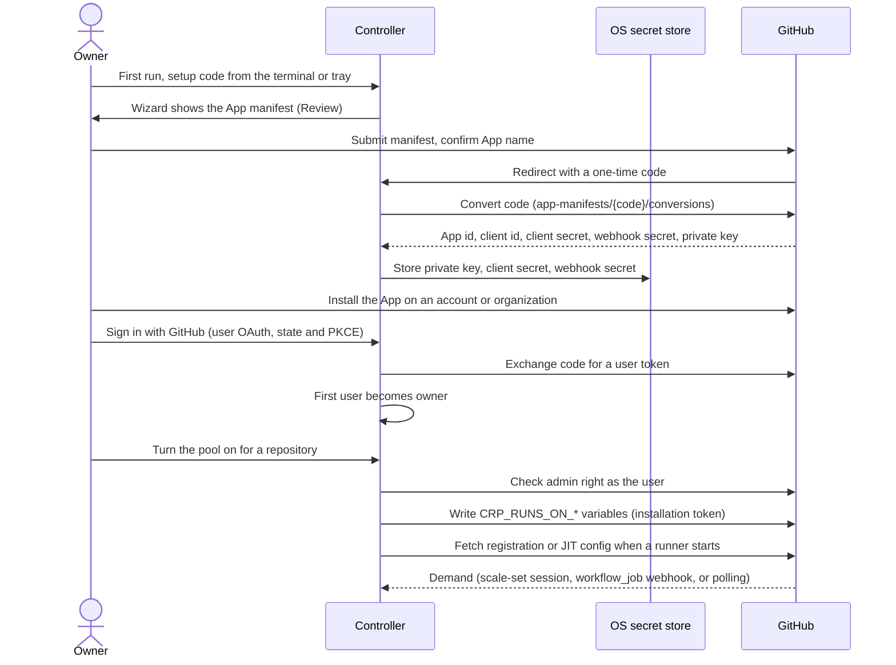
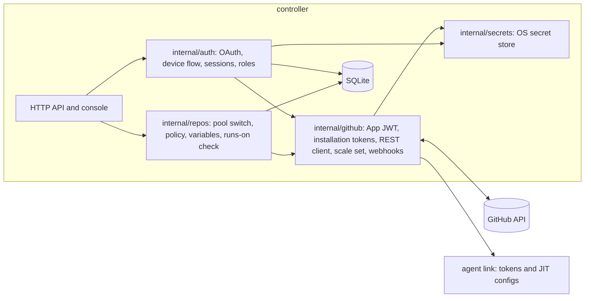

# GitHub integration

The top half (sections 1 to 4) is for every reader. The bottom half (5 to 12) is for engineers.

No code exists yet. Every requirement is NOT YET IMPLEMENTED. Each one names the milestone that builds it (M1 to M8, from the product brief).

## 1. In one paragraph

Each controller registers its own GitHub App in the first-run wizard. People sign in to the web console with GitHub, and to the CLI with a device code. The first person to sign in becomes the owner. The owner lets other GitHub users in as admin or viewer. After sign-in the console lists the App's installations and the repositories the user can administer. An admin turns the pool on or off per repository (and later per organization) and sets a policy for it. The controller then registers runners with short-lived tokens, keeps three repository variables correct, checks workflow `runs-on` labels, and learns about queued jobs from GitHub. Its secrets live only in the OS secret store.

## 2. Why

**Problem.** The pool must act on GitHub for the user: list repositories, register and remove runners, write variables, and see queued jobs. The product is open source and self-hosted, so it cannot ship a shared secret. It must never store a personal access token (decision [0002](../../architecture/decisions/0002-github-auth.md)).

**Users.**

- The owner, who installs the controller and runs the first-run wizard.
- Admins, who turn the pool on for repositories they administer on GitHub.
- Viewers, who watch the pool and change nothing.

**Goals.**

- One-click App creation with the exact permissions the product needs, no more.
- Sign-in that acts as the user, so a user sees only what GitHub lets them see.
- Runners that work with `runs-on: ${{ fromJSON(vars.CRP_RUNS_ON_LINUX) }}` without the user writing labels by hand.
- No secret in the database, config files, logs or test fixtures.

**Non-goals.**

- GitHub-hosted runners. The product manages self-hosted runners only.
- GitHub Enterprise Server. Only github.com in the first milestones (see section 11).
- A shared App owned by the project.
- Personal access tokens or classic OAuth Apps.

## 3. How it works

The steps in words:

1. The controller starts with no GitHub App. It prints a one-time setup code to its terminal and gives it to the tray.
2. The owner opens the console and enters the code. The first-run wizard starts.
3. The wizard shows what it will create: the App name, the account, the callback URLs and the permissions. Nothing has changed yet.
4. The owner sends the manifest to GitHub and confirms there. GitHub sends the browser back with a one-time code.
5. The controller trades the code for the App's credentials. It puts the secrets in the OS secret store. It keeps only public facts (App id, slug, client id) in the database.
6. The owner installs the App on their account or an organization, from the link the wizard shows.
7. The owner signs in with GitHub. The first person to sign in with the setup code becomes the owner.
8. An admin picks a repository they administer on GitHub and turns the pool on. They set its policy.
9. The controller writes the repository variables and checks the workflows' `runs-on` labels.
10. When a job waits, the controller learns it from GitHub and starts a runner with a fresh token. The scheduling spec decides where.
11. The CLI signs in with the device flow and gets its own controller token.

## 4. Screens and states

Screens are from the product brief: 1 (sign-in and first-run wizard), 3 (repositories) and 9 (settings, users). No mocks exist yet. Images will go in `images/` with alt text.

**First-run wizard** (components 4, rules UX-5, UX-30, UX-54). Steps:

1. *Setup code*. One field for the code from the terminal or tray.
2. *Console address*. The controller shows the addresses it listens on. A loopback address uses `http`. Any other address uses `https`. The owner picks the ones to register as callback URLs.
3. *Account*. A personal account or an organization the App belongs to.
4. *Review*. App name, account, callback URLs, webhook on or off, and the permission list from R5.23. It says "Nothing has changed yet."
5. *Creating the App*. The browser goes to GitHub and comes back. Live progress per sub-step: code received, credentials stored, App read back.
6. *Done*. What was created, with the App's GitHub link. Next actions: install the App, then sign in.

**Sign-in.** One primary action: "Sign in with GitHub". A user who is not allowed sees a Problem message (rules UX-26) with their GitHub login and what to do: ask the owner to add them.

**Repositories** (components 15, rules UX-22, UX-58). One row per repository the user can see through the App. Columns: repository, visibility, your GitHub right, pool switch, variable status, `runs-on` check. The pool switch saves at once (rules UX-22). A repository the user does not administer on GitHub shows the switch disabled, with the reason beside it (rules UX-38).

**Repository policy.** Allowed runner groups and labels, maximum parallel jobs, priority, and fork pull requests. Turning fork pull requests on asks first with a warning card (components 9, rules UX-9).

**Users** (Settings). Each user with GitHub login, role and who added them. Add by GitHub login. Removing a user asks first and names the user (rules UX-62).

**States** (components 18, components 19, rules UX-6, UX-28, UX-29):

- *No installation*. Empty state with the next step: "Install the App on an account", which opens GitHub's install page.
- *No repository you can administer*. Empty state that says why and links to the App's installation settings to add repositories.
- *GitHub rate limit*. A wait that names the limit and the reset time (rules UX-29).
- *GitHub unreachable*. Could not load: what, why, what next (rules UX-28).
- *Secret store unavailable*. A Problem message that names the store and points to the doctor.
- *Variable drift*. A Needs-you status on the repository row when a variable was changed outside the product.

## 5. Functional requirements

Each requirement names its milestone and its source when it is ported. "runner-pool" means `docs/features/runner-pool/spec.md` in dev-standards. "DELIVERYSPEC" means `docs/architecture/DELIVERYSPEC.md` in dev-standards.

### 5.1 The GitHub App

**R5.1** (M1, NOT YET IMPLEMENTED) — **First-run gate.** A controller with no App and no owner serves only the first-run wizard and health. The wizard needs a one-time setup code that the controller prints at start and hands to the tray. The code is single use and void once an owner exists.

**R5.2** (M1, NOT YET IMPLEMENTED) — **Manifest flow.** The wizard creates the App with GitHub's App manifest flow, for a personal account or an organization. The manifest holds the name, the console URL, the callback URLs, the setup URL, the webhook settings, the permissions of R5.23 and the event `workflow_job`. The `state` value is random, single use and expires after 10 minutes.

**R5.3** (M1, NOT YET IMPLEMENTED) — **Code conversion.** The redirect handler trades the code through `POST /app-manifests/{code}/conversions` once. It stores the private key, the client secret and the webhook secret in the OS secret store (R6.1). It stores the App id, slug, client id, owner account and HTML URL in the database. A second use of the same code is refused.

**R5.4** (M1, NOT YET IMPLEMENTED) — **Callback URLs.** The App's callback URLs are the console addresses chosen in the wizard, each ending in `/auth/github/callback`. A loopback address uses `http://127.0.0.1:<port>`. Any other address uses `https`. The controller never registers `https://localhost` (GitHub rejects it) and never registers `http` for a non-loopback host. The dev App uses `http://127.0.0.1:8460/auth/github/callback`.

**R5.5** (M1, NOT YET IMPLEMENTED) — **Webhooks off for a local-only controller.** When every console address is loopback, the manifest sets the webhook inactive. Demand then comes from the scale-set API or polling (R5.29 to R5.31). The owner can turn webhooks on later by giving a public HTTPS URL.

**R5.6** (M1, NOT YET IMPLEMENTED) — **App health.** The controller reads `GET /app` with an App JWT at start and every hour. When GitHub says the App or its key is gone, GitHub work stops, the console says so, and it offers to run the wizard again. Running jobs are not touched.

**R5.7** (M8, NOT YET IMPLEMENTED) — **Key rotation.** The owner can upload a new private key from Settings. The controller checks it against `GET /app` before it replaces the old one in the secret store.

### 5.2 Sign-in and users

**R5.8** (M1, NOT YET IMPLEMENTED) — **Web sign-in.** The console signs in with the App's user OAuth flow (`/login/oauth/authorize`, then `/login/oauth/access_token`). It sends a random `state` and a PKCE `S256` challenge. Both are single use and expire after 10 minutes. The redirect URI is the callback URL of the address the browser used.

**R5.9** (M1, NOT YET IMPLEMENTED) — **Identity.** A user is identified by their numeric GitHub user id, never by login. The login is shown and refreshed at each sign-in.

**R5.10** (M1, NOT YET IMPLEMENTED) — **Owner.** The first user who signs in with a valid setup code (R5.1) becomes the owner. There is exactly one owner. Ownership moves only when the owner hands it to an admin, and the owner asks first.

**R5.11** (M1, NOT YET IMPLEMENTED) — **Allowed users.** The owner adds other GitHub users by login, as admin or viewer. The controller resolves the login to a user id when it is added. A GitHub user who is not on the list cannot sign in; the page names their login and says to ask the owner.

**R5.12** (M1, NOT YET IMPLEMENTED) — **Roles.** A viewer can read every screen and change nothing. An admin can change pool, policy, machines and runners, but not users. The owner can do everything. Every API operation declares its role in `x-auth`, and the route-coverage test checks it.

**R5.13** (M1, NOT YET IMPLEMENTED) — **Sessions.** A web session is a random id in a cookie (`HttpOnly`, `SameSite=Lax`, and `Secure` on every non-loopback address). The database keeps only a hash of the id. A session ends after 12 hours idle or 7 days, at sign-out, and when the user is removed or their role changes.

**R5.14** (M1, NOT YET IMPLEMENTED) — **CLI device flow.** `ci-runners-pool login` runs GitHub's device flow with the App's client id. It shows the code and the URL, and waits at the interval GitHub gives. It sends the GitHub user token once to the controller, which checks it with `POST /applications/{client_id}/token` and that the user is allowed. The controller returns its own CLI token. The CLI keeps that token in the OS secret store and drops the GitHub token.

**R5.15** (M1, NOT YET IMPLEMENTED) — **CLI token.** A CLI token carries the user's role, expires after 30 days, and is listed in Settings. The owner or the user can revoke it.

**R5.16** (M1, NOT YET IMPLEMENTED) — **Audit.** Every sign-in, failed sign-in, user change, role change, pool change, policy change and variable write is logged in the audit log: who, what, when. The audit log never holds a token.

### 5.3 Installations and repositories

**R5.17** (M1, NOT YET IMPLEMENTED) — **List installations.** After sign-in the console lists the App's installations that the user can see, through `GET /user/installations` with the user's token.

**R5.18** (M1, NOT YET IMPLEMENTED) — **List repositories.** For each installation the console lists the repositories through `GET /user/installations/{id}/repositories`, all pages. Each row shows whether the user has the GitHub `admin` permission on it.

**R5.19** (M1, NOT YET IMPLEMENTED) — **Enable needs GitHub admin.** Turning the pool on or off, or changing a repository's policy, needs the product role admin or owner and the GitHub `admin` permission on that repository. The controller reads that permission fresh, as the user, at the moment of the change. A missing right disables the switch and says why.

**R5.20** (M1, NOT YET IMPLEMENTED) — **Pool per repository.** An admin turns the pool on or off per repository. On means the controller may register runners for it and writes its variables. Off means the controller registers no new runner for it. Its runners are removed after their running jobs end (drain, never kill).

**R5.21** (M3, NOT YET IMPLEMENTED) — **Pool per organization.** An admin who is an owner of a GitHub organization can turn the pool on for the organization. The controller then uses organization runners in a runner group named for the pool, with selected repositories only. Repository-level runners are used for personal accounts.

**R5.22** (M1, NOT YET IMPLEMENTED) — **Installation changes.** The controller follows installation changes (repositories added or removed, App suspended or uninstalled) by webhook when on, and by a reconcile every 10 minutes. A repository that leaves the installation is turned off, and the console says why.

### 5.4 Permissions

**R5.23** (M1, NOT YET IMPLEMENTED) — **Exact App permissions.** The manifest asks for exactly these, and no others:

| Level | Permission | Access | Used for |
|---|---|---|---|
| Repository | Administration | Read and write | Repository runners, registration and remove tokens, JIT configs, fork approval setting |
| Repository | Actions | Read | Workflow runs and jobs for polling; `workflow_job` events |
| Repository | Variables | Read and write | `CRP_RUNS_ON_*` variables |
| Repository | Contents | Read | Reading `.github/workflows/` for the `runs-on` check |
| Repository | Metadata | Read | Required by GitHub |
| Organization | Self-hosted runners | Read and write | Organization runners and runner groups (R5.21) |

**R5.24** (M1, NOT YET IMPLEMENTED) — **Permission check.** At start and after each installation change, the controller compares the installation's granted permissions with R5.23. A missing permission blocks the parts that need it, and the console names the permission and links to the page where the owner accepts it.

### 5.5 Policy

**R5.25** (M1 stored, enforcement as noted, NOT YET IMPLEMENTED) — **Repository policy.** Each enabled repository has a policy:

- Allowed runner groups and labels. Only generic labels: `self-hosted`, OS, architecture, `docker`, `kvm`, `gpu`, a pool name. Never a project name. (Source: runner-pool R5.36, product brief.)
- Maximum parallel jobs. Default 2. Enforced by the scheduling spec (M1).
- Priority. Default normal. Enforced by the scheduling spec (M3).
- Fork pull requests. Default off (R5.26).

**R5.26** (M1, NOT YET IMPLEMENTED) — **Fork pull requests off by default.** For a public repository, jobs from pull requests whose head repository is a fork never run on the pool unless the policy allows it. Two guards apply. The controller sets the repository's fork-approval setting to require approval for all outside contributors. The runner's job-started hook reads the event payload and fails a forked pull request job at once, before any step runs, with a message that names the policy. Turning it on asks first with a warning that fork code runs on the user's machines.

**R5.27** (M1, NOT YET IMPLEMENTED) — **Labels stay generic.** A label that is not generic is refused in a policy. A runner that carries a leftover non-generic label loses it only after a yes that names the label, and only when no workflow names it. When a workflow still names it, the console lists the files that must switch to the variable. (Source: runner-pool R5.37, DL316.)

### 5.6 Repository variables and `runs-on`

**R5.28** (M1, NOT YET IMPLEMENTED) — **Variables kept correct.** For each enabled repository the controller writes `CRP_RUNS_ON_LINUX`, `CRP_RUNS_ON_WINDOWS` and `CRP_RUNS_ON_MACOS`. Each is a JSON list of labels, for example `["self-hosted","Linux","crp-home"]`. A variable is written only for an OS the policy enables and some machine can serve. The controller writes them on enable and on policy change, and checks them every 10 minutes. A value changed outside the product is restored, logged in the audit log, and shown as drift on the repository row. (Source: runner-pool R5.36, which used `CI_RUNS_ON_WINDOWS`.)

**R5.29** (M1, NOT YET IMPLEMENTED) — **Variables when the pool is off.** Turning the pool off names the variables the controller would delete. It deletes them only after a yes. The question says that workflows that read them will fail to start.

**R5.30** (M1, NOT YET IMPLEMENTED) — **`runs-on` check.** The controller reads every file in `.github/workflows/` of an enabled repository on enable, on policy change and every hour (with ETags). It reports a finding with file and line when:

- a self-hosted job names a literal label set that no runner of the pool carries (fail);
- a self-hosted job uses literal labels instead of `fromJSON(vars.CRP_RUNS_ON_<OS>)` (warning);
- a workflow reads a `CRP_RUNS_ON_<OS>` variable that is not set (fail).

Findings show on the repository row and feed the doctor. (Source: runner-pool R5.39; DELIVERYSPEC DL-09.)

### 5.7 Runner tokens

**R5.31** (M1, NOT YET IMPLEMENTED) — **Registration token on demand.** For a persistent runner the controller fetches a registration token (`POST .../actions/runners/registration-token`) right before registration. It passes it to the agent over the agent link and drops it after use. It is never stored or logged. (Source: runner-pool R5.32.)

**R5.32** (M1, NOT YET IMPLEMENTED) — **Remove token to deregister.** To deregister a runner the controller fetches a remove token (`POST .../actions/runners/remove-token`). GitHub refuses a registration token there. The step checks the result and stops on failure, so a failed removal leaves the old runner working. A runner with a running job is never removed. (Source: runner-pool R5.32 rerun and R5.33, DL315.)

**R5.33** (M1, NOT YET IMPLEMENTED) — **Offline runner cleanup.** When an agent cannot run the remove step (machine gone), the controller deletes the runner with `DELETE .../actions/runners/{id}` after a yes that names it.

**R5.34** (M2, NOT YET IMPLEMENTED) — **JIT config.** For an ephemeral runner the controller calls `generate-jitconfig` (repository or organization level) with the runner name, runner group and labels. It passes the encoded config to the agent over the agent link and drops it. The config is a secret: never stored or logged.

### 5.8 Demand

**R5.35** (M2, NOT YET IMPLEMENTED) — **Scale-set API first.** The controller learns demand from the runner scale-set API through `github.com/actions/scaleset`: one scale set per pool and scope, a long-poll message session, and `TotalAssignedJobs` as the signal. Because the client is a public preview, M2 checks its API again before relying on it (decision 0002).

**R5.36** (M1, NOT YET IMPLEMENTED) — **`workflow_job` webhook.** When webhooks are on, `POST /webhooks/github` takes `workflow_job` events (queued, in_progress, completed) and installation events. It checks `X-Hub-Signature-256` with the webhook secret before it reads the body. It records each delivery id and ignores a repeat.

**R5.37** (M1, NOT YET IMPLEMENTED) — **REST polling fallback.** With no scale set and no webhook, the controller polls queued and in-progress workflow runs and their jobs for each enabled repository. The default interval is 30 seconds. It sends ETags, backs off when idle, and keeps within the rate budget of R6.6.

**R5.38** (M1, NOT YET IMPLEMENTED) — **Reconcile.** Whatever the source, the controller reconciles its job view with REST every 5 minutes. A missed webhook or a broken session never leaves a job waiting unseen for longer than that.

## 6. Non-functional requirements

**R6.1** (M1, NOT YET IMPLEMENTED) — **Secrets only in the OS secret store.** The App private key, client secret, webhook secret, CLI tokens and any GitHub user refresh token live only in the OS secret store: Windows Credential Manager or DPAPI, macOS Keychain, Linux Secret Service, or a file with mode 0600 when no service exists. They never go to the database, config files, environment files, logs, crash files, API responses or the audit log.

**R6.2** (M1, NOT YET IMPLEMENTED) — **Short-lived tokens in memory.** App JWTs live at most 10 minutes. Installation tokens are cached in memory only and renewed 5 minutes before expiry. Registration tokens, remove tokens and JIT configs are dropped after their one use. No personal access token is ever asked for or stored.

**R6.3** (M1, NOT YET IMPLEMENTED) — **Redaction.** The logger redacts every value that matches a GitHub token prefix (`ghs_`, `ghu_`, `ghr_`, `gho_`, `ghp_`, `github_pat_`), a PEM block, or a known secret value. A test feeds each kind through every log path and finds none in the output.

**R6.4** (M1, NOT YET IMPLEMENTED) — **Transport.** Any non-loopback console address serves only HTTPS. Plain HTTP is allowed only on `127.0.0.1` and `::1`. An OAuth callback that arrives over HTTP on a non-loopback host is refused.

**R6.5** (M1, NOT YET IMPLEMENTED) — **Webhook safety.** A delivery without a valid signature gets 401 and is not parsed. The signature is compared in constant time. A body over 25 MB is refused. Webhooks are off for a local-only controller (R5.5).

**R6.6** (M1, NOT YET IMPLEMENTED) — **Rate budget.** Background work (polling, reconcile, variable checks, `runs-on` checks) uses at most half of each installation's hourly REST limit. On a primary or secondary rate limit the controller waits until the reset GitHub gives, and the console shows the wait and its end time.

**R6.7** (M1, NOT YET IMPLEMENTED) — **Timeouts and retries.** Every GitHub call has a 10-second deadline, except the scale-set long poll. Writes retry at most 3 times with backoff and jitter, and only when GitHub's answer allows a retry.

**R6.8** (M1, NOT YET IMPLEMENTED) — **API version.** Every REST call sends `X-GitHub-Api-Version` with one pinned version. Changing it is a reviewed change with new fixtures.

**R6.9** (M1, NOT YET IMPLEMENTED) — **Tests use a fake GitHub.** No test calls github.com. Tests run against a fake GitHub API server in `internal/github/githubfake` that serves recorded real responses as fixtures. Fixtures are recorded from the dev App with a recorder that scrubs every token, key and secret before writing. A guard test fails when a fixture holds a token pattern or a PEM block.

**R6.10** (M1, NOT YET IMPLEMENTED) — **Data kept.** The database keeps per user: GitHub id, login, role, who added them, and dates. Sessions keep a hashed id and expire as R5.13 says. The data inventory (stack profile section 7) lists these fields before the first release.

**R6.11** (M1, NOT YET IMPLEMENTED) — **Limits.** The repository list handles at least 1,000 repositories per installation, 100 per page from GitHub and the console's pager on screen. The first page shows within 3 seconds on a normal home connection.

**R6.12** (M1, NOT YET IMPLEMENTED) — **Accessibility.** The wizard, sign-in, repositories and users screens follow design system v1 (rules UX-17 and the components cited in section 4). No new UX rule is made here.

## 7. Design

**Packages.**

- `internal/secrets`: one interface (`Get`, `Put`, `Delete` by key) with one implementation per OS store and the 0600 file fallback. Keys look like `crp/github-app/<app-id>/private-key`.
- `internal/github`: the App client (JWT signing, installation token cache), a typed REST client over `go-github`, the scale-set adapter over `github.com/actions/scaleset`, the webhook handler, and the poller. One `Demand` interface hides the three demand sources.
- `internal/github/githubfake`: the fake GitHub server and the fixture recorder for tests.
- `internal/auth`: the manifest flow handlers, web OAuth with state and PKCE, the device-flow exchange, sessions, CLI tokens and role checks.
- `internal/repos`: pool switch, policy, variable reconcile and the `runs-on` parser.
- `internal/cli/auth`: the `login` and `logout` commands.

**Data (planned tables).** `github_app` (id, slug, client id, owner, HTML URL; no secrets), `users` (GitHub id, login, role, added by, dates), `sessions` (id hash, user, created, last seen), `cli_tokens` (id hash, user, created, expires, revoked), `installations`, `repositories` (id, full name, installation, visibility, pool on), `repo_policies`, `managed_variables` (repository, name, value written, written at), `webhook_deliveries` (delivery id, received at), `runs_on_findings`.

**API (planned; added to `packages/contract/openapi.yaml` when built).**

| Operation | Path | x-auth |
|---|---|---|
| Setup status | `GET /api/v1/setup` | public |
| Start manifest flow | `POST /api/v1/setup/github-app` | setup code |
| Manifest redirect | `GET /auth/github/app-created` | setup state |
| Sign-in start | `GET /auth/github/login` | public |
| OAuth callback | `GET /auth/github/callback` | OAuth state |
| CLI token exchange | `POST /api/v1/auth/cli` | GitHub user token |
| Sign out | `POST /api/v1/auth/logout` | viewer |
| Current user | `GET /api/v1/me` | viewer |
| Users | `GET`, `POST /api/v1/users`; `PATCH`, `DELETE /api/v1/users/{id}` | owner |
| Installations | `GET /api/v1/github/installations` | viewer |
| Repositories | `GET /api/v1/github/repositories` | viewer |
| Pool switch | `PUT /api/v1/repositories/{id}/pool` | admin and GitHub admin |
| Policy | `GET`, `PATCH /api/v1/repositories/{id}/policy` | viewer to read, admin and GitHub admin to change |
| `runs-on` findings | `GET /api/v1/repositories/{id}/runs-on` | viewer |
| Webhook | `POST /webhooks/github` | webhook signature |

**Jobs.** Variable reconcile (10 minutes), installation reconcile (10 minutes), `runs-on` check (hourly), job reconcile (5 minutes), App health (hourly). Each is a row in the `job_queue` table (stack profile section 11).

**Ports.** The console and API listen on 8460 by default (product brief). The current config default is `127.0.0.1:8080` (`internal/config/config.go`); M1 moves it to 8460 so the dev callback URL holds.

## 8. Failure modes

| Dependency | Fails | Behaviour | Why |
|---|---|---|---|
| GitHub API | Unreachable or 5xx | Fail closed for sign-in and changes. Running jobs and runners go on. Reads show the last known state with its age. | No change may be made without GitHub's answer; jobs must never be cut. |
| GitHub rate limit | Primary or secondary limit | Wait until reset; show the wait (R6.6). | Retrying early makes the limit longer. |
| Scale-set session | Broken or API changed | Fall back to webhook, then polling (R5.36, R5.37). | The client is a preview. |
| Webhook delivery | Lost or late | The 5-minute reconcile finds the job (R5.38). | GitHub does not retry every failed delivery. |
| OS secret store | Locked or missing | Fail closed: GitHub work stops, the console and doctor name the store. | A key in any other place breaks R6.1. |
| App key or App | Deleted or revoked on GitHub | Stop GitHub work; offer the wizard again (R5.6). | Every call would fail. |
| User's GitHub admin right | Removed | Changes to that repository are refused; the pool stays as it is and the row says the user lost the right. | The right is checked at each change, not polled. |
| Variable write | Fails | Retry as R6.7; the row shows the stale state. | Workflows keep the last good value. |
| Remove token step | Fails | Stop; the old runner stays registered and working (R5.32). | A half-removed runner is worse than an old one. |

## 9. How it is proven

No test exists yet. Each path is planned. The fake GitHub server and its fixtures (R6.9) back every Go test that touches GitHub.

| Requirement | Test |
|---|---|
| R5.1 | planned: internal/auth/setup_test.go (setup code single use, void after owner) |
| R5.2 | planned: internal/auth/manifest_test.go (manifest content, state expiry) |
| R5.3 | planned: internal/auth/manifest_test.go (conversion once, secrets go to the store, database holds no secret) |
| R5.4 | planned: internal/auth/callback_urls_test.go (loopback http, non-loopback https, no https://localhost) |
| R5.5 | planned: internal/auth/manifest_test.go (webhook inactive when all addresses are loopback) |
| R5.6 | planned: internal/github/app_health_test.go |
| R5.7 | planned: internal/github/key_rotation_test.go |
| R5.8 | planned: internal/auth/oauth_test.go (state, PKCE, redirect URI per address); e2e/github-signin.spec.ts |
| R5.9 | planned: internal/auth/identity_test.go (login rename keeps the user) |
| R5.10 | planned: internal/auth/owner_test.go |
| R5.11 | planned: internal/auth/users_test.go; e2e/github-users.spec.ts |
| R5.12 | planned: internal/api/route_coverage_test.go (x-auth roles); internal/auth/roles_test.go |
| R5.13 | planned: internal/auth/session_test.go |
| R5.14 | planned: internal/cli/auth/login_test.go; internal/auth/cli_exchange_test.go |
| R5.15 | planned: internal/auth/cli_token_test.go |
| R5.16 | planned: internal/auth/audit_test.go |
| R5.17 | planned: internal/github/installations_test.go |
| R5.18 | planned: internal/github/repositories_test.go (all pages, admin flag) |
| R5.19 | planned: internal/repos/enable_test.go (fresh admin check); apps/web/src/features/repositories/RepositoryRow.test.tsx |
| R5.20 | planned: internal/repos/enable_test.go (off drains, never kills) |
| R5.21 | planned: internal/repos/org_pool_test.go |
| R5.22 | planned: internal/github/installation_reconcile_test.go |
| R5.23 | planned: internal/auth/manifest_permissions_test.go (exact set, no extra) |
| R5.24 | planned: internal/github/permission_check_test.go |
| R5.25 | planned: internal/repos/policy_test.go |
| R5.26 | planned: internal/repos/fork_policy_test.go; internal/agent/hooks/fork_guard_test.go |
| R5.27 | planned: internal/repos/labels_test.go (ported from dev-standards test_pool label tests) |
| R5.28 | planned: internal/repos/variables_test.go (write, drift restore, audit) |
| R5.29 | planned: internal/repos/variables_test.go (delete only after yes) |
| R5.30 | planned: internal/repos/runson_test.go (ported from dev-standards doctor runs-on tests) |
| R5.31 | planned: internal/github/runner_tokens_test.go (token never stored or logged) |
| R5.32 | planned: internal/github/runner_tokens_test.go (remove token, stop on failure; ported from test_dl315_runner_remove_token.py) |
| R5.33 | planned: internal/github/runner_delete_test.go |
| R5.34 | planned: internal/github/jitconfig_test.go |
| R5.35 | planned: internal/github/scaleset_test.go |
| R5.36 | planned: internal/github/webhook_test.go (signature, repeat delivery) |
| R5.37 | planned: internal/github/poller_test.go (ETags, backoff) |
| R5.38 | planned: internal/github/reconcile_test.go |
| R6.1 | planned: internal/secrets/store_test.go; internal/store/no_secrets_test.go (schema has no secret column) |
| R6.2 | planned: internal/github/token_cache_test.go |
| R6.3 | planned: internal/logging/redact_test.go |
| R6.4 | planned: internal/api/tls_policy_test.go |
| R6.5 | planned: internal/github/webhook_test.go (401, constant time, size cap) |
| R6.6 | planned: internal/github/ratelimit_test.go |
| R6.7 | planned: internal/github/retry_test.go |
| R6.8 | planned: internal/github/client_test.go (version header on every call) |
| R6.9 | planned: internal/github/githubfake/fixtures_guard_test.go (no tokens or PEM in fixtures) |
| R6.10 | planned: internal/store/retention_test.go |
| R6.11 | planned: internal/github/repositories_test.go (1,000 repositories); e2e/github-repositories.spec.ts |
| R6.12 | planned: e2e/github-a11y.spec.ts |

## 10. Decisions

| ID | Question | Chosen | Date |
|---|---|---|---|
| GI-1 | Variable names | `CRP_RUNS_ON_LINUX`, `CRP_RUNS_ON_WINDOWS`, `CRP_RUNS_ON_MACOS` (product brief, 2026-11-14). Decision 0002 still shows the older `CI_RUNS_ON` names as an example. | 2026-11-14 |
| GI-2 | How the first owner is protected on a network | A one-time setup code from the terminal or tray gates the wizard and the owner claim (R5.1, R5.10). | 2026-11-14 |
| GI-3 | How the CLI authenticates to the controller | Device flow to GitHub, then a controller CLI token; the GitHub token is dropped (R5.14). | 2026-11-14 |
| GI-4 | How fork pull requests are kept off | Fork approval setting plus a job-started hook guard (R5.26). | 2026-11-14 |
| GI-5 | Milestone of the scale-set API | M2, with JIT runners. M1 uses webhook and polling for the queue view. | 2026-11-14 |
| GI-6 | Test strategy | A fake GitHub server with scrubbed recorded fixtures; no test calls github.com (R6.9). | 2026-11-14 |

## 11. Not built yet

Everything in this spec is NOT YET IMPLEMENTED. The seams:

- The HTTP contract: `packages/contract/openapi.yaml` gains the operations of section 7.
- The schema: a new goose migration in `internal/store/migrations/` adds the tables of section 7.
- The config: `internal/config/config.go` gains the console addresses and moves the default port to 8460.
- The agent link: `packages/contract/proto/agent/v1/agent.proto` gains messages that carry a registration token or JIT config to the agent.

Open checks for M1, each recorded as a fixture when built:

- Whether the App manifest can turn on the device flow, or the wizard's Done step must tell the owner to tick it in the App settings.
- Whether organization runner groups with selected repositories are available on the owner's GitHub plan (R5.21).
- The scale-set client's API at the time of M2 (R5.35).
- GitHub Enterprise Server support (a base URL in config) is out of scope until a user asks.

## 12. Code map

No code exists yet. These are the files the feature will change:

- Source: packages/contract/openapi.yaml
- Source: internal/config/config.go
- Source: internal/api/server.go
- Source: internal/store/migrations/00001_init.sql

Planned new code: `internal/github/`, `internal/github/githubfake/`, `internal/auth/`, `internal/secrets/`, `internal/repos/`, `internal/cli/auth/`, and the web features `apps/web/src/features/setup/`, `auth/`, `repositories/` and `users/`.
