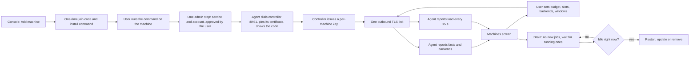
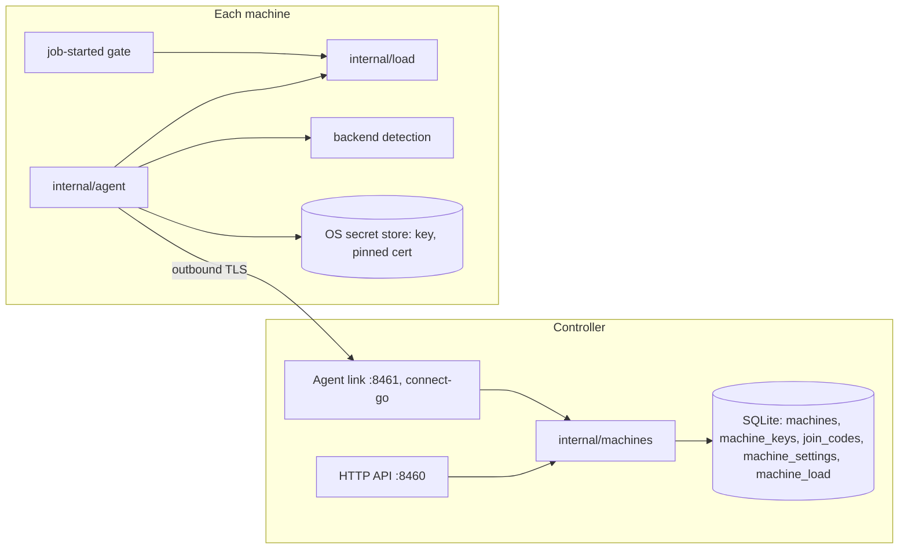

# Machines

PARTLY BUILT (CRSP20). The M1 agent link, join codes, machine keys, detection, load measurement, settings, drain and the controller's own agent are built; see the change note. Not built: R5.14, R5.27 to R5.29, R5.49, R6.9, R6.10. Every requirement not built is NOT YET IMPLEMENTED. Each one names its milestone: **M1** (one machine, the controller's own) or **M3** (more machines, placement and removal), or a later one where it says so.

Sources: the product brief ([product.md](../../overview/product.md)), decisions [0003](../../architecture/decisions/0003-isolation-backends.md), [0004](../../architecture/decisions/0004-agent-link.md) and [0005](../../architecture/decisions/0005-product-boundary.md). Requirements ported from dev-standards cite their origin there: `docs/features/runner-pool/spec.md` (runner-pool R5.x) and `docs/architecture/DELIVERYSPEC.md` (DL-x).

## 1. In one paragraph

A machine is any computer on the user's local network that runs the `crsp` agent. The user adds machines before anything else. The console shows one install command with a one-time join code. The agent joins, gets its own key, and keeps one outbound TLS link to the controller. It reports what the machine is (OS, CPU, memory, disk, GPU, isolation backends) and how loaded it is. The user sets, per machine, whether it takes jobs, its load budget, its job slots and its allowed backends. Changes that restart runners wait for running jobs to finish. They never cut a job.

## 2. Why

**Problem.** Runners need somewhere to run. A pool of the user's own computers differs in OS, hardware and isolation. Each computer is also someone's working machine. A pool that overloads it, or cuts a job to restart, loses the user's trust.

**Users.** The owner and admins who add and look after machines. Viewers see machines and load.

**Goals.**

- Add a machine with one command and one approval.
- Know what each machine can run, and how loaded it is now.
- Keep each machine within its load budget.
- Never cut a running job.
- Remove a machine cleanly: its runners go, its key stops working.

**Non-goals.**

- Cloud machines (later; decision 0005).
- Placing jobs on machines. That is the scheduling spec; this spec gives it the facts, the settings and the load.
- Building images and running runners. That is the runners spec and decision 0003.
- An inbound port on any machine (decision 0004).

## 3. How it works

1. In milestone 1 the controller starts its own agent on the same machine. It joins without a code.
2. From milestone 1 the user presses **Add machine**. The console shows the install command for each OS with a one-time join code.
3. The user runs it on the new machine. The one step that needs admin rights lists what it does and asks first. It installs the agent as a service under its own account.
4. The agent dials the controller on port 8461. It checks the controller's certificate against the fingerprint in the command and keeps it. It shows the join code.
5. The controller checks the code, uses it up and issues a key for this machine. The agent keeps the key in the OS secret store.
6. The agent sends the machine's facts and backends, then its load every 15 seconds.
7. The user sets the machine's budget, slots, allowed backends, maintenance windows and quiet hours.
8. A change that restarts runners drains the machine first. It says which jobs it waits for. Right before the restart it checks again that nothing runs.
9. If the link drops, the agent reconnects with backoff. The controller marks a silent machine offline.
10. Removing a machine names what goes and asks for a yes. Its key is revoked.

## 4. Screens and states

The Machines screen and the Add machine wizard follow design system v1 ([ux-rules.md](../../design-system/v1/ux-rules.md)). Rules are cited by ID, never copied.

| Screen or state | What it shows | Rules |
|---|---|---|
| Machines, list | One card per machine: name, OS, state word (online, offline, drained, draining), backends, load bars for memory and CPU against the budget, slots used of total, last seen | UX-10, UX-41, UX-51, UX-53, UX-58 |
| Machines, empty | "No machines yet." and the **Add machine** action | UX-6, UX-4 |
| Machine detail | Facts, backends with their reason when not usable, settings, running jobs, the install command again | UX-25, UX-22, UX-61 |
| Add machine | Wizard: pick the OS, copy the command, wait for the machine to join, Done | UX-5, UX-29, UX-30, UX-54 |
| Waiting for join | Names what it waits for and when the code expires | UX-29, UX-6 |
| Draining | Names each job it waits for and the time left before the drain timeout | UX-29, UX-34 |
| Drain past its timeout | Still draining: a Needs you message that says "still draining, N jobs running, waited X", names the jobs, and offers wait longer or cancel. No choice stops a job | UX-26, UX-38 |
| Remove machine | Question card that lists every item that goes | UX-9, UX-62 |
| Offline | Offline state word, last seen, what the agent was doing | UX-58, UX-6 |
| Load unknown | "Load unknown" with the reason; the machine takes no new job | UX-26, UX-28 |

The overview shows machines and load and only links here (UX-52). Busy buttons follow UX-13. Running state comes from one source (UX-19). Times follow UX-18. Every screen works from 360 px (UX-16) and meets UX-17.

## 5. Functional requirements

### 5.1 The controller's own machine

**R5.1** (M1) — The controller runs its own agent on the same machine. At first run it joins that agent without a join code, over the same link and port as any other agent (loopback). The machine then appears in the console like any other.

**R5.2** (M1) — The controller's own machine follows every rule below (load, settings, drain, privilege). It has no special path.

### 5.2 Join

**R5.3** (M1) — **Add machine** shows one install command per OS (Windows, Linux, macOS). The command carries the controller address, port 8461, the controller certificate's SHA-256 fingerprint and a one-time join code.

**R5.4** (M1) — A join code works once. It expires after 15 minutes by default (ceiling 24 hours). The console shows when it expires. A new code makes the old unused one invalid.

**R5.5** (M1) — At join the agent checks the controller certificate against the fingerprint in the command. On a mismatch it stops and says so. It never joins a controller it cannot verify.

**R5.6** (M1) — At join the controller checks the code, marks it used, and issues a key for this machine only. A used, expired or unknown code is refused with the reason ("this code was already used", "this code expired at 14:05").

**R5.7** (M1) — The agent keeps its key and the pinned certificate in the OS secret store: Windows Credential Manager or DPAPI, macOS Keychain, Linux Secret Service or a file with mode 0600 owned by the agent account.

**R5.8** (M1) — Every connection after join proves the machine's key over TLS and checks the pinned certificate. The controller refuses an unknown or revoked key.

**R5.9** (M1) — The agent only dials out. It opens no listening port on the machine (decision 0004).

### 5.3 Facts and backends

**R5.10** (M1) — The agent reports: host name, OS name and version, kernel version, CPU model, core and thread count, architecture, total memory, total and free disk on the agent's data volume, and each GPU (vendor, model, memory).

**R5.11** (M1) — The agent detects each backend and reports, for each: present or not, usable or not, its version, and the reason when it is not usable. Backends: Docker, Podman (rootless or not), containerd with nerdctl, WSL2, Hyper-V, KVM (`/dev/kvm` readable by the agent account), Tart (Apple Virtualization) and Firecracker. A persistent runner is always listed as usable.

**R5.12** (M1) — Detected does not mean allowed. A backend runs jobs only when the user allows it on that machine (R5.22).

**R5.13** (M1) — The agent detects again at start, every 10 minutes, and when the user presses **Check again**. A change in facts or backends is shown on the machine and written to the audit log.

**R5.14** (M5) — On a Mac the agent reports how many macOS VMs run, and the controller never starts more than two at once (decision 0003).

### 5.4 Load measurement

Ported from dev-standards `claude/plugins/delivery/scripts/load.py` and `load_guard.py` (DL-77, DL-79), and the pool sizing in `delivery_runner_pool.py` (DL176, DL177). Each port brings its tests (decision 0005).

**R5.15** (M1) — The agent measures total memory use % and total CPU use % of the machine. Windows: `GlobalMemoryStatusEx` and `GetSystemTimes`. Linux: `/proc/meminfo` and `/proc/stat`. macOS: `vm_stat` with `hw.memsize`, and CPU from `host_processor_info` or `top`. CPU is the delta of raw counters between two samples, never a sleep inside a hook.

**R5.16** (M1) — The agent samples every 5 seconds. The figure that decides is the median of the last 5 samples, so one spike does not decide (DL176). The one-shot job hooks use their own cached mean of up to 3 samples in 30 s (scheduling R5.42, D7); both rules are built and apply to different readers.

**R5.17** (M1) — On Windows with WSL2, the WSL VM's memory is the larger of the `vmmem` or `vmmemWSL` working set and its private bytes, and at least the memory its containers use (DL177). Windows trims the working set, so it alone reads too low.

**R5.18** (M1) — On Windows, Docker figures are read through the Windows `docker` CLI first, then through WSL, then reported as unknown. On Linux and macOS the agent never calls `wsl`.

**R5.19** (M1) — An agent that runs inside a container also reads the cgroup v2 figures (`memory.current`, `memory.max`, `cpu.stat`) and decides on the worse of host and container.

**R5.20** (M1) — When CPU cannot be measured, the agent decides on memory only and says so. When memory cannot be measured, the load is "unknown" and the machine takes no new job until it can be measured. The console shows the reason.

**R5.21** (M1) — The agent only measures. It never kills, suspends or lowers the priority of any process to meet the budget (DL-77). It only holds new jobs.

### 5.5 Machine settings

**R5.22** (M1) — Each machine has these settings. Defaults are in brackets.

| Setting | Default | Range |
|---|---|---|
| State | active | active, drained |
| Load budget, memory | 85% | 10 to 95% |
| Load budget, CPU | 60% | 10 to 95% |
| Job slots | 2 | 0 to 64 |
| Allowed backends | persistent runner only | any usable backend (R5.11) |
| Cache size cap | 20 GiB | 1 GiB to the free disk |
| Drain timeout (one per machine) | 60 minutes | 5 minutes to 24 hours |
| Maintenance windows | none | weekly windows, local time |
| Quiet hours | none | weekly windows, local time, with their own budget and slots |

**R5.22a** (M1) (built, CRSP37) — The pool has its own defaults for a machine that joins: memory budget (10 to 95%, default 85%), CPU budget (10 to 95%, default 60%), whether slots are sized from the machine's cores and memory within the budget (default yes), job slots when they are not sized or the machine does not report its size (0 to 64, default 2) and the drain timeout (5 to 1440 minutes, default 60). An admin changes them in Settings, Budgets (`getPoolSettings`, `updatePoolSettings`); each change writes one audit row. A change reaches only machines that join afterwards. A machine that already joined keeps its own settings, so the change restarts no runner and waits for no running job (UX-62). A machine that already joined is changed in its own settings (R5.22).

**R5.23** (M1) — A machine starts a new job only when all hold: its state is active, a slot is free, measured load is under the budget in force, the job's backend is allowed, and no maintenance window is open. The job-started gate on the machine checks this right before the job runs (runner-pool R5.2, DL-79). Placement across machines is the scheduling spec.

**R5.24** (M1) — A setting saved in the console or CLI reaches the agent within 5 seconds while it is online. The agent keeps the last settings it got and applies them while the link is down.

**R5.25** (M1) — A settings change that does not restart runners (budget, slots, windows) takes effect for the next job. Running jobs keep going even when the new budget is already exceeded.

**R5.26** (M1) — A settings change that restarts runners (allowed backends, cache cap when it forces an image or cache rebuild) goes through drain (R5.30).

**R5.27** (M3) — During a maintenance window the machine starts no new job. Agent updates and image rebuilds for that machine are scheduled into its next window when one is set.

**R5.28** (M3) — During quiet hours the machine uses its quiet budget and quiet slot count instead of the normal ones. This leaves room for the owner's own work by day. Running jobs are never cut when quiet hours start.

**R5.29** (M1) — The agent keeps its caches under the cache size cap and evicts the least recently used entries first. Milestone 1 enforces the per-runner quotas of the persistent runners (caches R5.36 and R5.37, config keys `cache_tool_gib` and `cache_rust_gib`) between jobs. The machine setting `cache_cap_bytes` is stored from M1 and returned by the machine API; it does not yet change the quotas (they are the same for every runner). The pool caches of milestone 7 use the setting when they land.

### 5.6 Drain, never kill

Ported from runner-pool R5.10 (no rebuild under a running job) and learning 1 of the brief.

**R5.30** (M1) — **Drain** stops new jobs on the machine. Running jobs finish. The console and CLI name each job it waits for: repository, workflow, job, runner and start time.

**R5.31** (M1) — Every change that restarts runners or the agent drains first: agent update, runner image rebuild, a new cap, a backend change, a service restart and machine removal. Each says, while it waits, which change waits and for which jobs.

**R5.32** (M1) — The idle check runs right before the restart, in the same step that keeps new jobs out. If a job started since the drain began, the change waits again. An idle check taken earlier never counts.

**R5.33** (M1) — **One drain timeout per machine.** It is the machine setting `drain_timeout_minutes` (default 60 minutes, 5 minutes to 24 hours). When it passes with jobs still running, crsp never stops a job: it keeps waiting and warns. The change stays waiting and the machine stays draining; nothing is stopped and nothing is offered that stops a job (no "stop those jobs now", no `stop_jobs` decision). The controller records the timeout once in the audit log and raises one warning (an alert event) that names the machine, the change and the jobs. The console and the CLI show "still draining, N jobs running, waited X" and the jobs. The user may wait longer (5 minutes to 24 hours from now) or cancel the change; both leave the jobs running. An automatic update does not wait past its limit: it postpones and tries again at the next check (operations spec, CRSP19).

**R5.34** (M1) — **Resume** returns a drained machine to active. A change that is still waiting is cancelled first, after a yes.

### 5.7 Offline and reconnect

**R5.35** (M1) — The agent sends a heartbeat every 10 seconds. The controller marks a machine offline after 30 seconds without one. An offline machine gets no new job.

**R5.36** (M1) — The agent reconnects with exponential backoff: 1 second, doubled each time, capped at 60 seconds, with up to 20% random jitter. A successful session resets the backoff.

**R5.37** (M1) — A lost link does not stop runners. Jobs already running keep running. The machine's own gate keeps enforcing slots and budget from its last settings.

**R5.38** (M1) — On reconnect the agent sends its facts, current load and the jobs it runs. The controller reconciles them with what it thought was running. Slots held by jobs that ended while offline are freed (scheduling spec; learning 2 of the brief).

**R5.39** (M1) — When the controller refuses the key (machine removed), the agent stops retrying, logs "this machine was removed from the pool", and waits for a new join.

### 5.8 Remove a machine

**R5.40** (M3) — **Remove machine** drains it first (R5.30). Then a question card names every item that goes: the machine, each runner on it (deregistered from GitHub with a remove token), its images and caches, its settings and its key. The user answers yes before anything goes.

**R5.41** (M3) — On yes, the controller revokes the machine's key at once and closes its link. If the agent is online it removes its runners, images and caches and reports each result. Items it could not remove are listed with the reason.

**R5.42** (M3) — If the machine is offline, removal still revokes the key and deregisters its runners from GitHub. The console says the agent will learn this on its next connect (R5.39) and that its local files stay until it is uninstalled.

**R5.43** (M1) — A removed machine joins again only with a new join code. It gets a new key.

### 5.9 Least privilege and the service

**R5.44** (M1) — The agent runs as its own non-admin account: a virtual service account on Windows (`NT SERVICE\crsp-agent`), a system user `crsp-agent` on Linux, a hidden daemon user `_crsp_agent` on macOS.

**R5.45** (M1) — Admin rights are needed in one install step only. Before it runs, it lists each admin action (create the account, install the service, grant each right, add the account to the groups a backend needs) and asks for a yes. It never runs without that yes.

**R5.46** (M1) — The agent is installed as a service that starts at boot and restarts after a crash: a Windows service, a systemd unit, a launchd LaunchDaemon (decision 0005).

**R5.47** (M1) — On Windows the service and any scheduled task are registered with the PowerShell cmdlets, never with a cmd-quoted command line (learning 5 of the brief).

**R5.48** (M1) — At run time the agent never asks for admin rights. A step that needs them (a new backend's group, a new right) goes back through the approved install step.

**R5.49** (M3) — Uninstall reverses the install step. It names what goes and asks for a yes.

### 5.10 Console and CLI

**R5.50** (M1) — The Machines screen lists every machine with its state, OS, backends, load against budget, slots used and last seen. Load updates live (server-sent events).

**R5.51** (M1) — The CLI has the same powers: `crsp machines list`, `show`, `set`, `drain`, `resume`, `join-code` (M1), and from M3 `remove`. A destructive command lists what goes and asks for a yes; `--yes` answers it in a script.

**R5.52** (M1) — Settings, drain, resume and removal need the admin or owner role. Viewers see machines and load only.

### 5.11 Parity with the old pool (after v0.1.0)

Each requirement below targets a milestone after v0.1.0 and is **NOT YET IMPLEMENTED**. Until this is built, jobs that need it run on GitHub-hosted runners. Source: the handover page ([section 3 items 8 and 13](../../architecture/dev-standards-handover.md)).

**R5.53** (after v0.1.0, NOT YET IMPLEMENTED) — **KVM on WSL2.** On Windows with WSL2, after `wsl --shutdown` or a reboot `/dev/kvm` is gone until the module `kvm_intel` or `kvm_amd` is loaded in the WSL VM. The agent checks `nestedVirtualization=true` in the user's `.wslconfig` and reports it as the backend reason when it is off ("nested virtualization is off in .wslconfig"); it never edits that file without a yes. When it is on and `/dev/kvm` is missing, the agent loads the module through a one-shot privileged helper that exits after the load; runners are never privileged. The `kvm` label (runners R5.36) is added only after `/dev/kvm` is usable. The step runs again at every WSL start.

**R5.54** (after v0.1.0, NOT YET IMPLEMENTED) — **WSL memory sizing.** The agent reads the `memory=` and `processors=` values of `.wslconfig` and the memory the WSL VM holds (R5.17), and shows them in the machine facts. The runner count and per-runner memory cap are set from the declared value, never from a live reading. It exports the CPU limit to jobs and splits it per runner, so `nproc` in a container matches the cap. A declared value above what the machine can give is refused with the reason. A change to `.wslconfig` needs `wsl --shutdown`, so the console says it waits for the machine to drain (R5.30).

**R5.58** (M2, v0.3.0, NOT YET IMPLEMENTED) — **The pool size is the owner's, checked against the budget.** The owner sets the memory (GiB) and CPUs the pool may use on a machine. The setting is accepted when it fits: the memory budget (85% of the total, counting the memory used outside WSL, the WSL VM and the guests R5.54 of runners), the CPU budget (60%), the floors (4 GiB and 2 CPUs) and 1.5 GiB per CPU. Otherwise it is refused, naming the budget that is short and the nearest sizes that pass (for example "10 GiB fits 6 CPUs; 7 CPUs needs 10.5 GiB"). Memory used outside WSL is the median of about 5 samples, one second apart, so a short spike of another program does not shrink the room. A change that lowers the size below the current one needs a second, explicit confirmation, never a side effect of another change. The sizing inputs (machine total, used outside WSL, budget, room, Docker ceiling, the figure that decided) are shown with the result. Port of DS R5.20 to R5.24 and `test_dl176_pool_resize.py`.

### 5.13 A stuck job and a runner set (M1)

**R5.55** (M1) — **A drain names its holder.** (Lesson 20 of the old pool.) A job that does not end blocks every drain behind it. While a change waits, the console and the API show the job that holds it longest (`holder` on the change): its repository, job and runner, how long it has run, and its usual duration. The usual duration is the median of the last finished runs of the same repository and job name in the job history (at least 3 runs; with fewer there is no usual duration and nothing is flagged). The agent reports the start time of each running job (`JobRef.started_unix_ms`). The machine screen shows the holder under "Waiting for a drain". Built (CRSP38).

**R5.56** (M1) — **A job far past its usual time is flagged, and the user has a named choice.** When the holder has run twice as long as its usual duration or more, the change marks it (`over_usual`), the audit log records `machine.drain.stuck` once, and the notifier is told once (`StuckNotifier`). Once the drain timeout has passed (R5.33) or the holder is flagged, the change lists its named choices (`choices`): wait longer or cancel the change. The drain never waits silently, and it offers nothing that stops a job (R5.33). The drain timeout stays 60 minutes per machine by default. Built (CRSP38).

**R5.57** (M1) — **A change for a runner set waits only for that set.** (Lesson 21.) A drain, restart or image swap can name the runners it touches (`runner_names`, `Drain.runner_names`). The controller counts only the jobs on those runners (names compare without case), whatever else the machine runs, including a busy runner of the same repository. The agent keeps new jobs out of those runners only (the gate answers `runner_draining`), the machine stays active, and the change runs when no job runs on its runners. The idle check and the hold are one step, as in R5.32. Without runner names the change is the whole machine, as before. Built (CRSP38).

## 6. Non-functional requirements

**R6.1** (M1) — The agent link uses TLS 1.3 only. A connection without a valid pinned certificate and a valid machine key is refused.

**R6.2** (M1) — No key, join code or certificate private key is written to the database, a log or the console in clear. The controller stores join codes and machine keys only as hashes.

**R6.3** (M1) — A join code has at least 128 bits of entropy. After 10 failed join attempts from one address in one minute, that address is refused for 5 minutes.

**R6.4** (M1) — Every join, settings change, drain, resume, removal and key revocation is written to the audit log: who, what, when.

**R6.5** (M1) — An idle agent uses under 1% of one CPU core and under 50 MB of memory on average over 10 minutes.

**R6.6** (M1) — Taking one load sample takes under 100 ms. The job-started gate never waits for a sample; it reads the newest one.

**R6.7** (M1) — The load shown in the console is at most 20 seconds old, or it is marked stale with its age.

**R6.8** (M1) — The controller keeps current facts and load per machine, and load history at 15-second steps for 24 hours. Older load is dropped.

**R6.9** (M3) — One controller serves up to 50 machines with the targets above.

**R6.10** (M1) — The Machines screen and the Add machine wizard meet design system v1, including UX-16 and UX-17.

## 7. Design

**Packages.**

- `internal/machines`: join codes, keys, the machine record, settings, drain and removal, offline detection. Controller side.
- `internal/agent`: the agent mode. Link, reconnect, facts and backend detection, settings cache, drain execution, service install and uninstall.
- `internal/load`: the load measurement per OS, medians, WSL VM and Docker reads, cgroup v2. Pure functions over parsed input, with the OS calls behind one probe interface so tests feed fixed output (as `load.py` does with its test seams).

**Agent link contract.** `packages/contract/proto/agent/v1/agent.proto` grows:

- `Join(JoinRequest{join_code, facts}) returns (JoinResponse{machine_id, machine_key})`, replacing the placeholder `Register`.
- `SessionRequest` adds `Facts`, `LoadReport{memory_pct, cpu_pct, cpu_known, wsl_vm_bytes, containers_bytes, slots_used, sampled_at}`, `JobsRunning`, `DrainStatus` and `CommandResult`.
- `SessionResponse` adds `Settings`, `Drain`, `Resume`, `Remove` and `Redetect`.

The machine key travels as connection metadata on every call after join.

**Data model (planned tables).**

- `machines`: id, name, os, arch, facts JSON, backends JSON, state, last_seen, created_at.
- `machine_keys`: machine_id, key hash, created_at, revoked_at.
- `join_codes`: code hash, created_by, expires_at, used_at, machine_id.
- `machine_settings`: machine_id, budgets, slots, allowed backends, cache cap, drain timeout, windows JSON, quiet hours JSON.
- `machine_load`: machine_id, sampled_at, memory_pct, cpu_pct (24 hours, R6.8).

**Certificate.** The controller makes its own certificate at first run and keeps its private key in the OS secret store. The install command carries its fingerprint.

## 8. Failure modes

| Dependency | When it fails | Behaviour | Why |
|---|---|---|---|
| Agent link | Link drops | Fail closed for new jobs on that machine after 30 s; running jobs continue | A machine the controller cannot see must not take new work, but a job must never be cut |
| Load measurement | Memory unknown | Fail closed: no new job; reason shown | The budget protects the owner's machine |
| Load measurement | CPU unknown | Decide on memory only and say so | Matches `load.py`; Windows can lack a CPU figure for the first sample |
| Docker CLI on Windows | Not found | Read through WSL, then unknown | DL177 |
| OS secret store | Unavailable at join | Join fails with the reason; no key is written to a plain file except the Linux 0600 fallback | Never store a secret in the clear |
| Certificate pin | Mismatch | Fail closed: the agent refuses to connect | A changed certificate may be another controller |
| Controller database | Unavailable | The controller refuses joins and settings changes; agents keep their last settings | Agents stay safe without the controller |
| Drain | Timeout passes | Keep waiting and warn once; nothing stops (R5.33) | Never cut a job |
| GitHub, at removal | Remove token refused | Removal reports the runner it could not deregister and keeps the item listed | A failure must leave a visible state, not a silent orphan |

## 9. How it is proven

Every test below is planned and NOT YET IMPLEMENTED. Paths are where the tests will live.

| Requirement | Test | Status |
|---|---|---|
| R5.1 | internal/machines/local_agent_test.go | planned |
| R5.2 | internal/machines/local_agent_test.go | planned |
| R5.3 | internal/machines/joincode_test.go | planned |
| R5.4 | internal/machines/joincode_test.go | planned |
| R5.5 | internal/agent/join_test.go | planned |
| R5.6 | internal/machines/join_test.go | planned |
| R5.7 | internal/agent/secretstore_test.go | planned |
| R5.8 | internal/machines/auth_test.go | planned |
| R5.9 | internal/agent/nolisten_test.go | planned |
| R5.10 | internal/agent/facts_test.go | planned |
| R5.11 | internal/agent/backends_test.go | planned |
| R5.12 | internal/machines/settings_test.go | planned |
| R5.13 | internal/agent/backends_test.go | planned |
| R5.14 | internal/agent/tart_limit_test.go | planned (M5) |
| R5.15 | internal/load/sample_test.go | planned; ports `test_load.py` |
| R5.16 | internal/load/median_test.go | planned; ports DL176 cases |
| R5.17 | internal/load/wslvm_test.go | planned; ports `test_dl177_pool_measure.py` VmReadTests |
| R5.18 | internal/load/docker_test.go | planned; ports `test_dl177_pool_measure.py` DockerReadTests |
| R5.19 | internal/load/cgroup_test.go | planned |
| R5.20 | internal/load/unknown_test.go | planned |
| R5.21 | internal/load/measure_only_test.go | planned |
| R5.22 | internal/machines/settings_test.go | planned |
| R5.22a | internal/machines/pool_defaults_test.go; internal/settings/pool_test.go; internal/api/handlers_pool_test.go | built, CRSP37 |
| R5.23 | internal/agent/gate_test.go | planned; ports runner-pool R5.2 cases |
| R5.24 | internal/agent/settings_cache_test.go | planned |
| R5.25 | internal/machines/settings_test.go | planned |
| R5.26 | internal/machines/drain_test.go | planned |
| R5.27 | internal/machines/windows_test.go | planned |
| R5.28 | internal/machines/quiet_hours_test.go | planned |
| R5.29 | internal/runnercache/runnercache_test.go TestEvictionOrderOldestFirstUntilItFits, TestNeverEvictsWhileARunnerIsBusy; internal/hooks/hooks_test.go TestJobDoneEvictsOldestOverQuota | built for the runner quotas; planned (M7) for the machine setting |
| R5.30 | internal/machines/drain_test.go | planned |
| R5.31 | internal/machines/drain_test.go | planned |
| R5.32 | internal/agent/drain_idle_test.go | planned |
| R5.33 | internal/machines/drain_timeout_test.go TestDrainTimeoutWarnsAndKeepsWaiting, TestDrainTimeoutIsPerMachine, TestNoDecisionStopsJobs | built |
| R5.34 | internal/machines/drain_test.go | planned |
| R5.35 | internal/machines/offline_test.go | planned |
| R5.36 | internal/agent/backoff_test.go | planned |
| R5.37 | internal/agent/link_loss_test.go | planned |
| R5.38 | internal/machines/reconcile_test.go | planned |
| R5.39 | internal/agent/revoked_test.go | planned |
| R5.40 | internal/machines/remove_test.go | planned |
| R5.41 | internal/machines/remove_test.go | planned |
| R5.42 | internal/machines/remove_offline_test.go | planned |
| R5.43 | internal/machines/join_test.go | planned |
| R5.44 | internal/agent/service_account_test.go | planned |
| R5.45 | internal/agent/install_plan_test.go | planned |
| R5.46 | internal/agent/service_install_test.go | planned; plus a CI start of the built agent per OS |
| R5.47 | internal/agent/service_windows_test.go | planned |
| R5.48 | internal/agent/install_plan_test.go | planned |
| R5.49 | internal/agent/uninstall_test.go | planned |
| R5.50 | apps/web/src/machines/Machines.test.tsx | planned |
| R5.51 | cmd/crsp/machines_cmd_test.go | planned |
| R5.52 | internal/api/machines_auth_test.go | planned |
| R5.53 | internal/agent/wsl_kvm_test.go | planned; after v0.1.0 |
| R5.54 | internal/agent/wsl_memory_test.go | planned; after v0.1.0 |
| R5.55 | `internal/machines/holder_test.go` TestDrainNamesTheHolderAndHowLongItRuns; `internal/api/machines_holder_test.go` TestChangeShowsTheDrainHolderAndChoices; `apps/web/src/screens/machines/Machines.test.tsx` Machine detail, a drain that waits | new, from the 14 Nov runs of the old pool |
| R5.56 | `internal/machines/holder_test.go` TestHolderFarPastItsUsualDurationIsFlaggedOnceWithChoices; `internal/api/machines_holder_test.go` TestChangeShowsTheDrainHolderAndChoices | new |
| R5.57 | `internal/machines/holder_test.go` TestScopedDrainCountsOnlyItsOwnRunners; `internal/agent/drain_idle_test.go` TestScopedHoldCountsOnlyItsOwnRunners, TestHoldRunnersWithoutNamesIsTheWholeMachine | new |
| R5.58 | internal/agent/pool_size_test.go | planned; v0.3.0 |
| R6.1 | internal/machines/tls_test.go | planned |
| R6.2 | internal/machines/secrets_test.go | planned |
| R6.3 | internal/machines/joincode_test.go | planned |
| R6.4 | internal/machines/audit_test.go | planned |
| R6.5 | internal/agent/idle_cost_test.go | planned (benchmark) |
| R6.6 | internal/load/sample_bench_test.go | planned (benchmark) |
| R6.7 | internal/machines/stale_test.go | planned |
| R6.8 | internal/machines/load_retention_test.go | planned |
| R6.9 | internal/machines/scale_test.go | planned |
| R6.10 | e2e/tests/machines.spec.ts | planned |

## 10. Decisions

| ID | Question | Chosen | Date |
|---|---|---|---|
| 0004 | How does an agent reach the controller? | Outbound gRPC over TLS, per-machine key, pinned controller certificate | 2026-11-13 |
| 0003 | How do machines differ in isolation? | Backends behind one interface; detected per machine, allowed by the user | 2026-11-13 |
| 0005 | Which comes first, machines or runners? | Machines first; any LAN computer; ported, never imported, from dev-standards | 2026-11-13 |
| M-1 | What happens when a drain times out? | One drain timeout per machine, default 60 minutes. crsp never stops a job: it keeps waiting and warns (R5.33). Owner decision | 2026-11-14 |
| M-2 | Which backends are allowed by default? | Proposed: persistent runner only; the user turns others on. Waiting for the owner | 2026-11-14 |

Open questions for the owner are listed in `docs/work/CRP4-report.md` on this branch.

## 11. Not built yet

Everything not named as built at the top is NOT YET IMPLEMENTED. The seams that will change:

- `packages/contract/proto/agent/v1/agent.proto`: `Register` becomes `Join`; session messages grow (section 7).
- `internal/store/migrations`: new tables for machines, keys, join codes, settings and load.
- `packages/contract/openapi.yaml`: machine endpoints for the console and CLI.
- `cmd/crsp/main.go`: the `agent` mode and the `machines` subcommands.
- `internal/config/config.go`: the agent link port (8461) and the controller address for the agent.
- Pool defaults (R5.22a, CRSP37): built for a machine that joins. Not built: applying a changed pool default to machines that already joined. That would restart runners, so it has to name the jobs it waits for (UX-62) through the drain of R5.30.

## 12. Code map

Source: packages/contract/proto/agent/v1/agent.proto
Source: internal/config/config.go
Source: cmd/crsp/main.go

Planned, not yet in the tree: `internal/agent/`, `internal/machines/`, `internal/load/`, `apps/web/src/machines/`.
