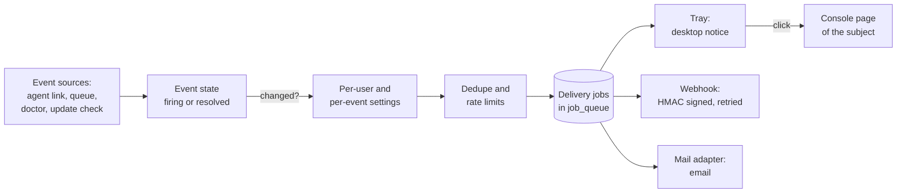
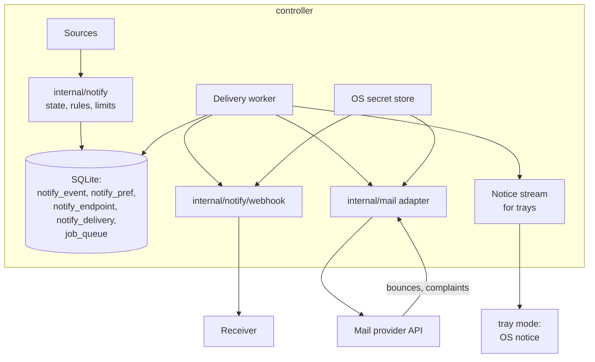

# Notifications

The top half (sections 1 to 4) is for every reader. The bottom half (5 to 12) is for engineers.

**NOT YET IMPLEMENTED.** Nothing in this spec is built. Desktop notices from the tray come with the tray. Webhooks, email, per-user settings in full, and the delivery log come in milestone 8 ([product brief](../../overview/product.md#milestones)).

## 1. In one paragraph

The pool tells people when something needs them: a machine went offline, a job has waited too long, a disk is nearly full, a runner version is old, the doctor found a problem, or an update is ready. It tells them once per change, not over and over. People get the news as a desktop notice from the tray, as a signed webhook to their own tools, or by email. Each user picks which events reach them and how. A **Send test** button proves that a channel works before a real event needs it.

## 2. Why

**Problem.** A self-hosted pool fails quietly. A machine sleeps, a disk fills, or a runner falls out of date, and jobs queue for hours before anyone looks at the console. The old runner pool in dev-standards had no notices at all.

**Users.**

- The owner and admins, who keep the machines running.
- Viewers, who want to know when their jobs are stuck.
- Other tools (chat bots, pagers, home automation) that take a webhook.

**Goals.**

- Tell the right person once, soon after a change, with a link to the place to fix it.
- Never flood: one notice per change, a cap per hour, and one summary for a burst.
- Keep secrets safe: webhook secrets and mail credentials live in the OS secret store.

**Non-goals.**

- No mobile push (the stack has no push transport; stack profile section 2).
- No chat integrations built in (Slack, Teams, Discord). A webhook covers them.
- No notices about GitHub-hosted runners (decision 0005).
- No paging rota, escalation or acknowledgement workflow.

## 3. How it works



1. A source reports a fact: the agent link dropped, a job is still queued, free disk fell, the doctor ran, a new version exists.
2. The controller keeps one state per event key (event type plus subject, such as "machine offline, machine `build-02`"). The state is **firing** or **resolved**.
3. Only a change of state makes a notice. A fact that repeats with no change makes nothing.
4. For each user who can see the subject, the controller reads that user's settings: which events, which channels, and for doctor findings the lowest severity.
5. Dedupe and rate limits drop repeats, and fold a burst into one summary.
6. Each notice that is left becomes a delivery job in the same transaction as the state change.
7. A worker delivers each job: to the user's tray, to each webhook whose filter matches, and to the user's email through the one mail adapter. Failed webhook and email jobs are tried again with backoff.
8. Clicking a desktop notice opens the console on the subject's page, signed in through a one-time link (decision 0005).

## 4. Screens and states

No mocks yet. The screens below cite the design system v1 by ID and add no rules of their own.

**Settings, Notifications (per user).** One row per event (components 15). Each row has a switch per channel, saved at once (UX-22). The doctor row has a choice of the lowest severity to send. The job-waiting row shows the pool's threshold in minutes. Each channel sits in its own card (components 8) with **Send test** at the bottom of the card (UX-37). The result of a test is one line under the button (UX-27). The button is busy until the server answers (UX-13).

**Settings, Webhooks (owner and admin).** A list of endpoints with name, URL, event filter and last delivery status as a word, glyph and colour (UX-58). Adding one is a form (components 14, UX-20). The new secret is shown once, with a copy button and the note "This secret is shown once." Removing an endpoint asks first and names it (UX-9).

**Settings, Mail (owner).** The mail adapter's provider, the sender address and the provider credential field. The credential is never shown again after Save (design system components 14, UX-20).

**Notices list.** The console keeps the last 30 days of notices: time (UX-18), event, subject, state and tone (UX-26). It only shows and links (UX-52).

**States.**

- Empty: "No notices yet. Notices appear here when a machine, job or disk needs you." (UX-6)
- Webhook failing: a Needs you message (components 18) names the endpoint, the last error, and the next try time.
- Send test, failed: a Problem line under the button says what failed and why ("Could not reach hooks.example.lan. The connection timed out after 10 s.").
- Blocked: email switches are disabled until the owner sets up the mail adapter and the user confirms an address; the reason sits beside them (UX-38).

**Desktop notice.** Title is the event in plain words ("Machine offline"). Body names the subject and the time ("build-02 stopped answering at 14:30."). A resolved notice says so in the past tense ("build-02 is back online."). The tone is a word in the text, never colour alone (design system UX-26).

## 5. Functional requirements

### Events

**R5.1** — The controller MUST raise these events, each with a stable type name and a subject:

| Type | Fires when | Resolves when | Default tone |
|---|---|---|---|
| `machine.offline` | A machine's agent link has been down longer than the grace time (default 2 min, range 1 to 60 min). | The link is back. | Problem |
| `job.waiting` | A queued job has waited longer than N minutes (default 15, range 1 to 1440). | The job starts, or is cancelled. | Needs you |
| `disk.low` | Free space on a machine's work disk is below the threshold (default 10%, range 1% to 50%). | Free space is 2 points above the threshold. | Needs you |
| `runner.outdated` | A runner's version is older than the pinned version, or GitHub has said it will stop accepting it. | The runner is updated or removed. | Needs you; Problem when GitHub has set a date |
| `doctor.finding` | The doctor reports a new finding. | The finding is gone on a later run. | By the finding's severity |
| `update.available` | A newer stable release of `crsp` exists. | The pool runs that version. | Note |

**R5.2** — Each event MUST have a key of type plus subject. The controller MUST keep one state per key: firing or resolved, with the time of the last change.

**R5.3** — A notice MUST be made only when a key's state changes (firing to resolved, or resolved to firing). A repeat of the same state MUST make no notice. This is "told once per change".

**R5.4** — A doctor finding MUST carry its severity (`error`, `warning`, `info`). A user MUST be able to pick the lowest severity they get, per channel (default: `warning`).

**R5.5** — A `machine.offline` grace time MUST be applied before firing, so that an agent restart or update with drain makes no notice.

### Who gets what

**R5.6** — A user MUST get notices only about machines and repositories they can see in the console.

**R5.7** — Each user MUST be able to turn each event on or off for each personal channel (tray, email). Defaults: owner and admins get every event on the tray; viewers get `job.waiting` on the tray; email is off for all.

**R5.8** — The owner and admins MUST be able to set the pool-wide thresholds: the offline grace time, N minutes for `job.waiting`, and the disk percent. Viewers MUST NOT change them.

**R5.9** — Webhooks MUST be pool-wide. Only the owner and admins MUST be able to add, edit, remove or test them. Each webhook MUST carry its own event filter (types and lowest doctor severity).

**R5.10** — Every setting in the console MUST also be readable and settable from the CLI (`crsp notify ...`), with the same rights.

### Dedupe and rate limits

**R5.11** — A key that fires again within the flap window (default 10 min) after it resolved MUST NOT make a new firing notice. Instead the existing notice stays open, and the notices list counts the flaps.

**R5.12** — Each user MUST get at most a set number of notices per channel per hour (default 20, ceiling 200). Notices over the cap MUST be held and replaced by one summary at the end of the hour ("12 more notices. Open the console to see them.").

**R5.13** — When five or more notices of one type are made within 60 s, they MUST be sent as one grouped notice ("6 machines are offline") per user and channel.

**R5.14** — Each webhook endpoint MUST get at most 60 deliveries per minute. Deliveries over that wait in the queue; none are dropped.

### Tray and desktop notices

**R5.15** — The tray MUST show each notice for its signed-in user as one OS notice: a Windows toast, a macOS user notification, or a freedesktop notification on Linux.

**R5.16** — Clicking a desktop notice MUST open the console on the subject's page, signed in through a one-time link (decision 0005).

**R5.17** — The tray MUST remember the last notice it showed, so that a tray restart MUST NOT show a notice twice. Notices made while the tray was closed MUST be shown as one summary when it starts ("3 notices while you were away."), never one by one.

**R5.18** — When the tray loses the controller for longer than 2 min, it MUST show one local notice ("Lost the controller.") and one more when it is back. It needs no controller to do this.

### Webhooks

**R5.19** — A webhook MUST be an HTTPS URL. The controller MUST NOT follow redirects.

**R5.20** — Each delivery MUST be a JSON POST with: schema version, event id, delivery id, type, subject, state, tone, time, a plain-English summary, and a console link. It MUST NOT carry any token, key or secret.

**R5.21** — Each delivery MUST be signed with HMAC-SHA256 over `<timestamp>.<body>`. The headers MUST be `X-CRP-Timestamp` (Unix seconds), `X-CRP-Signature` (`sha256=<hex>`) and `X-CRP-Delivery` (the delivery id, the same on every retry). The guide for receivers MUST say to reject a timestamp older than 5 min.

**R5.22** — The controller MUST make each webhook secret (32 random bytes), show it once, and store it only in the OS secret store. Rotate MUST make a new secret and show it once; the old one stops at once.

**R5.23** — A delivery that fails with a network error, a timeout (10 s), HTTP 408, 429 or 5xx MUST be tried again with exponential backoff and jitter: after about 30 s, 2 min, 10 min, 30 min, 1 h and 2 h. A `Retry-After` up to 1 h MUST be honoured. Any other 4xx MUST NOT be tried again.

**R5.24** — After the last try fails, the delivery MUST be marked failed, and the endpoint MUST show as failing in the console with the last error. Three failed deliveries in a row MUST raise a `doctor.finding` of severity `warning` for that endpoint.

### Email

**R5.25** — Email MUST go through one mail adapter (`internal/mail`), set up by the owner. Nothing outside the adapter MUST talk to a mail provider.

**R5.26** — The adapter MUST take bounce and complaint feedback from the provider, check its signature, and keep a suppression list. It MUST consult the list before every send (STACKSPEC 8.1).

**R5.27** — A user MUST confirm an email address with a one-time code before any notice is sent to it. A suppressed address MUST show as such in the user's settings.

**R5.28** — Email sends MUST be enqueued as jobs and retried with the backoff of R5.23. A send MUST never run inside a request.

### Send test

**R5.29** — Each channel (the user's tray, the user's email, each webhook) MUST have **Send test**. A test MUST travel the real path (signing, adapter, OS notice), MUST be marked as a test in its body and headers, and MUST NOT count toward the rate limits of R5.12.

**R5.30** — Send test MUST answer with the result of the first try: delivered, or what failed and why (status code, timeout, refused, suppressed). It MUST NOT be retried.

**R5.31** — Send test MUST be limited to one per channel per 10 s per user.

### History

**R5.32** — The console MUST list every notice of the last 30 days, with its deliveries and their results, for the subjects the user can see.

## 6. Non-functional requirements

**R6.1** — A firing notice MUST reach the delivery queue within 5 s of the state change, and a desktop notice MUST appear within 10 s when the tray is connected.

**R6.2** — No webhook secret, mail credential or tray credential MUST appear in the database, a log line, a crash file, the audit log, an API answer after creation, or a notice body.

**R6.3** — Sending MUST fail closed: if the secret store cannot give the webhook secret, the delivery MUST NOT be sent unsigned; it stays queued and raises a `doctor.finding`.

**R6.4** — A delivery job MUST be written in the same transaction as the state change that made it, so a controller crash loses no notice (stack profile section 11).

**R6.5** — Notices and delivery records MUST be deleted after 30 days. The suppression list MUST be kept until the owner removes an entry.

**R6.6** — Every change to webhooks, the mail adapter and pool-wide thresholds MUST be written to the audit log: who, what, when (product brief, Security).

**R6.7** — Desktop notice text and console text MUST use the words and formats of design system v1 content: dates and times per UX-18, tones per UX-26, no retired words.

**R6.8** — A desktop notice MUST be readable without its colour or icon: the tone and the subject are in its words (UX-26, UX-58).

**R6.9** — The notifier MUST hold at most 10 000 queued deliveries. Over that, the oldest Note-tone deliveries MUST be dropped first, and a `doctor.finding` MUST say how many.

## 7. Design

Planned, NOT YET IMPLEMENTED.



**Data.**

- `notify_event`: key, type, subject kind and id, state, tone or severity, first fired, last change, flap count, payload.
- `notify_pref`: user, event type, channel, on or off, lowest severity.
- `notify_settings`: pool-wide thresholds (R5.8) and rate caps.
- `notify_endpoint`: webhook name, URL, filter, secret reference (the secret store entry name, never the value), created by.
- `notify_delivery`: event, channel, target, attempt, status, next try, last error, test flag.
- `mail_address`: user, address, confirmed at. `mail_suppression`: address, reason, time.

**Interfaces.**

```go
// internal/notify
type Channel interface {
    Name() string
    Deliver(ctx context.Context, n Notice) (Result, error) // one try; the worker retries
}

// internal/mail
type Adapter interface {
    Send(ctx context.Context, m Message) error
    HandleFeedback(r *http.Request) error // checks the signature, updates the suppression list
}
```

**Tray link.** The tray reads a server-sent event stream of notices for its signed-in user from the controller API, and acknowledges each by id. How a tray signs in on a machine that is not the controller belongs to the tray spec.

**API.** New paths in `packages/contract/openapi.yaml`: notice list, notice stream, user settings, pool thresholds, webhook endpoints (add, edit, remove, rotate, test), mail adapter settings, mail address confirm, mail feedback. Each answers in the shared error shape.

## 8. Failure modes

| Dependency | Fails | Behaviour | Why |
|---|---|---|---|
| Controller | Down | No notices at all; each tray shows its own "Lost the controller" (R5.18). | The controller cannot report on itself. |
| OS secret store | Unavailable | Webhook and email jobs wait; nothing is sent (fail closed, R6.3). | An unsigned webhook or a send with a guessed credential is worse than a late one. |
| Webhook receiver | Down or slow | Retry with backoff (R5.23), then failed and shown (R5.24). Other endpoints are not held up. | One bad receiver must not block the rest. |
| Mail provider | Down | Retry with backoff (R5.28), then failed and shown. | Same as webhooks. |
| Mail feedback | Missing or bad signature | The feedback is refused and logged; the suppression list is not changed. | Forged feedback must not silence an address. |
| OS notices | Turned off by the user or the OS (focus mode) | The notice is still kept in the console list (fail open). | The console is the record; the desktop is a convenience. |
| Event source | Silent (agent gone) | `machine.offline` fires after the grace time. | Silence is the event. |

## 9. How it is proven

All tests are planned and NOT YET IMPLEMENTED. Paths are where each test will live.

| Requirement | Test |
|---|---|
| R5.1 | planned: internal/notify/events_test.go, TestEachEventFiresAndResolves |
| R5.2 | planned: internal/notify/state_test.go, TestOneStatePerKey |
| R5.3 | planned: internal/notify/state_test.go, TestNoticeOnlyOnChange |
| R5.4 | planned: internal/notify/rules_test.go, TestDoctorSeverityFloor |
| R5.5 | planned: internal/notify/events_test.go, TestOfflineGraceSkipsRestart |
| R5.6 | planned: internal/notify/rules_test.go, TestOnlyVisibleSubjects |
| R5.7 | planned: internal/notify/rules_test.go, TestPerUserPerEventDefaults |
| R5.8 | planned: internal/api/notify_test.go, TestThresholdsNeedAdmin |
| R5.9 | planned: internal/api/notify_test.go, TestWebhooksNeedAdmin |
| R5.10 | planned: cmd/crsp/notify_test.go, TestCLIMatchesConsole |
| R5.11 | planned: internal/notify/limits_test.go, TestFlapWindow |
| R5.12 | planned: internal/notify/limits_test.go, TestHourlyCapAndSummary |
| R5.13 | planned: internal/notify/limits_test.go, TestBurstIsGrouped |
| R5.14 | planned: internal/notify/webhook/webhook_test.go, TestEndpointRateNeverDrops |
| R5.15 | planned: internal/tray/notice_test.go, TestOSNoticePerPlatform; e2e/tests/tray-notice.spec.ts |
| R5.16 | planned: internal/tray/notice_test.go, TestClickOpensSubjectWithOneTimeLink |
| R5.17 | planned: internal/tray/notice_test.go, TestRestartShowsNoRepeatAndOneSummary |
| R5.18 | planned: internal/tray/notice_test.go, TestLostControllerNotice |
| R5.19 | planned: internal/notify/webhook/webhook_test.go, TestHTTPSOnlyNoRedirects |
| R5.20 | planned: internal/notify/webhook/webhook_test.go, TestPayloadShapeHasNoSecrets |
| R5.21 | planned: internal/notify/webhook/sign_test.go, TestSignatureHeaders |
| R5.22 | planned: internal/notify/webhook/secret_test.go, TestSecretShownOnceStoredInKeyring |
| R5.23 | planned: internal/notify/webhook/webhook_test.go, TestRetryScheduleAndRetryAfter |
| R5.24 | planned: internal/notify/webhook/webhook_test.go, TestFailingEndpointRaisesFinding |
| R5.25 | planned: guards (depguard rule in .golangci.yml): only internal/mail imports a mail client |
| R5.26 | planned: internal/mail/mail_test.go, TestFeedbackSignedAndSuppressionConsulted |
| R5.27 | planned: internal/mail/mail_test.go, TestAddressNeedsConfirmCode |
| R5.28 | planned: internal/mail/mail_test.go, TestSendIsQueuedAndRetried |
| R5.29 | planned: internal/notify/test_send_test.go, TestSendTestUsesRealPath |
| R5.30 | planned: internal/notify/test_send_test.go, TestSendTestReportsFirstTry; apps/web/src/features/notifications/SendTest.test.tsx |
| R5.31 | planned: internal/notify/test_send_test.go, TestSendTestLimit |
| R5.32 | planned: e2e/tests/notifications.spec.ts, notices list shows 30 days with deliveries |
| R6.1 | planned: internal/notify/latency_test.go, TestQueueWithin5s |
| R6.2 | planned: internal/notify/secrets_test.go, TestNoSecretInDBLogsOrAnswers |
| R6.3 | planned: internal/notify/webhook/webhook_test.go, TestNoSecretNoSend |
| R6.4 | planned: internal/notify/state_test.go, TestDeliveryInSameTransaction |
| R6.5 | planned: internal/notify/retention_test.go, TestThirtyDayPrune |
| R6.6 | planned: internal/api/notify_test.go, TestChangesAreAudited |
| R6.7 | planned: guards (design-system retired-words guard over notice text) |
| R6.8 | planned: internal/notify/text_test.go, TestToneInWords |
| R6.9 | planned: internal/notify/limits_test.go, TestQueueCeiling |

## 10. Decisions

| ID | Question | Chosen | Date |
|---|---|---|---|
| N1 | When to notify | Once per change of state, not per check | 2026-11-14 |
| N2 | Webhook signing | HMAC-SHA256 over timestamp and body, secret in the OS secret store | 2026-11-14 |
| N3 | Mail | One adapter in `internal/mail`, provider API with bounce feedback (STACKSPEC 8.1); raw SMTP only with a recorded deviation | 2026-11-14 |
| N4 | Order | Tray notices ship with the tray; the rest in milestone 8 | 2026-11-14 |

**Open for the owner.**

1. Raw SMTP. Many self-hosters have only an SMTP relay. STACKSPEC 8.1 needs bounce feedback, which bare SMTP cannot give. Allow SMTP as a recorded deviation in the stack profile section 15, or provider APIs only?
2. Webhooks to plain `http://` on the local network. R5.19 asks for HTTPS. Allow `http://` to private addresses with a warning?
3. Per-repository threshold for `job.waiting`, or one pool-wide value (R5.8)?
4. The word for the test button. Design system v1 `content.md` has no word for "Send". Add "Send test" to `next-version`?
5. UX-52 says Settings hold configuration only. Is **Send test** on a channel card allowed there, or does it move to another page?
6. Tray on a machine that is not the controller: which user does it sign in as, and how (tray spec)?
7. Which mail providers the adapter supports first.

## 11. Not built yet

Everything. NOT YET IMPLEMENTED:

- Event state and rules: `internal/notify` (the seam: the `Channel` interface).
- Desktop notices: the `tray` mode (with the tray).
- Webhooks: `internal/notify/webhook` (milestone 8).
- Email: `internal/mail` (milestone 8). Until then the stack profile records mail as a capability gap (section 14).
- Doctor findings and update checks depend on the doctor and update features, which have no spec yet.

## 12. Code map

No code exists yet, so there are no `Source:` lines. Planned paths: `internal/notify/`, `internal/notify/webhook/`, `internal/mail/`, the tray mode, and `apps/web/src/features/notifications/`.
