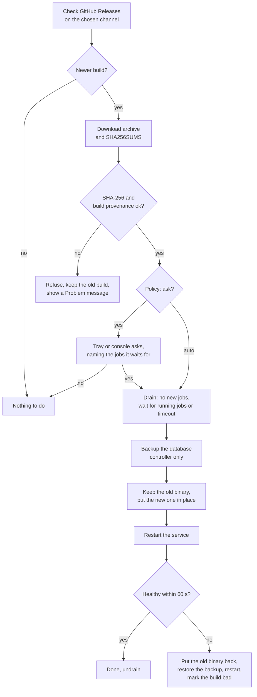
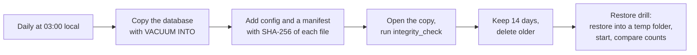
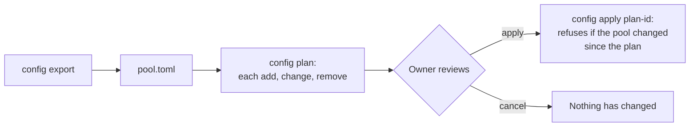
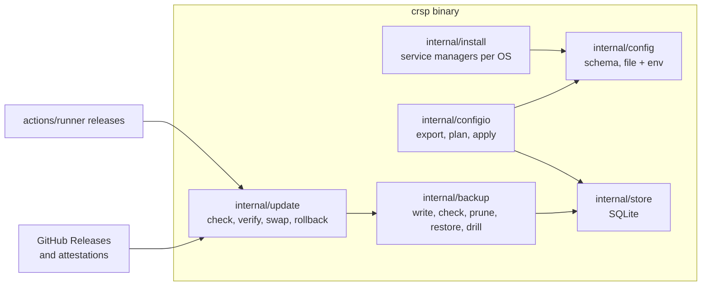

# Operations: install, config, updates, backup, config as code, uninstall

The top half (sections 1 to 4) is for every reader. The bottom half (5 to 12) is for engineers.

**Partly built (CRSP18, OPS1).** Built: the installers for Windows (MSI, R5.35 to R5.41), macOS (pkg) and Linux (deb and rpm) (R5.7), the config file and schema (R5.8, R5.9), the per-OS folders (R5.10), the daily backup, restore and drill (R5.21 to R5.25, R5.27, the secret list of R5.26 as `backup.MissingSecrets`). Everything else below is **NOT YET IMPLEMENTED**: planned, with its milestone.

## 1. In one paragraph

This feature keeps a pool running with little work from its owner. One command per OS installs the binary as a service. One config file, checked against one schema, sets it up. The controller, the agents and the tray update themselves from GitHub Releases after a check of the checksum and the build provenance, and they wait for running jobs first. The GitHub runner version is pinned and moved forward before GitHub stops accepting it. The database and config are backed up every day and kept for 14 days, with a restore command and a restore drill. The whole setup can be exported to a file and imported again, with a plan that shows each change first. Uninstall names what it removes and keeps the data unless asked.

## 2. Why

**Problem.** The pool runs on the owner's own machines, with no hosted service to keep it alive. Without this feature the owner copies files by hand, updates each machine by hand, and loses the setup when a disk dies.

**Users.**

- The owner, who installs the controller and runs the pool.
- Admins, who add machines and approve updates.
- Anyone who restores a controller on a new machine after a failure.

**Goals.**

- Install in one command per OS, with a service the OS restarts.
- Stay current without cutting a running job (product learning 1).
- Lose at most 24 hours of data (RPO) and be back within 1 hour (RTO), as the stack profile section 9 says.
- Keep the setup in a file that can be reviewed, diffed and applied.

**Non-goals.**

- Signed installers (MSI, pkg, deb, rpm) and code signing. Those come in milestone 8; this spec only names the seam.
- Backing up secrets. The GitHub App private key, the webhook secret, the TLS key and agent keys stay in the OS secret store (decision 0002).
- Point-in-time recovery. SQLite has none (stack profile section 14).
- Updating GitHub-hosted runners or anything the product does not manage (decision 0005).
- Backups of runner images, caches or job logs. They are rebuilt.

## 3. How it works

### Self-update

1. Every 6 hours the controller asks GitHub Releases for the newest build on its channel: `edge` (built from every merge to `main`) or stable (`v*` tags).
2. A newer build is downloaded. Its SHA-256 must match `SHA256SUMS`, and its build provenance attestation must name this repository's release workflow. Any mismatch stops the update.
3. With the policy `ask` (the default), the tray or the console asks first. The question names the jobs the update waits for.
4. The machine drains: it takes no new jobs and waits for running jobs to end. Past the drain timeout it keeps waiting and warns; only an automatic update postpones instead (R5.33 on CRSP19). The idle check runs right before the restart (learning 1).
5. On the controller, the database is backed up before the new build can migrate it.
6. The old binary is kept. The new one takes its place. The service restarts.
7. If the new build is not healthy within 60 seconds, the old binary and the backup come back, the service restarts, and that build is marked bad. It is never tried again on its own.
8. The controller updates first. Agents follow one machine at a time, to the controller's version.

### Backup and restore

1. Once a day the controller writes one backup archive: the database, the config file and a manifest. Secrets are never in it.
2. The copy is opened and checked before the old ones are pruned. Backups older than 14 days are deleted. The newest good backup is never deleted.
3. `crsp restore <file>` checks the manifest, backs up the current state, puts the backup in place, and starts the controller.
4. `crsp backup drill` restores the newest backup into a temporary folder, starts a controller there on a spare port, checks it, and records the result.

### Config as code

## 4. Screens and states

No mocks yet. They are made with the screens in milestone 8. The web console parts live under Settings (product screen 9). Rules are cited by design-system ID, never written here.

- **Settings > Updates.** Channel (stable or edge), policy per machine (ask or auto in a maintenance window), drain timeout, current and offered version per part. An offered update shows what it waits for and asks in the page (UX-9, UX-62). A running update shows in the activity strip (UX-34) with a progress bar (components 16, UX-29). A refused update shows a Problem message that says why (UX-26, components 18). A blocked update says why beside the disabled action (UX-38).
- **Settings > Backups.** The list of backups with date, size and check result; Back up now (busy while it runs, UX-13); the last drill and its result. No backup yet is an empty state with the next step (UX-6, components 19).
- **Settings > Config.** Export downloads the file. Import is a wizard (components 4, UX-5) that ends with Review, then the work, then Done (UX-30). Review uses the change review list (components 34). A removal lists what goes and asks for a yes (UX-62).
- **Tray.** "Update to <version>?" with the jobs it waits for, as a dialog (components 9). Restart and update ask first (decision 0005).
- **Terminal.** `install`, `uninstall`, `restore` and `config apply` print what they will do and ask `yes/no` unless `--yes` is given.

States for every screen: empty (no backups, no update), busy (draining, downloading, restoring), error (verify failed, start failed and rolled back, backup check failed).

## 5. Functional requirements

Each requirement names its milestone (M1 to M8, product brief). Those not named as built in the status line at the top are **NOT YET IMPLEMENTED**.

### Install and first run

**R5.1** (M1) — One command per OS installs the binary. Linux and macOS: `curl -fsSL <release>/install.sh | sh`. Windows: `irm <release>/install.ps1 | iex`. The script downloads the archive for the OS and architecture, checks its SHA-256 against `SHA256SUMS`, and runs `crsp install`. The script does nothing else.

**R5.2** (M1) — `crsp install --mode controller|agent` registers the service with the OS service manager: a Windows service (through `golang.org/x/sys/windows/svc/mgr`, never a cmd-quoted command line, learning 5), a systemd unit on Linux, a LaunchDaemon on macOS. The service starts at boot and restarts after a crash.

**R5.3** (M1) — On a desktop machine, install also adds the tray to start at login: a per-user startup entry on Windows, a LaunchAgent on macOS, an XDG autostart entry on Linux (decision 0005). A headless Linux machine gets no tray.

**R5.4** (M1) — On Linux and macOS install runs the service as a dedicated non-admin account where the OS allows it. On Windows the controller service runs as LocalSystem: it manages the runner services and their accounts and runs the MSI upgrade for auto-update (R5.39), which a non-admin account cannot do. Steps that need admin rights are one step, listed before the user says yes.

**R5.5** (M3) — Agent install takes the one-time join code from the console's install command (`--join <code>`) and stores the machine key in the OS secret store (decision 0004).

**R5.6** (M1) — On first start the controller makes its TLS certificate, opens ports 8460 and 8461 (or the configured ports), and prints a one-time link to the first-run wizard. The tray opens that link. The wizard itself is in the GitHub spec.

**R5.7** (M1 for Windows, M8 for the rest) — Installers per OS (MSI, pkg, deb and rpm) install the same files and services as R5.2 to R5.4. The Windows MSI is built (R5.35 to R5.41; task CRSP18). The macOS `.pkg` and the Linux `.deb` and `.rpm` are built (OPS1). Signed installers come in M8.
#### macOS and Linux installers (OPS1)

Release assets: `crsp-darwin-<arch>.pkg`, `crsp-linux-<arch>.deb` and `crsp-linux-<arch>.rpm`, with `<arch>` as in the `.tar.gz` names. They are listed in `SHA256SUMS` and carry a build provenance attestation. They are not signed or notarized yet (milestone 8). Edge builds get the version `<next patch after the latest stable tag>~edge.<run>` (deb, rpm) or `<next patch>.<run>` (pkg), so a later edge build sorts above an earlier one and the stable release above both.

| | Linux (`.deb`, `.rpm`) | macOS (`.pkg`) |
|---|---|---|
| Binary | `/usr/bin/crsp` | `/usr/local/bin/crsp` |
| Service | systemd unit `crsp` (`/usr/lib/systemd/system/crsp.service`), `ExecStart=/usr/bin/crsp controller`, enabled and started | LaunchDaemon label `crsp` (`/Library/LaunchDaemons/crsp.plist`), runs `/usr/local/bin/crsp controller` |
| Tray start | `/etc/xdg/autostart/crsp-tray.desktop` | `/Library/LaunchAgents/dev.luismc.crsp.tray.plist` |
| Install marker | `/usr/share/crsp/install-kind` holds `deb` or `rpm` | `/usr/local/share/crsp/install-kind` holds `pkg` |
| Data | `/var/lib/crsp` (0700), `/etc/crsp` (0750), owned by root | `/Library/Application Support/crsp` (0700), owned by root |
| Remove | `apt remove` and `rpm -e` keep the data; `apt purge` deletes `/var/lib/crsp` and `/etc/crsp` (rpm has no purge) | `sudo crsp-uninstall` keeps the data; `--delete-data` also deletes it and the log |

- The controller service runs as root on Linux and macOS (owner decision, 2026-11-14): it manages runner services and accounts and applies package upgrades for auto-update. This is the exception to the non-admin account of R5.4 for these two installers; there is no `crsp` or `_crsp` account.
- Installing over an older version (upgrade) keeps the data, stops the service before the files are replaced and starts it again afterwards.
- The marker tells the updater (R5.11 to R5.18) which package manager owns the files.
- If systemd is not running (a plain container), the files are installed and the service starts at the next boot.

### Config file and data folder

**R5.8** (M1) — The controller and the agent read one config file, `config.toml`, checked against one schema. A `CRSP_*` environment variable overrides the matching key. `crsp config check` prints every problem at once and exits non-zero.

**R5.9** (M1) — The config check refuses: unknown keys, wrong types, values out of range, placeholder values (`<...>`, `${...}`, `changeme`, `todo`, `example` and the like), and any key that holds a secret (a private key, token or password). The service does not start with a refused config.

**R5.10** (M1) — Each OS has one data folder and one config path:

| OS | Data folder | Config file |
|---|---|---|
| Windows | `%ProgramData%\crsp` | `%ProgramData%\crsp\config.toml` |
| Linux | `/var/lib/crsp` | `/etc/crsp/config.toml` |
| macOS | `/Library/Application Support/crsp` | `/Library/Application Support/crsp/config.toml` |

The data folder holds the database, `backups/`, `logs/` and `updates/`. It is readable only by the service account and admins (on Windows, Administrators and SYSTEM).

### Self-update

**R5.11** (M3) — The controller checks GitHub Releases every 6 hours for the newest build on its channel. The channel is `stable` (the newest `v*` release that is not a pre-release) or `edge` (the `edge` pre-release). The default is `stable`.

**R5.12** (M3) — A downloaded archive is used only if its SHA-256 matches `SHA256SUMS` and its build provenance attestation is valid and names `.github/workflows/release.yml` of this repository. Any failure refuses the build, keeps the running one, and shows a Problem message that says which check failed.

**R5.13** (M3) — Before the swap, the new binary runs `self-check`: it starts, prints its version and database schema version, and exits. A build whose schema version is older than the database is refused (no downgrade; migrations go forward only).

**R5.14** (M3) — An update on a machine drains first: no new jobs start there, and the update waits until no job runs. The drain timeout is one per machine (default 60 minutes, machines R5.33): when it passes the update keeps waiting and warns, and never stops a job. An automatic update postpones instead (R5.33). The idle check runs right before the restart. The wait says what it waits for.

**R5.15** (M3) — With the policy `ask` (default), nothing installs until a user says yes: in the tray on that machine, or in the console for a headless machine. The question names the version and the running jobs it waits for. With the policy `auto`, the update runs in the machine's maintenance window.

**R5.16** (M3) — The controller backs up the database before the new build starts (R5.21 format).

**R5.17** (M3) — The old binary is kept as the previous build. If the new build is not healthy within 60 seconds after start, the previous binary (and, on the controller, the pre-update backup) come back, the service restarts, and the build is marked bad. A bad build is not offered again until a newer one appears.

**R5.18** (M3) — The controller updates first. Agents then update one machine at a time to the controller's version. The tray updates with the binary on its machine. A controller accepts agents of its own version and of the previous release.

### GitHub runner version

**R5.19** (M1) — The GitHub runner version is pinned: one version and one SHA-256 per OS and architecture, in a manifest the controller keeps. A runner download that does not match is refused. Runners are registered with `--disableupdate`, so they never update in the middle of a job.

**R5.20** (M3) — Once a day the controller reads the newest `actions/runner` release. It moves the pin to it within 7 days of its release (default), and always before GitHub's 30-day limit for runners that do not update themselves. Ephemeral runners use the new version for the next job. Persistent runners are replaced with drain (R5.14). The doctor warns when the pinned version is 21 days or more behind the newest one.

### Backup and restore

**R5.21** (M1) — Every day at 03:00 local time (configurable) the controller writes one archive `crsp-backup-<yyyy-mm-dd-hhmm>.tar.gz` in `backups/`. It holds a copy of the database made with `VACUUM INTO`, the config file, and a manifest with the product version, the schema version and the SHA-256 of each file. It never holds a secret.

**R5.22** (M1) — After writing, the backup is opened and `PRAGMA integrity_check` must return `ok`. A failed backup is deleted, logged, and shown by the doctor.

**R5.23** (M1) — Backups older than 14 days are deleted after a good backup is written. The newest good backup is never deleted, however old.

**R5.24** (M1) — `crsp backup` writes a backup now. `crsp backup list` lists them with date, size and check result.

**R5.25** (M1) — `crsp restore <file>` checks the manifest and each SHA-256, refuses a backup from a newer schema, backs up the current state first, stops the controller, puts the database and config in place, starts it, and waits for it to be healthy. It names what it replaces and asks for a yes. Running jobs on other machines keep running.

**R5.26** (M1) — After a restore, the doctor lists the secrets the controller still needs (for example the GitHub App private key on a new machine) and how to add each one.

**R5.27** (M1) — `crsp backup drill` restores the newest backup into a temporary folder, starts a controller there on a free local port with no GitHub traffic, checks its health and the row counts against the manifest, records the date and result, and deletes the folder. The doctor warns when no drill has passed in 90 days. One drill passes before the first release.

### Config as code

**R5.28** (M8) — `crsp config export` writes one file with the whole setup: repositories and their policies, machines and their settings (budget, slots, backends allowed, drain timeout, maintenance windows, update policy), runner definitions, image layers, notifications, users and roles, and update settings. It holds no secret, no job history, no audit log and no machine key.

**R5.29** (M8) — `crsp config plan <file>` checks the file against the schema and lists each change: added, changed (field, old value, new value) or removed, by name. It changes nothing and ends with "Nothing has changed." It gives the plan an ID tied to the current state.

**R5.30** (M8) — `crsp config apply <plan-id>` applies exactly that plan. It refuses if the pool changed since the plan. Removals need an explicit yes that names each one. Changes that restart runners drain first (R5.14). Each change is written to the audit log.

**R5.31** (M8) — The console offers export and import under Settings; import is a wizard that ends with Review, the work, and Done.

### Windows installer (MSI)

**R5.35** (M1) — Windows installs through `crsp-windows-amd64.msi` or `crsp-windows-arm64.msi`, built with WiX Toolset v5 (pinned to 5.0.2) on `windows-latest` by `release.yml` and published for edge and stable releases. Both are listed in `SHA256SUMS` and covered by the provenance attestation. They are not signed in v0.1.0. The MSI `ProductVersion` is the release version (`1.2.3` becomes `1.2.3.0`); an edge build is the next patch after the latest stable tag with the run number as fourth field.

**R5.36** (M1) — The MSI is per machine and installs to `%ProgramFiles%\crsp`. It installs `crsp.exe`; registers the one service `crsp` (`crsp.exe controller`, automatic start, delayed, restart after a crash, account LocalSystem) and starts it; adds the install folder to the system `PATH`; adds a Start Menu shortcut (`crsp tray`); starts the tray at every user's sign-in (`HKLM\...\Run`, value `crsp-tray`); and adds an inbound firewall rule, TCP 8460 and 8461, on the Private profile only, never Public. It makes `%ProgramData%\crsp` readable by Administrators and SYSTEM only (R5.10; the service is LocalSystem). It writes the file `install-kind` next to `crsp.exe`, containing `msi`; the updater reads it to choose the update method.

**R5.37** (M1) — Uninstall removes the program, the service, the `PATH` entry, the shortcut, the autostart value, the firewall rule and `install-kind`. With the dialogs (`msiexec /x crsp-windows-<arch>.msi`, and Settings > Apps > crsp) it asks "Also delete my data", unticked by default; CI proves the dialog from the built MSI's tables (the dialog, its checkbox bound to `REMOVEDATA`, default 0, and its place in the UI sequence); a hosted runner cannot show msiexec's windows, so the UI Automation drive in `installer/ui-test.ps1` runs only where a desktop exists. Silent uninstall keeps the data folder; `REMOVEDATA=1` deletes it. Data is the config file, the database, the audit log, backups and the CA.

**R5.38** (M1) — The UpgradeCode is fixed: `C1D62442-6DB4-4FF0-9F28-A1CE3121B332`. A newer MSI replaces the installed one in place and keeps the data folder; the same `a.b.c` replaces itself; a lower version is refused (exit 1603, `A newer version of crsp is already installed.` in the log).

**R5.39** (M1) — The command the self-updater runs, from an elevated process, is exactly `msiexec /i crsp-windows-<arch>.msi /qn /norestart /l*v <log>`. It stops the tray and the service (and the `crsp-agent` service when it runs from the install folder, which is started again afterwards), replaces the files, and starts the service again. No run needs a reboot. The updater reads the result from the exit code (0 done, 1603 refused or failed) and from `<log>`. The upgrade ends every process that runs from the install folder, `crsp.exe` itself included, so the updater must start `msiexec` detached (a new process outside the service's process and job) and exit at once; it cannot wait for `msiexec` from inside the folder. The updater is task CRSP19.

**R5.40** (M1) — A failed install or upgrade rolls back: Windows Installer puts the old version back and a rollback action starts the old service again. The `/l*v` log records the rollback.

**R5.41** (M1) — `crsp.exe` run by the service manager reports its state through the Windows service protocol: Stop ends the controller as SIGTERM does, a non-zero end makes the service manager restart it, and the log goes to `%ProgramData%\crsp\logs\crsp.log`. `crsp tray` detaches from its console window.

### Uninstall

**R5.32** (M1) — `crsp uninstall` lists what it removes and what it keeps, then asks for a yes. It removes: the services, the tray start entries, the binary, and the runners on that machine (drained first, then deregistered from GitHub with a remove token). It keeps: the data folder (database, config, backups, logs) and the secrets in the OS secret store.

**R5.33** (M1) — `crsp uninstall --purge-data` also removes the data folder and this product's secrets, and lists them by name before asking.

**R5.34** (M3) — Uninstalling an agent revokes its machine key on the controller. Uninstalling a controller that still has machines names them and asks again.

## 6. Non-functional requirements

**R6.1** (M3) — An update never stops a running job. A controller restart never stops a job on any machine; agents reconnect with backoff.

**R6.2** (M3) — Update checks and downloads send nothing about the pool to GitHub beyond the release requests. No telemetry (stack profile section 8).

**R6.3** (M3) — Verification fails closed. With no network to check provenance, nothing installs.

**R6.4** (M1) — RPO 24 hours: a good backup is never older than 24 hours while the controller runs. The doctor reports a Problem when it is.

**R6.5** (M1) — RTO 1 hour: a drill on a reference database of 1 GB completes restore and health check in under 10 minutes, leaving the rest of the hour for reinstalling.

**R6.6** (M1) — A daily backup of a 1 GB database takes under 2 minutes and never blocks database writes for more than 1 second (WAL mode).

**R6.7** (M1) — Backups take no more than 14 days of archives plus the newest good one. The doctor warns when the backup folder is above 20% of free disk.

**R6.8** (M1) — No secret appears in a backup, an export, a config file, a log line or an update message. A test scans each of them for the known secret values.

**R6.9** (M1) — Install, update, restore and uninstall leave the machine in the old working state if they fail half way. Each step can be run again.

**R6.10** (M8) — Config export, then import into an empty controller, then export again gives the same file (round trip).

## 7. Design

**Packages.**

- `internal/install`: one `ServiceManager` interface (`Install`, `Start`, `Stop`, `Remove`, `Status`) with Windows service, systemd and launchd implementations; tray start entries; data folder and permissions.
- `internal/update`: `Checker` (GitHub Releases per channel, ETag cache), `Verifier` (SHA-256, build provenance through the Sigstore bundle of the attestation), `Swapper` (keep previous, rename into place; on Windows rename the running file aside first), `Health` (controller: `/healthz` and migrations done; agent: link to controller up), runner version manifest.
- `internal/backup`: `Writer` (`VACUUM INTO`, archive, manifest), `Checker`, `Pruner`, `Restorer`, `Drill`.
- `internal/configio`: `Export`, `Plan` (diff of file against store, plan ID = hash of the current state and the file), `Apply` (in one transaction, drain where needed, audit).
- `internal/config` (exists): grows from three env variables to the file schema with env overrides.

**Data (new tables, planned).** `update_state` (part, machine, current, offered, policy, bad builds), `runner_version` (version, OS, arch, SHA-256, pinned at), `backups` (file, time, size, check result), `restore_drills` (time, backup, result), `config_plans` (ID, state hash, created, applied).

**Interfaces (planned).** HTTP API: `GET /api/v1/updates`, `POST /api/v1/updates/{part}/approve`, `GET /api/v1/backups`, `POST /api/v1/backups`, `POST /api/v1/config/plans`, `POST /api/v1/config/plans/{id}/apply`. Agent link: `Drain`, `Update` and `UpdateResult` messages in `agent.proto`. CLI: `install`, `uninstall`, `config check|export|plan|apply`, `backup [list|drill]`, `restore`, `update [check|apply]`, `self-check`.

**Jobs.** Update check every 6 hours; runner version check daily; backup daily; prune after each backup.

## 8. Failure modes

| Dependency | Behaviour | Why |
|---|---|---|
| GitHub Releases down | Fail closed: no update, retry next check | The running build still works |
| Provenance or checksum check fails | Fail closed: refuse, keep the running build, Problem message | A wrong binary would run with the agent's rights |
| New build does not start | Roll back binary and database, mark build bad | Learning 1: the pool must keep working |
| Drain timeout reached | Ask: keep waiting and warn. Auto: postpone to the next check. Never cut the job | Learning 1 |
| Backup write or check fails | Delete the bad file, keep the old ones, doctor Problem | A bad backup is worse than none |
| Disk full | Skip the backup, keep old ones, doctor Problem | Never prune the last good backup |
| OS secret store missing after restore | Controller starts; doctor lists each missing secret | Secrets are never in a backup |
| Config file refused | Service does not start, every problem listed | A wrong config must not half-run |
| Plan stale at apply | Refuse; make a new plan | The user approved a different change |

## 9. How it is proven

All tests are planned; none exists yet. Paths are where each test will live.

| Requirement | Test |
|---|---|
| R5.1 | planned: scripts/install/install_test.sh and install_test.ps1, run in CI on each OS against a release build |
| R5.2 | planned: internal/install/service_windows_test.go, service_linux_test.go, service_darwin_test.go TestInstallRegistersService (CI on each OS) |
| R5.3 | planned: internal/install/tray_test.go TestTrayStartEntryPerOS |
| R5.4 | planned: internal/install/account_test.go TestServiceRunsAsNonAdmin (Linux, macOS); Windows: installer/smoke.ps1 checks the service runs as LocalSystem |
| R5.5 | planned: internal/install/join_test.go TestJoinStoresKeyInSecretStore |
| R5.6 | planned: cmd/crsp first-run e2e TestFirstStartPrintsOneTimeLink |
| R5.7 | Windows: R5.35 to R5.41 below; macOS and Linux: `.github/workflows/installer-unix.yml` smoke jobs for the deb (systemd on the runner), the rpm (Fedora container) and the pkg (macOS runner): install, upgrade, remove, purge or uninstall |
| R5.35 | installer/smoke.ps1 (`.github/workflows/installer.yml`, x64 install; arm64 builds and extracts), .github/workflows/release.yml asset count |
| R5.36 | installer/smoke.ps1: service, account, failure actions, PATH, firewall rule (Private, 8460, 8461), shortcut, autostart, data ACL, `install-kind` |
| R5.37 | installer/smoke.ps1 silent uninstall keeps data and leaves nothing; `REMOVEDATA=1`; installer/ui-test.ps1 drives the dialog |
| R5.38 | installer/smoke.ps1: silent upgrade, refused downgrade |
| R5.39 | installer/smoke.ps1: the exact command, new service process, data kept |
| R5.40 | installer/smoke.ps1: failed upgrade (a test build that fails after the files are in) leaves the old version running |
| R5.41 | installer/smoke.ps1: service runs and listens on 8460; the service log file exists |
| R5.8 | internal/config/config_test.go TestFileThenEnvOverride, TestReportsAllProblems |
| R5.9 | internal/config/config_test.go TestRefusesPlaceholders, TestRefusesUnknownKeysWrongTypesAndSecrets |
| R5.10 | internal/config/config_test.go TestDataFolderPerOS |
| R5.11 | planned: internal/update/checker_test.go TestNewestBuildPerChannel (recorded GitHub responses) |
| R5.12 | planned: internal/update/verify_test.go TestRejectsBadSHA256, TestRejectsWrongWorkflowProvenance |
| R5.13 | planned: internal/update/selfcheck_test.go TestRefusesOlderSchema |
| R5.14 | planned: internal/update/drain_test.go TestIdleCheckRightBeforeRestart, TestDrainTimeout |
| R5.15 | planned: internal/update/policy_test.go TestAskWaitsForYes, TestAutoInWindow; tray e2e |
| R5.16 | planned: internal/update/swap_test.go TestBackupBeforeControllerSwap |
| R5.17 | planned: internal/update/swap_test.go TestRollbackOnFailedStart, TestBadBuildNotOfferedAgain |
| R5.18 | planned: internal/update/rollout_test.go TestControllerFirstThenOneMachineAtATime, TestAcceptsPreviousAgent |
| R5.19 | planned: internal/update/runner_version_test.go TestRunnerSHA256Mismatch, TestDisableUpdateFlag |
| R5.20 | planned: internal/update/runner_version_test.go TestPinMovesWithin7Days, TestDoctorWarnsAt21Days |
| R5.21 | internal/backup/backup_test.go TestArchiveHasDbConfigManifestNoSecret, TestScheduledRunWritesBackup |
| R5.22 | internal/backup/backup_test.go TestCorruptBackupDeleted |
| R5.23 | internal/backup/backup_test.go TestKeep14DaysAndNewestGood |
| R5.24 | internal/backup/backup_test.go TestBackupNowAndList; internal/api/handlers_ops_test.go TestBackupsListRunDrillRestore |
| R5.25 | internal/backup/backup_test.go TestRestoreChecksManifestAndBacksUpFirst, TestRestoreRefusesNewerSchemaAndTamperedArchive |
| R5.26 | internal/backup/backup_test.go TestDoctorListsMissingSecrets (the doctor check itself is the doctor's) |
| R5.27 | internal/backup/backup_test.go TestDrillRecordsResult, TestDoctorWarnsAfter90Days |
| R5.28 | planned: internal/configio/export_test.go TestExportHasNoSecretsOrHistory |
| R5.29 | planned: internal/configio/plan_test.go TestPlanListsEachChangeAndChangesNothing |
| R5.30 | planned: internal/configio/apply_test.go TestRefusesStalePlan, TestRemovalNeedsYes, TestAuditPerChange |
| R5.31 | planned: e2e/config-import.spec.ts (Playwright) |
| R5.32 | planned: internal/install/uninstall_test.go TestListsWhatGoesAndKeepsData, TestDeregistersWithRemoveToken |
| R5.33 | planned: internal/install/uninstall_test.go TestPurgeDataNamesEachItem |
| R5.34 | planned: internal/install/uninstall_test.go TestAgentKeyRevoked, TestControllerWithMachinesAsksAgain |
| R6.1 | planned: internal/update/rollout_test.go TestControllerRestartKeepsJobs (two-machine integration) |
| R6.2 | planned: internal/update/checker_test.go TestOnlyReleaseRequests (HTTP recorder) |
| R6.3 | planned: internal/update/verify_test.go TestNoNetworkFailsClosed |
| R6.4 | planned: internal/backup/doctor_test.go TestProblemWhenBackupOlderThan24h |
| R6.5 | planned: internal/backup/drill_bench_test.go BenchmarkDrill1GB (under 10 minutes) |
| R6.6 | WAL and VACUUM INTO: internal/store/ops_test.go TestInspectAndVacuumInto (benchmark planned) |
| R6.7 | planned: internal/backup/doctor_test.go TestWarnsAbove20PercentFreeDisk |
| R6.8 | planned: internal/backup/secrets_scan_test.go TestNoSecretInBackupExportConfigLogs |
| R6.9 | planned: internal/install/rerun_test.go, internal/update/swap_test.go TestInterruptedStepsRerun |
| R6.10 | planned: internal/configio/roundtrip_test.go TestExportImportExportSame |

## 10. Decisions

Proposed by the spec writer. The owner confirms or changes each one (see the questions in section 11).

| ID | Question | Chosen | Date |
|---|---|---|---|
| OP-1 | Config file format | TOML, one file, env `CRSP_*` overrides (proposed) | 2026-11-14 |
| OP-2 | Default update channel and policy | `stable`; policy `ask` on every machine | 2026-11-14 |
| OP-3 | Where agents get builds | From GitHub Releases, same checks; version set by the controller | 2026-11-14 |
| OP-4 | Downgrade on channel switch | Never; wait for a stable build with a schema at least as new | 2026-11-14 |
| OP-5 | Backup method | `VACUUM INTO` plus archive and manifest; no secrets | 2026-11-14 |
| OP-6 | Backup milestone | Backup, restore and drill in M1 (stack profile section 9 needs a drill before the first release); console screens in M8 | 2026-11-14 |
| OP-7 | Runner version policy | Pin with SHA-256, `--disableupdate`, move within 7 days | 2026-11-14 |
| OP-8 | Uninstall default | Keep data and secrets; `--purge-data` removes them | 2026-11-14 |

## 11. Not built yet

Built in CRSP18: see the status line at the top. The seams:

- `internal/config/config.go` reads `config.toml` and the `CRSP_*` variables (R5.8 to R5.10). `crsp config check` (the command) is the CLI's.
- `.github/workflows/release.yml` publishes archives, `SHA256SUMS` and provenance today. The updater reads exactly these. It will also need `install.sh` and `install.ps1` as release assets (R5.1), and the `edge` release keeps its tag name so the checker can find it.
- Code signing and notarization come in milestone 8. The installers for Windows (MSI), macOS (pkg) and Linux (deb, rpm) are built.

**Open owner questions.**

1. Config file format: TOML (proposed), YAML or JSON?
2. Backups sit on the same disk as the database. Add an optional second folder (for example a network share) for copies?
3. Secrets are not backed up. On a new machine the owner re-enters the GitHub App key, and agents must re-join if the TLS key is lost. Accept, or add a passphrase-encrypted secrets export?
4. Default update policy for headless machines: `ask` in the console (proposed) or `auto` in a maintenance window?
5. The brief puts backup in milestone 8; the stack profile needs a restore drill before the first release. Confirm backup, restore and drill move to milestone 1.
6. The install script checks SHA-256 only; provenance is checked from the first self-update on, and signed installers come in milestone 8. Accept?
7. Move the runner pin within 7 days of a new GitHub runner release (proposed)?
8. Should a controller uninstall with `--purge-data` also offer to delete the repository variables and the GitHub App, or only say how?
9. When a user switches from edge to stable and the newest stable is older, wait for the next stable (proposed)?

## 12. Code map

Source: internal/config/config.go
Source: installer/crsp.wxs
Source: cmd/crsp/service_windows.go
Source: internal/backup/service.go
Source: internal/backup/archive.go
Source: internal/backup/start.go
Source: internal/api/handlers_ops.go
Source: .github/workflows/release.yml
Source: cmd/crsp/main.go
