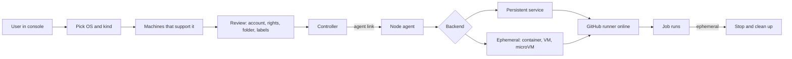
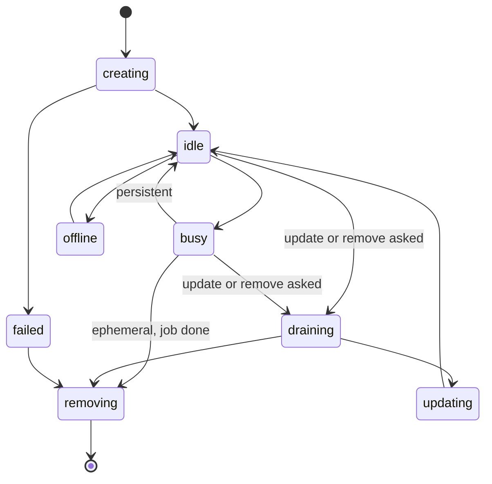
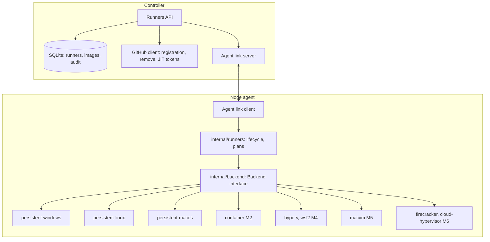

# Runners and isolation backends

**PARTLY BUILT (CRSP22).** The M1 persistent runner backends for Windows, Linux and macOS, the runner rules, the plan and apply flow and the runner API operations are built. Requirements not listed under "Built" in section 5 are **NOT YET IMPLEMENTED**. Each requirement names the milestone that builds it (M1 to M6, from [the product brief](../../overview/product.md#milestones)).

Related: [product brief](../../overview/product.md), [decision 0003, isolation backends](../../architecture/decisions/0003-isolation-backends.md), [decision 0004, agent link](../../architecture/decisions/0004-agent-link.md), [decision 0005, product boundary](../../architecture/decisions/0005-product-boundary.md).

## 1. In one paragraph

A runner is a GitHub Actions self-hosted runner that the product creates, watches and removes on one of the user's machines. The user creates runners in the web console or the CLI, per OS, and only on machines that support that OS and isolation. Milestone 1 builds persistent runners on Windows, Linux and macOS: each runs as an OS service under its own non-admin account (the agent that makes it runs as LocalSystem or root, machines R5.44). Later milestones add ephemeral runners: one fresh container, VM or microVM per job, started with a just-in-time (JIT) config and thrown away after the job. Every kind of runner sits behind one backend interface.

## 2. Why

**Problem.** Runners made by hand drift. They run as a strong account (NETWORK SERVICE or LocalSystem), carry project labels, keep state between jobs and are hard to remove cleanly. The dev-standards runner pool fixed this for one Windows PC with Docker Desktop, at the cost of many failures (the learnings in the product brief). This feature carries that work into the product, for every OS.

**Users.** One person or a small team that runs CI for many repositories on their own machines.

**Goals.**

- Create, update and remove runners from the console, with no manual steps on the machine after the agent is installed.
- Use the best isolation each machine supports, behind one interface (decision 0003).
- Keep each runner's rights as small as the job allows.
- Never cut a running job.

**Non-goals.**

- GitHub-hosted runners.
- Scheduling and the slot queue (the `scheduling` feature). This spec only says when a runner starts and stops.
- Caches and the registry mirror server (milestone 7, the `caching` feature). This spec only says how runners use them.
- Cloud machines.

## 3. How it works



The steps in words:

1. The user opens Runners and chooses Create. They pick the OS and the kind (persistent or ephemeral).
2. The console lists only machines whose agent reports that OS and an allowed backend for that kind. Other machines are shown with the reason they cannot take it.
3. Review shows what will happen on the machine: the account, its rights, the folder, the service, the labels and the runner version. Nothing has changed yet.
4. The controller sends the plan to the agent over the agent link. The agent runs it through the backend.
5. A persistent runner registers once and stays. Its service runs jobs until the user removes or updates it.
6. An ephemeral runner gets a JIT config for one job. It starts, takes one job, and is stopped and cleaned up when the job ends.
7. The agent streams setup logs and runner logs, and reports usage, to the controller.



## 4. Screens and states

No mocks yet. The Runners screen and the Create runner wizard follow design system v1.

- Runners list: one row per runner with machine, OS, backend, isolation, labels, state, current job and age. Rows compare more than three facts, so it is a table (design system UX-25). Age keeps ageing (UX-53).
- Isolation: every row and detail names the isolation, and a persistent runner says it keeps state between jobs (design system UX-61).
- State: each state is a word, a glyph and a colour (design system UX-58), read from one source (UX-19).
- Create runner: a wizard (design system UX-5) that ends with Review, Creating, Done (UX-30). A machine that cannot take the runner is shown disabled with its reason (UX-38).
- Remove runner, remove an image, replace an old runner: the question card names each item that goes, and a busy runner names its job and waits for the drain (design system UX-62, UX-9).
- Empty state: no machine supports the chosen OS. It says why and links to Machines (design system UX-6).
- Busy state: buttons that start work stay busy until the server answers (design system UX-13). A drain shows what it waits for and until when (UX-29).

## 5. Functional requirements

**Wired by CRSP41:** the controller passes the runners service to the API (`cmd/crsp/areas_wiring.go`), so the runner operations answer instead of 501. Records and plans are in memory until the SQL store lands. The controller's own machine runs the persistent backend of its OS. Another machine answers with a reason, because the agent does not carry `AddRunner` and `RemoveRunner` of the agent link yet. A test (`cmd/crsp/wiring_test.go`) builds the controller wiring and fails if a built operation answers 501. **Built by CRSP56:** R5.41, R5.42, R5.50 to R5.52, and R5.43 in part. **Built by CRSP49:** R5.47, and R5.48 and R5.49 in part (see each). **Built by CRSP38:** R5.46. **Built by CRSP22:** R5.1 to R5.8, R5.10, R5.13 to R5.24, R5.36, R5.37, R6.1 to R6.4 and R6.8 and R5.40 (R5.39 is built by CRSP21 and CRSP26) (their store and agent link adapters are listed in section 11). **Built in part:** R5.5 (the finders are built; the console list that shows `not managed` is not), R5.9 (`Detect` is built; the allow list belongs to `machines`), R5.11 (`StreamLogs` takes a redactor; the secret list is not wired), R5.12 (`ReportUsage` is built; the 15-second sender is not). **Built in part by CRSP59:** R5.38 (see it). **Not built:** R6.7, R6.9 (CI jobs). Every other requirement is **NOT YET IMPLEMENTED**. "Port" names the dev-standards source (repository `luis-mc/dev-standards`, spec `docs/features/runner-pool/spec.md`, requirement IDs as `DS R5.n`).

### 5.1 Lifecycle from the console

**R5.1** (M1) — **Create per OS, only where supported.** The console and the CLI create a runner from an OS, a kind (persistent or ephemeral) and a machine. The machine choice lists only machines whose agent reports that OS and a backend that is allowed on that machine and supports the kind. The controller refuses any other request with the reason (for example `machine mac-1: no allowed backend for Windows`).

**R5.2** (M1) — **One runner record.** Each runner has: id, name, machine, OS, architecture, kind, backend, isolation (`microVM`, `VM`, `container` or `persistent`), labels, scope (repository, or organization runner group), runner version, state and current job. The record lives in the controller's database.

**R5.3** (M1) — **States.** A runner is in one state: `creating`, `idle`, `busy`, `draining`, `updating`, `offline`, `failed` or `removing`. The agent reports changes; the controller stores them and pushes them to the console.

**R5.4** (M1) — **Remove with a yes and a drain.** Removing a runner lists what goes (the GitHub registration, the service, the account, the folder) and needs a yes (design system UX-62). A busy runner drains first: it takes no new job and is removed when its job ends, and keeps waiting past the machine's drain timeout (machines R5.33), with a warning. The idle check runs right before the removal. Removal from GitHub uses a remove token, never a registration token, and its result is checked (port DS R5.32, DL315). **Planned (CRSP80, M2):** the order of idle check, deregister and stop, and the `422` rule, are in R5.62.

**R5.5** (M1) — **Find runners already on a machine.** The agent lists existing runners from the OS service list, not only from folders: Windows `Win32_Service` entries named `actions.runner.*` (path gives the folder, `StartName` the account), Linux systemd units `actions.runner.*`, macOS launchd jobs `actions.runner.*`. A runner whose folder the agent cannot read is still reported, and the checks that need admin rights say so (port DS R5.38). The console shows a runner it did not create as `not managed`.

**R5.6** (M1) — **Replace a hand-made runner only after the new one is online.** When a repository already has a self-hosted runner for the same OS that the product did not create, the plan can add steps after the new runner: stop and delete the old service, remove the old runner from GitHub, delete its folder. Each step needs its own yes naming it. A step waits while the new runner is not online, the runner list cannot be read, or the old runner has a job (port DS R5.33).

**R5.7** (M1) — **Isolation is named.** The console, the CLI and the API name each runner's isolation. A persistent runner is marked as keeping state between jobs (design system UX-61).

### 5.2 Backend interface

**R5.8** (M1) — **One interface.** Every backend implements: `Detect` (is it present and usable here), `PrepareImage`, `Start` (with a JIT config, or a registration for a persistent runner), `StreamLogs`, `Stop`, `CleanUp` and `ReportUsage` (decision 0003). The agent calls backends only through this interface.

**R5.9** (M1) — **Detect and allow.** At start and every 10 minutes the agent reports which backends work on the machine and why the others do not (for example `firecracker: no /dev/kvm`). The user allows backends per machine. A backend that is present but not allowed is never used.

**R5.10** (M1) — **Clean up always.** After `Stop`, the agent calls `CleanUp`, also after an error or a timeout. `CleanUp` is safe to call twice. An ephemeral runner leaves no container, VM, overlay disk, network or temp folder behind. A persistent runner's `CleanUp` (on removal) removes the service, the account and the folder.

**R5.11** (M1, redactor and private log Built CRSP47; wiring of `StreamLogs` to the controller stays with the agent link) — **Logs.** `StreamLogs` sends the setup log and the runner's own log lines to the controller as they come. Known secrets (tokens, passwords, JIT configs) are replaced by `***` before they leave the agent.

*Built by CRSP47* (`internal/redact`): one redactor holds every one-time value a backend is given (registration, remove and JIT tokens, with their base64 forms) and also matches the shapes `ghp_`, `github_pat_`, private keys, JWTs, `Authorization:` and `Cookie:` lines, `--token` flags and `ACTIONS_RUNNER_INPUT_*` values. The three persistent backends teach it each value in `Start` before any log line is written, and the controller passes it to every backend (`sys.Deps.Redact`, `sys.Deps.Secret`). A *private log* (`redact.PrivateLog`) is the runner's setup log file: written after redaction, mode `0600` in a `0700` folder, so only the account that owns the runner folder reads it.

**R5.12** (M1) — **Usage.** `ReportUsage` gives, per runner and per job: CPU time, peak and median memory, disk used, and wall time. The agent sends it at least every 15 seconds while a job runs, and once at the end.

### 5.3 Persistent runners on Windows (M1)

**R5.13** (M1) — **A service with its own account.** Each Windows persistent runner is a Windows service that runs as its own local account, never NETWORK SERVICE, LocalSystem or an administrator. The account name is `crsp-<short slug>`: at most 20 characters, lower-case letters, digits and hyphens, the same for the same runner on every run; a name that does not fit or is taken gets a 4-character hash (port DS R5.31, `test_dl310_windows_runner.py` slug tests).

**R5.14** (M1) — **Account rights.** The account is a member of the local group `crsp-runners`, has "log on as a service", and is denied interactive and remote desktop logon. It gets "create symbolic links" (`SeCreateSymbolicLinkPrivilege`) only when the runner's settings ask for it (for example a tool layer that needs symlinks, such as cargo-xwin). A rerun adds or removes the right to match the settings (port DS R5.31, changed: dev-standards gives it to every account).

**R5.15** (M1) — **Password never kept.** The account password is random. It is made inside the process that registers the service, set on the account and passed only to the runner's service registration. It is never in the plan, the database, a log, the output or a file. A rerun makes a new one only when the service is registered again (port DS R5.31).

**R5.16** (M1) — **Folder locked to the account.** The runner folder grants Full control to its account, Administrators and SYSTEM only. Inheritance is off.

**R5.17** (M1) — **PowerShell hooks that call the all-users binary.** The runner `.env` sets `ACTIONS_RUNNER_HOOK_JOB_STARTED` and `ACTIONS_RUNNER_HOOK_JOB_COMPLETED` to `.ps1` files, never `.cmd` (the runner refuses `.cmd`). Each hook calls the `crsp` binary installed for all users (under `Program Files`), never a copy in a user profile. The `.env` also sets `PSExecutionPolicyPreference=RemoteSigned` for the runner's processes only; the machine policy is not changed (port DS R5.31, learnings 4).

**R5.18** (M1) — **No cmd quoting.** The agent registers services and scheduled tasks through the Windows service API or PowerShell cmdlets (`New-Service`, `Register-ScheduledTask`) with each argument passed on its own. It never builds a cmd-quoted command line, because PowerShell 5.1 mangles quotes to native programs (port DS R5.32, learning 5).

**R5.19** (M1) — **Remove the old registration before locking the folder.** When a runner is registered again in place (for example with another account), the agent first removes the old registration with a remove token and checks the exit code. On failure it stops and leaves the old runner and folder as they were. Only after a good removal does it lock the folder to the new account (port DS R5.32, DL315, `test_dl315_runner_remove_token.py`).

**R5.20** (M1) — **Reruns are safe.** A runner whose name, folder, labels, account, rights and `.env` all match is reported `already` and not touched. One with another account is registered again in place (R5.19). One with only a stale `.env` has the file rewritten and the service restarted, without a new password (port DS R5.32).

### 5.4 Persistent runners on Linux (M1)

**R5.21** (M1) — **A systemd unit with its own user.** Each Linux persistent runner is a systemd system unit that runs as its own system user `crsp-<short slug>` (same naming as R5.13). The user has no login shell, no password and no sudo rights, and is in the group `crsp-runners`.

**R5.22** (M1) — **Folder and unit hardening.** The runner folder is owned by its user, mode `0700`. The unit sets `NoNewPrivileges=yes`, `PrivateTmp=yes`, `ProtectSystem=strict` with the runner folder in `ReadWritePaths`, and `Restart=on-failure`. The hooks are `.sh` files that call `/usr/local/bin/crsp`.

### 5.5 Persistent runners on macOS (M1)

**R5.23** (M1) — **A launchd daemon with its own user.** Each macOS persistent runner is a launchd daemon in `/Library/LaunchDaemons` with `UserName` set to its own hidden user `crsp-<short slug>` (no login shell, not an admin, not shown at login). The folder is owned by that user, mode `0700`. The hooks are `.sh` files that call `/usr/local/bin/crsp`.

**R5.24** (M1) — **All three OS together.** Milestone 1 ships R5.13 to R5.23 for Windows, Linux and macOS in the same release. Each OS backend is built only into the binary for that OS.

### 5.6 Ephemeral JIT runners

**R5.25** (M2, v0.3.0, Built CRSP52) — **One runner per job with a JIT config.** For an ephemeral runner the controller asks GitHub for a JIT config for one job and hands it to the agent. The runner takes one job and exits. The JIT config is passed in memory or in a file only the runner can read, and is deleted at start. It is never stored in the database or logged. Built: `internal/runners/jit.go` `StartJobRunner` asks GitHub for the config (`internal/github/jitconfig.go`), passes it to the agent in the same call and drops it; the container backend writes it to a `0700` tmpfs file only the job user reads, and the start script deletes the file before the runner runs. It is in no argument, record, event, audit line, log or error text. Plain `generate-jitconfig` is used, not scale sets (open question 8).

**R5.26** (M2, v0.3.0, Built CRSP52) — **Nothing carries over.** After the job, the agent calls `Stop` and `CleanUp` (R5.10). The next job gets a new runner from the image. No state passes between jobs except the shared caches the user turned on. Built: each runner gets its own folder under `/home/runner/jobs`, copied from the image; `CleanUp` removes it and any config file, safe twice and when the container is gone (`internal/backend/container/container.go`). Built by CRSP64: a runner that gets no job keeps its slot only 15 minutes. The demand loop (`internal/demand/demand.go` `SweepIdle`, `DefaultIdleAfter`) asks GitHub that the runner is not busy (`Service.RemoveIdleRunner`, `internal/runners/ephemeral.go`), deletes it at GitHub (GitHub refuses a runner that took a job in the meantime), stops the listener, cleans up the folder and drops the record, which frees the slot. A busy runner is left to its job; a failed removal is tried again after a minute; the job the runner was made for waits again when it is still queued. The runner records and the loop's view are in memory (the store table exists but the controller wires the memory store), so a restart loses them; see open question 44.

**R5.27** (M2, v0.3.0, Built CRSP52) — **Containers on Linux and WSL2.** The container backend uses rootless Podman, or Docker when Podman is not there. The job runs as a non-root user. The container never runs with `--privileged` and never gets the Docker socket. When the machine allows KVM for that runner, `/dev/kvm` is passed with `--device` only. Memory and CPU caps come from the machine's load budget. Built in part: Docker only (rootless Podman is open question 19). One pool container per repository (`PoolName`), `--user 1001:1001`, `--cap-drop ALL` with `no-new-privileges` as the one capability set (open question 18), `--device /dev/kvm` only when the machine allows it, memory and CPU caps from `Config.Limits`. `CheckRunArgs` refuses `--privileged`, `--cap-add`, host PID, network, IPC or user namespace, any other device, any engine socket and root, before every `docker run`. The registry does not list the backend yet (open question 21). Wired by CRSP58: the Linux binary's registry holds the container backend (`internal/backend/registry/registry_linux.go`), listed before the persistent one. A machine uses it only when `docker` is in its allowed backends (machines R5.9), which is off by default: the default allow list is `persistent`. The local agent sends a JIT config to the container backend and a registration token to the persistent one, builds the base image on first use, and cleans up a container handle (`<pool>:<runner>`) with the container backend. `PlanAdd` and its apply start an ephemeral runner only on Linux and only on a machine with the container backend allowed, usable and present (`internal/runners/ephemeral_test.go`). Built by CRSP64: the pool size of the machine (machines R5.58: CPUs and memory) is passed with the runner spec (`PoolCPUs`, `PoolMemoryMB`, set in `StartJobRunner`) and becomes `--cpus` and `--memory` of the repository's pool container (`limitsFor`); `Config.Limits` is the fallback and `DefaultConfig` sets none. `CheckRunArgs` accepts both flags. A machine with no pool size set leaves the container uncapped. The base image files are embedded in the binary (`images/embed.go`) and written with the crsp binary to a build folder under the user cache (`stageBuild`) before a build; the folder is removed after it, and the image key is the same as before. No installer folder is needed. **Planned (CRSP81, M2, NOT YET IMPLEMENTED):** the memory, CPU and process limits, the single job network with no traffic between containers, and the "What a job can reach" page are in R5.63 and R5.64.

**R5.28** (M4) — **Hyper-V and WSL2 VMs on Windows.** The Hyper-V backend starts a VM per job from a prepared disk with a differencing disk on top, and deletes the differencing disk after the job. The WSL2 backend starts a Linux microVM or container per job inside WSL2. **Planned (CRSP86, M4):** a job that needs Docker runs in a copy-on-write clone; see R5.66. Windows containers with Hyper-V isolation (R5.65, CRSP85) are an option beside the VM.

**R5.29** (M5, NOT YET IMPLEMENTED) — **macOS VMs on Apple's Virtualization.framework, at most two.** (Owner decision D54, 2026-11-15.) crsp uses its own code on Apple's Virtualization.framework, not Tart: Tart moved to OpenAI and is under FSL-1.1-ALv2, a licence the product does not take on. The macOS backend creates a VM per job from a prepared image, with its own image preparation and cloning, and no external VM tool. The agent never runs more than two macOS VMs on one Mac at once, counting VMs it did not start. A third job waits for a free VM and says why. This is spec text only; no code exists. **Planned (CRSP86, M5):** the macOS clone for Docker in a job follows R5.66.

**R5.30** (M6) — **MicroVMs with snapshots.** On Linux with KVM, the Firecracker or Cloud Hypervisor backend boots an image once, takes a snapshot, and starts each job from that snapshot. The snapshot is keyed by image, kernel, vCPU count and memory; a change of any of them makes a new snapshot. After a restore the guest clock is set from the host and the guest random pool is reseeded (port DS R5.29).

**R5.31** (M2, v0.3.0, Built CRSP52) — **Best backend first.** When the user does not choose, the agent uses the first allowed backend in the order of decision 0003 for that OS (for Linux with `/dev/kvm`: microVM, then container, then persistent). Built: `backend.Order` and `backend.Choose` (`internal/backend/choose.go`). A backend that is absent, not allowed or not usable is skipped; a backend the user chose is the only one tried, and its failure is named. Wired by CRSP58: the demand loop (github-integration R5.37) picks a machine whose allow list names the container backend and starts the runner there; `PlanAdd` accepts an ephemeral runner only on such a machine. Open questions 21 and 32 to 36.

### 5.7 Images

**R5.32** (M2, v0.3.0, Built CRSP52) — **Base images with tool layers.** Each OS has a few base images. The user turns tool layers on per pool: build tools, browsers for Playwright, packaging tools, cross-compilers. The layer list of an image is shown with its size (port DS R5.9, R5.11). Built in part: layer names go into the image as a build argument and a label, and `ListImages` shows each image with its layers and total size. A size per layer is not read (open question 20). The tool lists of the layers are R5.50.

**R5.33** (M2, v0.3.0, Built CRSP52) — **Build once per machine, keep the newest few.** An image is keyed by its base, its layers and its pinned versions. A machine builds each key once and reuses it. It keeps the newest 3 images per OS (a setting) and deletes older ones that no runner uses. Built: `runners.ImageKey` (base, sorted layers, pinned versions), `PrepareImage` builds a key once, `PruneImages` keeps the newest 3 per OS (`DefaultKeepImages`) and never deletes an image a pool container uses. Built by CRSP64: the files of the base image and the layers come from the binary (`images.FS`), see R5.27.

**R5.34** (M2) — **Pull through the registry mirror.** When the pool has a registry mirror, image pulls go through it. When the mirror cannot be reached, pulls go to the upstream registry and the console says so once.

**R5.35** (M2, v0.3.0, Built CRSP52) — **Rebuild with drain.** A rebuild builds the new image while the old one keeps serving jobs. Runners switch to the new image only when idle; the idle check runs right before the switch. When the pool container is not running (Exited, for example after a Docker restart) there is no job and no supervisor to answer, so the pool counts as drained at once and the switch runs without a wait (handover lesson 27; HND2). A build failure keeps the old image and says `the rebuild failed: <reason>` (port DS R5.10, R5.13, R5.15; learning 1). Built: `Backend.Refresh` builds aside, stops new runners (`ErrDraining`), waits with `runners.Drain` (idle check right before the swap, then once more under the lock), swaps, and puts the old image back when the new one does not start. A failed build says `the rebuild failed: <reason>` and changes nothing.

### 5.10 Runner caches (M1)

**R5.39** (M1) — **Cache folders, quotas and disk guard.** Each persistent runner has its own tool cache and Rust build cache folders under its folder, exported to its jobs as `CI_TOOLS_DIR` and `CARGO_TARGET_DIR`, with the quotas declared in configuration (default 20 GiB and 40 GiB). The job-completed hook evicts the oldest entries over a quota, between jobs only. The job-started gate holds new jobs while the volume has under 10% free, and the doctor reports it. The rules, the defaults and the tests are caches R5.36 to R5.39. Built (CRSP21, CRSP26). Replaces the milestone 7 plan for the cache cap.

### 5.8 Labels

**R5.36** (M1) — **Generic labels only.** A runner carries only `self-hosted`, its OS, its architecture, `docker`, `kvm`, `gpu` and the pool name. Each capability label is added only when the agent has checked it works (for example `kvm` only when `/dev/kvm` is usable by the runner). The controller refuses any other label with the reason (port DS R5.36, R5.37; learning 7).

### 5.9 Runner version

**R5.37** (M1) — **Pinned runner version with SHA-256.** The binary carries one pinned GitHub runner version per OS and architecture, each with its SHA-256. A download whose hash does not match is deleted and refused. A hash that is not 64 hex characters, or is one repeated character, is treated as wrong (port DS R5.14).

**R5.38** (M1, Built in part CRSP59: `Service.UpdateRunner` and `UpdateAll`, the owner setting; the agent message that replaces the files is not built) — **Auto-update with drain.** Persistent runners are registered with the runner's own self-update turned off. When a release of the product pins a newer runner version, or GitHub marks the running version as deprecated, the agent updates each runner: it drains it, replaces the runner files, and starts it again. The idle check runs right before the swap. An ephemeral runner uses the new version from its next job. Built (CRSP59): `UpdateRunner` sets the runner `draining`, waits with `Drain` (idle check right before the swap, R6.4), sets `updating`, calls the agent, then records the new version and sets `idle`. The result is `updated`, `failed` with the reason, or `waiting for the job to end` (the drain ran out; the runner keeps its old version and nothing was stopped). `UpdateAll` skips ephemeral runners and runners already on the pin. The automatic run follows the product's automatic-update setting (operations R5.15, default on); an update the owner asks for runs when it is off. Not built: the agent link message `UpdateRunner` and the backend file replacement on each OS, so a controller without it answers `the agent of this machine cannot update runners yet`; the schedule that calls `UpdateAll` when a release pins a newer version or GitHub marks the version deprecated.

**R5.40** (M1) — **A missing or broken crsp never hides.** The `.ps1` and `.sh` hooks keep the job going when `crsp` is not installed, cannot start, or cannot be reached (a bad install must not fail CI), but each prints the GitHub Actions annotation `::warning title=crsp::...` on its own line. The text says what failed (`crsp is not installed at <path>` or `crsp at <path> could not run (...)`), that the job ran without the queue and the load gate, and what to do (reinstall crsp for all users on this machine, then run `crsp doctor --check runner.hooks`). The hook also writes the line to `crsp-hook-problem.txt` next to the scripts, which the agent reads into the runner's hook problems for the doctor (doctor R5.14). `CRSP_BIN` overrides the binary path, for tests. The same applies to every OS. Built.

### 5.11 Parity with the old pool (after v0.1.0)

The dev-standards runner pool covered these cases ([handover page](../../architecture/dev-standards-handover.md), section 4). Each requirement below targets a milestone after v0.1.0 and is **NOT YET IMPLEMENTED**. Until this is built, jobs that need it run on GitHub-hosted runners.

**R5.41** (after v0.1.0, Built by CRSP56: `container.KVMArgs`, `CheckRunArgs`, `DecideKVM`, the `kvm` layer and `images/layers/compose.kvm.yaml`; Built by CRSP68: the pool start passes the device with the host group only when the pool has the `kvm` layer and the probe finds a device the agent can open, after a bounded wait, or when the machine config forces it; otherwise it starts without the device and logs why; open question 51) — **Linux containers with KVM.** A Linux runner in a container (R5.27) on a machine whose `/dev/kvm` the agent has checked as usable by the runner gets the `kvm` label (R5.36) and the device through the cgroup rule `--device-cgroup-rule 'c 10:232 rwm'` (compose: `device_cgroup_rules`), never `--privileged` and never a `--device /dev/kvm` or `devices:` mapping: at daemon boot Docker restarts the pool before the KVM loader, and a mapping to a missing file fails the container start (handover lesson 28; HND1). The pool's `kvm-wait.sh` creates `/dev/kvm` with `mknod` (10:232) once `/proc/misc` lists `kvm`, inside its bounded wait (machines R5.53). A test VM boot job (the `vm_check.py` case of the handover page) runs in it. When `/dev/kvm` is missing or not usable the runner has no `kvm` label and the doctor says why (machines R5.53).

**R5.42** (after v0.1.0, Built by CRSP56: `container.RunnerWinePrefix`, `WineEnv`, `UnsetWineEnv`, the `windows-packaging` layer) — **A Wine prefix per runner.** A Linux runner image that has the `wine` layer gives each runner its own Wine prefix in the runner's own folder, set by `WINEPREFIX`. `TMPDIR` is not set in the runner's job environment, because a set `TMPDIR` breaks Wine's startup. Two runners never share a prefix. A prefix is made on first use and removed with the runner.

**R5.43** (after v0.1.0, Built in part CRSP56: the `llvm` layer with LLVM 20.1.8 for amd64 and its self-check; the symlink right on Windows is not built, see open question 28) — **LLVM and clang-cl for cargo-xwin.** A Linux image layer `llvm` holds a pinned LLVM (SHA-256 checked, R5.37 rule) with `clang-cl`, `lld-link` and `llvm-lib` on the `PATH`, so `cargo-xwin` builds Windows targets. The layer has a self-check that runs `clang-cl --version`. On a Windows runner the symlink right that `cargo-xwin` and Rust tooling need follows R5.14: given only when the machine or label setting asks for it.

**R5.44** (v0.4.0, Built CRSP55: `images/layers/browsers/Dockerfile`, `SelectLayers` and `NeverLower` in `internal/runners/layers.go`, CI job `image`; CRSP68: the pool start sets `PLAYWRIGHT_BROWSERS_PATH` to the image path for a pool with the layer, open question 53) — **Playwright browsers in the image.** An image layer `browsers` (open question 25) holds the Chromium, Firefox and WebKit builds for one pinned Playwright version and their system packages, at a fixed path set by `PLAYWRIGHT_BROWSERS_PATH` (caches R5.41). The layer's self-check launches each browser headless once. A job that finds the browsers there downloads nothing. The layer is built on top of the base image (`FROM ${BASE_IMAGE}`), its Playwright version is pinned (`PlaywrightPin`) and chosen per pool, and **a rebuild never lowers a pool's Playwright version**: when the pool's current version is higher than the wanted one, the current one is kept (`NeverLower`). A version that is not dotted numbers is refused and nothing changes. CI builds the layer with `docker build` only, no push.

**R5.45** (v0.4.0, Built CRSP54: `internal/runners/postgres.go`; starting the server for a real pool is the pool lifecycle, the next wave) — **Postgres roles per runner.** Where a machine offers a Postgres server to jobs, each runner gets its own role and its own database owned by it, with a random password the agent keeps in the OS secret store and puts only in that runner's job environment. A role cannot connect to another runner's database. The role and database go with the runner when it is removed. No secret is written to a log (R6.2).

Section 5.11 continues with the requirements the [parity plan](../../architecture/parity-plan.md) adds so that crsp runs every job of the old pool (task CRSP39). Each names the release that builds it.

**R5.47** (M2, v0.3.0, Built CRSP49: engine detection and the `Engine` interface, `internal/backend/container/engine.go`; CRSP61: `agent.DetectEngine` in `internal/agent/engine.go` names the engine the agent found, Docker in WSL2 through the Windows CLI, through `wsl docker`, or Docker Desktop (told by the `OperatingSystem` of `docker info`), and the doctor check `machine.engine` shows it; the agent link does not carry this report yet) — **Containers run in WSL2 through Docker first.** On a Windows machine the container backend (R5.27) uses the Docker engine of WSL2 through the Windows `docker` CLI first, and `wsl docker` only when that CLI cannot run (machines R5.18). The agent detects the engine, its version and the WSL2 state, and reports the reason when the engine is not usable (R5.9). The backend interface hides the engine, so rootless Podman in a crsp-owned WSL2 distro can replace Docker later with no change to runners. The agent never edits the settings of Docker Desktop.

**R5.48** (M2, v0.3.0, Built in part CRSP49: the image holds a copy of the linux `crsp`; `container.CrspMountArgs` builds the read-only mount; `crsp vm` is built by CRSP61 (caches R5.46); `crsp db-env` is built (R5.54); CRSP68: the pool start mounts it when the config has the agent's linux binary, which is set by default on a Linux agent; open question 52) — **The `crsp` binary is inside every container job.** The agent mounts its own binary read-only at `/usr/local/bin/crsp` in each runner container, so a job can call `crsp vm` and `crsp db-env` (caches R5.46, runners R5.54). The version is the agent's. No socket is mounted (R6.1).

**R5.49** (M2, v0.3.0, Built CRSP49 and CRSP69: `images/linux-base/Dockerfile` and the CI job `image`; the Actions runner is in `/opt/actions-runner`, see open question 10) — **A base image that is like a GitHub-hosted runner.** The Linux base image is an Ubuntu LTS image. It always holds: `git`, `curl`, `ca-certificates`, `python3`, `jq`, `zip`, `unzip`, `xz-utils`, `build-essential`, `pkg-config`, `libatomic1` (pnpm needs it), `postgresql-client`, `libicu`; the GitHub CLI `gh`; the Actions runner and its dependencies; and Node LTS with `corepack`. Every download is pinned and SHA-256 checked (R5.37 rule); a missing or wrong hash fails the build. Node is installed with its `bin` first on `PATH` for every user and before the build step that runs `corepack enable`. `corepack enable` runs once at build time as root, so the `pnpm` and `yarn` shims exist and an unprivileged job needs no write access; the shims pin no version. The job user is not root and has no `sudo`. A self-check at build time runs each tool (`node --version`, `corepack --version`, `gh --version`, the `pnpm` shim, `ldconfig -p` for `libatomic`) and fails the build when one is missing (port DS R5.26, R5.16 and the pool image of runner-pool).

**R5.50** (M2, v0.4.0 to v0.6.0, Built by CRSP56 and finished by CRSP60 (self-checks pin the dotnet and Wine lines, `fakeroot` added, the layers are chosen by name in `SelectLayers`) for `windows-packaging`, `linux-packaging`, `llvm` and `kvm`: `runners.Layers()` and `images/layers/*/Dockerfile`, each built in CI; `playwright` is R5.44 and is not built; turning a layer on for a pool needs the pool settings, the next wave) — **Image layers carry fixed tool lists.** A layer is off until the user turns it on for a pool (R5.32), and a layer turned off in a repository setting is removed from an image only by an explicit drop. The layers and what each adds:
- `windows-packaging` (v0.5.0): `dotnet-sdk-8.0`, `wine`, `wine64`, `xvfb`, `xauth`, `msitools`. It includes the Wine rules of R5.42 and R5.52. About 1 GB.
- `linux-packaging` (v0.5.0): `dpkg-dev`, `fakeroot`, `rpm`, `make`, `checkpolicy`, `selinux-policy-dev`, `policycoreutils`, `gnupg`, `shellcheck`, `systemd`, `createrepo-c`, and `policycoreutils-python-utils` when the base image has it (a missing one is skipped without a failure).
- `llvm` (v0.5.0): R5.43. `playwright` (v0.4.0): R5.44.
- `kvm` (v0.6.0): `qemu-system-x86`, `qemu-utils`, `cloud-image-utils`, `openssh-client`, plus R5.41.
Each layer has a self-check that runs its main tools. The doctor probes the same tools in the running image (doctor R5.31). A layer name stays the same as the dev-standards name, so a project setting maps one to one (port DS R5.9, R5.11).

**R5.51** (M2, v0.5.0, Built by CRSP56, CRSP60 and CRSP70: `runners.ParseExtraPackages`, `MergeExtraPackages`, `LayerSetKey`, `PlanImage` and `images/layers/extra-packages/Dockerfile`, built in CI; the pool setting, its API, CLI and console field are built; the list does not yet reach a remote agent) — **Extra packages per pool.** A pool may list extra distribution packages, one per line. A name has only letters, digits and `+ - .` and does not start with `-`; anything else is refused with the line number and nothing changes. The names are part of the image key (R5.33). A name that was added stays until the user drops it. The packages are installed by the last layer of the image (`extra-packages`, `PlanImage`), which checks each name against the same pattern again and runs `dpkg -s` on each as its self-check. An empty list adds no layer. A changed list changes the image key, so the new image builds aside. Built by CRSP70: the list is a field of the repository policy (`Policy.ExtraPackages`, sorted, no repeats), read with `GET /api/v1/repositories/{id}/extra-packages` and replaced as a whole with `PUT` (text, one name per line; admin; the controller checks it with `ParseExtraPackages` and a bad name answers 400 with its line number and changes nothing). The policy view lists it as `extra_packages`. The CLI is `crsp repo packages OWNER/NAME [--set A,B]`. The console shows the list on the repository's page as a text area with the line number of a mistake above its box. The demand loop passes the list with the runner request (`JobRunner.ExtraPackages`, `RunnerSpec.ExtraPackages`); the local agent hands it to `PrepareImage` (`ImageSpec.Extras`), which adds it to the image key (`ImageKeyInput.Extras`; no names leaves the key as before) and passes it as the `EXTRA_PACKAGES` build argument. NOT YET IMPLEMENTED: the list over the agent link to a remote machine (the proto has no field for it; open question 54), the SQL column (the repositories store is in memory, as for every policy field), and building the `extra-packages` layer inside the pool image build on the machine.

**R5.52** (M2, v0.5.0, Built by CRSP56: `container.PrepareWinePrefix`; Built in part by CRSP66: `container.EnsureWinePrefix` with the stamp file, `LaneWinePrefix`, `LaneWineJobEnv`; CRSP68: the pool start calls `EnsureWinePrefix` through the engine, in the lane's Wine folder, for a pool with the `windows-packaging` layer, and sets `WINEPREFIX` and `POOL_WINE_PREFIX`; a pool with that layer and no lane is refused; open question 49) — **The Wine prefix is made once and kept.** With the `wine` tools in the image, the agent prepares the prefix of a cache lane (caches R5.43) before the first job that uses the lane: `wineboot --init` under `xvfb-run -a`, as the job user, with `WINEDEBUG=-all`, a 180 second timeout and `wineserver -w` after it. It skips a lane whose prefix already holds `system.reg`. A failure is logged and never stops the job from starting. The prefix lives in the lane's cache folder, so it outlives the container. The agent sets `WINEPREFIX` to it and also `POOL_WINE_PREFIX` to the same path, the name that existing workflows copy from, until the dev-standards scripts drop it. `TMPDIR` is unset for every Wine tool (R5.43). Port of DS R5.17 to R5.19. **Built (CRSP66):** the prefix is made only when the image has the `windows-packaging` layer. A stamp file `.crsp-wine-line` in the prefix holds the Wine line (`major.minor` of `wine --version`, so a patch release keeps the prefix). A prefix whose stamp matches is kept; a different line, or a prefix with no stamp, is removed and made again, and the stamp is written only after a good boot, so a failed rebuild is tried again at the next job. The prefix is the Wine folder of the repository's own lane, so two repositories never share one; inside the container a job sees it as `/wine` under `WINEPREFIX` and `POOL_WINE_PREFIX`.

**R5.53** (M2, v0.3.0, partly built, CRSP50) — **The job environment is a contract.** A container job and a persistent runner job get these values and no others from the pool: `CI_TOOLS_DIR` and `CARGO_TARGET_DIR` (caches R5.39, R5.43), `CI_MAX_PARALLEL` (the runner's CPU count, machines R5.54), `PLAYWRIGHT_BROWSERS_PATH` (R5.44, caches R5.41), `WINEPREFIX` and `POOL_WINE_PREFIX` (R5.51), `RUNNER_TOOL_CACHE` kept in the lane (caches R5.43), and the database settings of R5.53. No project name and no pool path is set. The list is in the runner `.env` or the container environment, and the doctor reports a runner that lacks one that its image layers promise. Built (CRSP50): `CI_MAX_PARALLEL` in the `.env` of a persistent runner on Linux, Windows and macOS, the pool CPUs split over the job slots of the machine (machines R5.54); no pool size set exports none. Built (CRSP68): the container environment: `CI_TOOLS_DIR`, `CARGO_TARGET_DIR`, `RUNNER_TOOL_CACHE` and the lane on the pool container; `PLAYWRIGHT_BROWSERS_PATH`, `WINEPREFIX` and `POOL_WINE_PREFIX` on the pool container by layer; `CI_MAX_PARALLEL`, the cache quotas and `CRSP_DB_ENV_FILE` on each runner's listener. NOT YET IMPLEMENTED: the doctor check.

**R5.54** (M2, v0.4.0, Built CRSP54: `internal/runners/postgres.go` and `internal/jobcmd/dbenv.go`; Built CRSP68: the pool start calls `EnsureServer` and `Provision` for a repository that declares a database, joins the pool container to the Postgres network, writes `db.env` (mode 0600, job user) into the runner folder, sets `CRSP_DB_ENV_FILE`, and removes the login at clean up; open question 50) — **Postgres per runner, in detail.** This adds to R5.45. The Postgres server is a container the agent starts (PostgreSQL 16, its data in a named volume, no published port, reachable only on the pool network). Its admin password is made once and kept in the OS secret store. For each repository's runner lane the agent makes: a login role with a random password and a database it owns; `CREATEDB` for that login only when the repository setting `db_createdb` is on (so a test run can make `<base>_w<K>` databases, one per worker); and the repository's declared `NOLOGIN` roles (names are lowercase letters, digits and underscore, at most 63; `postgres`, `public` and `pg_*` are refused, and so is a role another repository declares, with both repositories named), each created behind an exists check and granted to the login `WITH ADMIN OPTION`. A rerun keeps the password, so a running job is not cut off. The job gets `DATABASE_URL`, `PGHOST`, `PGPORT`, `PGUSER`, `PGPASSWORD` and `PGDATABASE` through the step `crsp db-env`, which masks the secrets and appends the lines to `GITHUB_ENV`; outside a pool job it prints that it does nothing and exits 0 (port of `pool-db-env`, DS R5.27).

**R5.55** (M2, v0.6.0, Built CRSP71: `crsp vm boot`, `run` and `selinux` print the warning; `internal/vmcheck/memory.go`; it warns and boots anyway, caches open question 21) — **A VM counts against the runner's memory.** A job that boots a guest VM (caches R5.46) uses memory of the runner's cap. `crsp vm` prints a warning when the cap has less than the guest memory plus 1 GiB free, and the machine load budget (scheduling R5.40) already counts the guest because it is a process on the machine. A runner with the `kvm` label is sized for its guests (machines R5.54).

**R5.56** (M1, v0.2.0, Built CRSP47) — **A tool home per persistent runner.** The `.env` of each persistent runner sets `RUSTUP_HOME` and `CARGO_HOME` to folders under its own runner folder (`<runner folder>/cache/tools/rustup` and `.../cargo`), so two runner accounts never share a toolchain and a toolchain follows the runner when it is removed. They count in the tool cache quota (caches R5.36). On Windows the account needs no other setting for them. Port of DS R5.31 (`.env`).

**R5.57** (M1) — **A light runner per repository and OS.** (Lesson 22 of the old pool; scheduling R5.65.) For each repository with the pool on and the policy setting `light_runner` on, crsp keeps one persistent runner for each OS the repository serves, in the repository's own scope. Its name is `crsp-light-<repository>-<os>` (the job gate reads the prefix `crsp-light-` to give its jobs a light slot only), and it carries the generic labels `self-hosted`, the OS, the architecture and the extra generic label `crsp-light`. It is placed on an online, active machine of that OS with light slots above 0 that has an allowed backend; of several, the one with the fewest light runners for its light slots. Only the controller's own machine can host one until the runner messages of the agent link are built. When no machine fits, no runner is made, the reason is audited and the doctor shows it (`repo.light`); the next reconcile tries again. The runner is added with the same registration, token and account rules as any runner (R5.1, R6.2). Removing it (setting off, pool off) is an ordinary removal: it waits for the runner's own job, then deregisters it with a remove token (R5.4). Built (CRSP44).
**R5.58** (M1, Built OPS3) — **An account switch resets the runner folder.** When the service account of a Windows runner changes (for example from NETWORK SERVICE to its own account), the files in its `_work` tool cache keep the old owner and explicit entries, and every job that runs a tool from it fails with "Access is denied" (handover lesson 23). After the account exists and before the folder is locked (R5.16), the backend runs `takeown /F <folder> /R /D Y`, `icacls <folder> /setowner <account> /T /C` and `icacls <folder> /reset /T /C`, as fixed programs through the command runner, with the call's context. Each exit code is checked and each step is logged; a step that fails stops the change with the step and the reason, and the folder is not locked and the service is not registered. Linux already gives the folder to the account with `chown -R` before registration (R5.21); macOS needs no step. The doctor reports the same fault (doctor R5.35). Built (OPS3).

**R5.59** (M1, Built OPS9) — **Stop ends the whole listener, and confirms it.** (Handover lesson 26.) A refused refresh drain stopped `run.sh` but `Runner.Listener` lived on under init, and when the drain ended the supervisor started more listeners that looped on "session already exists". The Linux unit now has `KillMode=mixed`, so the service stop ends the listener and its children. After every stop, crsp waits for the runner's listeners (found by runner folder) to end by themselves; a listener still alive gets a terminate for it and its process group, a bounded grace, then a kill of the group (on Windows `taskkill /T /F`, which ends the process tree), a second grace, and a last check. Only when none is left does the stop succeed; otherwise it fails with the process ids and nothing is started.

**R5.60** (M1, Built OPS9) — **Never start beside a listener.** Before crsp starts the service or daemon of a runner (first start on Linux, macOS and Windows; restarts after the stop of R5.59), it looks for a `Runner.Listener` started from the same runner folder. If one runs, nothing is started and the start fails with `a listener of this runner is still running` and its process ids, which the log and the doctor check `runner.listener` (more than one listener, or a listener whose service is stopped) report. Tests use a fake process table; no test signals a real process.

**R5.61** (M2, v0.3.0, Built CRSP63) — **Runner commands go to any machine over the agent link.** The controller asks an agent to add a runner (`AddRunner`: a registration token for a persistent runner, an encoded JIT config for one ephemeral runner), to stop or clean one up (`StopRunner`), to remove one (`RemoveRunner`, with the remove token) and to drain one (`DrainRunner`). Each command carries a command id and is answered by one `RunnerResult` that says what the agent did: `ok`, `outcome` (`done`, `already` or `failed`), the redacted error, and the service ref the backend gave the runner. The controller takes the result as it comes and never assumes success; a command that gets no answer in 15 minutes, or finds no open stream, fails with that reason. The demand loop (github-integration R5.37) starts a JIT runner on any connected Linux machine whose allow list names `docker`, not only the controller's own. The token or JIT config travels in the message once. The agent adds it to its log redactor on receipt, redacts every error text it sends, and never logs a message (R5.11, R6.2); the controller keeps no copy. Draining one runner alone is not built: the agent answers `failed` and says to use the machine drain with the runner's name (open question 41).

### 5.12 Supervising the listener (M1)

**R5.46** (M1) — **Supervise the listener, not its wrapper.** (Lesson 19 of the old pool.) GitHub allows one session per registered runner and refuses a second listener with "a session for this runner already exists". The process that holds the session is `Runner.Listener`, not the service wrapper around it (the systemd unit and `runsvc.sh`, the launchd daemon, the Windows service and `RunnerService.exe`). crsp therefore tracks the listener: after it stops a runner (a stop, a restart for a rewritten `.env`, the stop before a re-registration or a deregistration) it waits until no `Runner.Listener` that runs from the runner folder is alive, and it starts the service again only then. A listener that outlives its service for 30 seconds ends the step with an error that names the process ids, and no second listener is started; an unreadable process list is the same refusal, never a guess. The same rule holds on Linux (`pgrep` against `<folder>/bin/Runner.Listener`), macOS (the same, with `launchctl bootout` and `bootstrap`, not `kickstart -k`, so a restart never leaves two) and Windows (`Get-Process Runner.Listener` by its path). crsp never starts a listener of its own and never kills one, so a running job is never cut. The doctor checks the result (`runner.listener`, doctor R5.30). Built (CRSP38).

**R5.62** (M2, NOT YET IMPLEMENTED, CRSP80) — **Remove a runner safely.** Before the agent stops a runner service or container, the controller asks GitHub whether the runner is idle. A busy runner is left alone and drains (R5.4). An idle runner is deregistered from GitHub first (with the remove token, R5.4) and stopped second, so GitHub never lists a runner that has nothing behind it. If GitHub answers `422` because the runner became busy between the check and the delete, crsp takes that as busy: it leaves the runner running and drains it. A runner that GitHub no longer knows counts as already deregistered. Each outcome is logged with the runner name. Offline registrations that nothing removed are swept by github-integration R5.33.

**R5.63** (M2, NOT YET IMPLEMENTED, CRSP81) — **Container limits and one job network.** Beyond R5.27, every job container has a memory limit, a CPU limit and a process-count limit (`--pids-limit`), taken from the machine's pool size (machines R5.58) with a default for a machine that sets none, so an uncapped container does not exist. Containers mount no host folder: the only mounts are the job's own work folder, the read-only crsp binary (R5.48) and the cache folders the user turned on. All job containers on a machine join one crsp-made network that has no traffic between containers (inter-container communication off), and reach only the outside. `CheckRunArgs` refuses a container that has no limits, joins another network, or mounts a host folder outside that list. The agent never changes the engine's own settings (R5.47).

**R5.64** (M2, NOT YET IMPLEMENTED, CRSP81) — **"What a job can reach".** The repository holds one page, `SECURITY.md`, with a section `What a job can reach` that lists, in plain words, what a job on a pool runner can still touch after R5.27 and R5.63. It lists at least: services that listen on the host's loopback address, which a container can reach through the host gateway unless the machine's firewall blocks it; setuid programs inside an image, which `no-new-privileges` limits but the user's image choice decides; and the fact that anyone with write access to a repository can edit its `RUNS_ON_*` variables or its workflow and so choose which pool runs their code (the same trust boundary as the workflow files, github-integration R5.28). Each item says what to do about it. The doctor links to the section when a repository is served (doctor R5.38), and a test fails when R5.63 changes a limit and the page does not name it.

**R5.65** (M4, NOT YET IMPLEMENTED, CRSP85) — **Windows jobs in Hyper-V isolated containers.** A Windows machine may run a job in a Windows container with Hyper-V isolation, as an option next to the Hyper-V VM per job of R5.28. The machine's allowed backends setting names it separately, off by default. The agent uses it only when the host supports it and the base image matches the host's build; otherwise it says why and uses the next backend. The container follows R5.26 (nothing carries over) and R5.63 (limits, no host folders). A job that needs Docker inside the job (R5.66) or a different kernel version does not use this backend.

**R5.66** (M4, M5 for macOS, NOT YET IMPLEMENTED, CRSP86) — **Docker inside a job through a cloned VM.** A job that needs Docker itself runs in a VM cloned copy-on-write for that job: a Hyper-V differencing disk on Windows (R5.28), a clone on macOS (R5.29). The base the clone comes from is built only from the repository's default branch, never from a pull request or any other branch, and is rebuilt when that branch moves. The job's VM is deleted when the job ends. At start the agent sweeps orphans: every VM and disk that crsp made and that no runner owns is deleted and logged. A job never gets the host's Docker socket (R5.27).

**R5.67** (M1, Built HND23) — **A stale session after a restart is expected for a while.** (Handover lesson 29.) After a real `wsl --shutdown` the pool came back with KVM, but every listener logged "A session for this runner already exists" for about two minutes, until GitHub dropped the sessions it still held. When a runner's listener reports that message right after a restart (container pool start, VM restart, service restart), the supervisor treats it as expected for a bounded window, the pool setting `session_wait_minutes` (default 3, 1 to 30). Inside the window it backs off quietly: one log line says it waits for GitHub to drop the old session and until when, and it never starts a second listener for the runner (R5.59, R5.60; a start goes through the listener guard first). The doctor and the console raise no problem inside the window (doctor R5.41). Past the window it is a real fault: the supervisor returns `ErrSessionStale` and the doctor warns with what to do. A second listener is a fault at any time (R5.46). `persistent.SessionGuard` holds the rule; `settings.GetSessionWait` and `UpdateSessionWait` hold the window. Not built: the setting in the API and the settings screen, and the agent filling `SessionRefused` and `RestartedAt` from the listener log (open question 55).

**R5.68** (M2, Built HND9) — **A job container mounts folders, never single files.** (Handover lesson 14, rule D12.) A file bind mount keeps the old file when the file is replaced and goes stale. The pool container mounts the folder of the agent's linux binary read-only at `/opt/crsp-bin` and sets `CRSP_BIN` to the binary there (`/opt/crsp-bin/<file name>`); the job hooks run it from that path. The other mounts of the backend (the five lane folders, `/lib/modules` in the KVM compose file) are folders already; the image builds copy files and mount none. An engine socket is still refused (R5.27).

**R5.69** (M2, Built HND10) — **Exit 137 is the memory cap.** (Handover lessons 15 and 16, rules C5 and D13.) A job or runner container that exits 137 is reported as `stopped by the memory cap (exit 137)`: in the job log (an error line with the cap, such as `memory cap 8192 MiB`), in the console data (`Usage.StoppedBy`) and in the doctor (check `container.memory-cap`, a failure with the cap value). The OOM-kill event is logged as a structured `oom` log line with the cap value, read from `docker inspect` (`State.OOMKilled`, `HostConfig.Memory`) and the cgroup's `memory.events` (`oom_kill`). The caps themselves are not changed here (R5.27, R5.63).

## 6. Non-functional requirements

All **NOT YET IMPLEMENTED**.

**R6.1** (M1) — **No privileged containers, KVM as a device.** No backend ever starts a container with `--privileged`, a host PID or network namespace, or the Docker or Podman socket mounted. KVM is passed only as `--device /dev/kvm`.

**R6.2** (M1) — **No secret is kept.** Registration tokens, remove tokens, JIT configs and account passwords are fetched or made when needed and dropped after use. None is written to the database, a log, a plan, the API output or the console.

**R6.3** (M1) — **Least rights.** The agent's admin work (making accounts, services, groups) runs in one install-time helper the user approves. Runner accounts are never administrators. A persistent runner's account can write only its own folder and the shared tool cache.

**R6.4** (M1) — **Never cut a running job.** Any change that stops a runner (remove, update, image switch, backend change) drains first and checks for an idle runner right before it acts, not earlier. The drain timeout is one setting per machine (default 60 minutes, machines R5.33). When it passes the change keeps waiting and warns "still draining, N jobs running, waited X"; it never stops the job.

**R6.5** (M2) — **Start times.** With a warm image, an ephemeral container runner is online in GitHub within 15 s of the job being assigned (median over 20 starts). A microVM from a snapshot is online within 5 s (M6).

**R6.6** (M5) — **Hard limit of two macOS VMs.** The two-VM limit per Mac (R5.29) cannot be raised by a setting.

**R6.7** (M1) — **Logs kept for a while.** Runner setup logs are kept for 14 days or 200 MB per machine, whichever comes first. Usage figures are kept for 90 days.

**R6.8** (M1) — **Audit.** Every create, update, remove and adopt of a runner writes an audit entry: who, what, when, which machine.

**R6.9** (M1) — **Tested on the real OS.** Each OS backend has build-tagged tests that run on that OS in CI. A Windows hook is tested as the service account runs it (product brief rule "Test as the real caller").

## 7. Design



**Packages (planned).**

- `internal/runners`: the runner record, states, plans (each step with its yes, deletions named), drain and the idle check, label rules, runner version pins.
- `internal/backend`: the `Backend` interface and one sub-package per backend. Windows, Linux and macOS code sits behind build tags.

**Interface (sketch, Go).**

```go
type Backend interface {
    Name() string
    Detect(ctx context.Context) (Support, error)
    PrepareImage(ctx context.Context, spec ImageSpec) (ImageRef, error)
    Start(ctx context.Context, r RunnerSpec, cfg StartConfig) (Handle, error) // JIT config or registration
    StreamLogs(ctx context.Context, h Handle, out chan<- LogLine) error
    Stop(ctx context.Context, h Handle) error
    CleanUp(ctx context.Context, h Handle) error // idempotent
    ReportUsage(ctx context.Context, h Handle) (Usage, error)
}
```

**Data (planned tables).** `runners` (the R5.2 record), `runner_events` (state changes), `images` (key, OS, layers, size, machine, last used), `runner_usage` (per job). Tokens and passwords have no column.

**Agent link.** The controller sends plans and tokens to the agent over the agent link (decision 0004). A token travels once, for one step.

## 8. Failure modes

| Dependency or failure | Behaviour | Why |
|---|---|---|
| GitHub API cannot be reached | Fail closed: no create, no remove; running runners keep running | A half-made registration is worse than a wait. |
| Remove token step fails | Fail closed: stop, keep the old runner and folder (R5.19) | A failed removal must leave a working runner. |
| Runner list cannot be read | Fail closed: no replace, no drain-based change (R5.6, R6.4) | Without the list the agent cannot know a job is running. |
| Image build fails | Keep the old image; runners keep working (R5.35) | Never break the working path. |
| Registry mirror down | Fail open: pull from upstream, say so once (R5.34) | The mirror is a speed-up, not a dependency. |
| Agent loses the controller | Persistent runners keep running jobs; no new ephemeral runner starts | GitHub assigns jobs to persistent runners directly. |
| Backend `CleanUp` fails | Retry at the next agent start; report the leftover in the doctor | Leftovers fill the disk. |
| Third macOS VM asked | Wait (R5.29) | Apple's licence. |
| Runner download hash differs | Fail closed: delete the file, refuse (R5.37) | A wrong binary runs with the runner's rights. |

## 9. How it is proven

Rows that name a test file are built and run in CI; rows that say `planned:` are not built yet. Ported tests name their dev-standards source.

| Requirement | Test |
|---|---|
| R5.1 | internal/runners/service_test.go TestCreateOnlyOnSupportingMachine; internal/api/handlers_runners_test.go TestPlanRefusalCarriesReason |
| R5.2 | internal/runners/service_test.go TestRunnerRecordFields |
| R5.3 | internal/runners/runners_test.go TestStateTransitions |
| R5.4 | internal/runners/service_test.go TestRemoveDrainsAndUsesRemoveToken, TestRemoveFailureKeepsRunner; internal/api/handlers_runners_test.go TestDeleteNeedsConfirmation |
| R5.5 | internal/backend/windows/windows_test.go TestFindFromServiceList, TestFindReportsUnreadableFolder (port of test_dl318_doctor_locked_runner.py); internal/backend/linux/linux_test.go TestFindFromUnitList; internal/backend/macos/macos_test.go TestFindFromLaunchd; internal/runners/service_test.go TestReportFoundStoresNotManaged |
| R5.6 | internal/runners/service_test.go TestReplaceOnlyAfterNewOnline, TestReplaceWithoutYesChangesNothing, TestReplaceRemovalFailureStops |
| R5.7 | internal/api/handlers_runners_test.go TestIsolationInResponse |
| R5.8 | internal/backend/registry/registry_test.go TestEveryBackendImplementsInterface |
| R5.9 | planned: internal/backend/detect_test.go TestDetectReportsReasons; TestNotAllowedNeverUsed |
| R5.10 | internal/backend/windows/windows_test.go TestCleanUpTwice; internal/backend/linux/linux_test.go TestCleanUpTwice; internal/backend/macos/macos_test.go TestCleanUpTwice; internal/runners/localagent_test.go TestLocalAgentRemoveOrder |
| R5.11 | internal/redact/redact_test.go TestSecretsRedacted, TestPrivateLogOwnerOnlyAndRedacted; internal/backend/linux/linux_test.go TestSecretsRedacted (CRSP47) |
| R5.12 | planned: internal/backend/usage_test.go TestUsageInterval |
| R5.13 | internal/runners/runners_test.go TestAccountName (port of the slug tests of test_dl310_windows_runner.py) |
| R5.14 | internal/backend/windows/windows_test.go TestAccountRights, TestSymlinkRightOnlyWhenAsked, TestSymlinkChangeUpdatesRightOnly |
| R5.15 | internal/backend/windows/windows_test.go TestNoPasswordInPlanOrLog (port of test_plan_holds_no_password_and_no_token) |
| R5.16 | internal/backend/windows/windows_test.go TestFolderAcl (port of test_folder_rights) |
| R5.17 | internal/backend/windows/windows_test.go TestPs1HooksCallAllUsersBinary (port of test_no_cmd_hook_and_no_second_machine_folder) |
| R5.18 | internal/backend/windows/windows_test.go TestNoCmdQuotedCommandLine |
| R5.19 | internal/backend/windows/windows_test.go TestRemoveBeforeLock, TestRemoveFailureStops (port of test_dl315_runner_remove_token.py); internal/backend/linux/linux_test.go and internal/backend/macos/macos_test.go TestReregisterRemovesFirstAndStopsOnFailure |
| R5.20 | internal/backend/persistent/persistent_test.go TestDecide; internal/backend/windows/windows_test.go TestRerunAlready, TestStaleEnvOnlyRewrites (port of the test_dl310 rerun tests) |
| R5.21 | internal/backend/linux/linux_test.go TestUnitUserAndGroup |
| R5.22 | internal/backend/linux/linux_test.go TestUnitHardeningAndFolderMode |
| R5.23 | internal/backend/macos/macos_test.go TestDaemonPlistUserAndFolder, TestHiddenUser |
| R5.24 | internal/backend/registry/registry_test.go TestRegistryHoldsOnlyThisOS; build-tagged files internal/backend/registry/registry_{windows,linux,darwin}.go (the CI matrix job is not added) |
| R5.25 | internal/runners/jit_test.go TestJitConfigNotStored, TestJitFailureIsNamedAndLeavesNoSecret, TestJitRunnerRefusesProjectLabels; internal/backend/container/container_test.go TestJitConfigOnlyInAFileAndDeletedAtStart; internal/github/jitconfig_test.go TestJitConfigNeverStoredOrLogged |
| R5.26 | internal/backend/container/container_test.go TestNothingCarriesOver; internal/demand/demand_test.go TestIdleRunnerRemovedAfterFifteenMinutes, TestRunnerWithAJobIsNotIdle, TestBusyRunnerIsLeftAlone, TestFailedIdleRemovalRetriesLater; internal/runners/ephemeral_test.go TestRemoveIdleRunnerFreesSlot, TestRemoveIdleRunnerLeavesBusyRunner, TestRemoveIdleRunnerFailsClosed, TestRemoveIdleRunnerNotListedStillCleansUp |
| R5.27 | internal/backend/container/container_test.go TestNoPrivilegedNoSocketKvmDevice, TestOnePoolContainerPerRepository, TestStartRefusals, TestDetectReportsTheEngine |; internal/backend/registry/registry_test.go TestRegistryHoldsOnlyThisOS; internal/runners/ephemeral_test.go TestEphemeralOnlyOnAllowListedMachine, TestEphemeralCountAndFinish; internal/runners/localagent_test.go TestLocalAgentRoutesByKind; cmd/crsp/demand_wiring_test.go TestHostsFollowTheAllowList; internal/backend/container/stage_test.go TestPoolSizeBecomesPoolLimits, TestLimitsFallBackToConfig, TestRunArgsGuardPassesLimits, TestDefaultConfigEmbedsImagesAndNeedsNoInstalledFolder; internal/runners/jit_test.go TestJitRunnerCarriesPoolSize, TestJitRunnerWithNoPoolSizeSetsNoLimit
| R5.28 | planned: internal/backend/hyperv/hyperv_test.go TestDifferencingDiskDeleted; internal/backend/wsl2/wsl2_test.go |
| R5.29 | planned: internal/backend/macvm/macvm_test.go TestAtMostTwoVms |
| R5.30 | planned: internal/backend/microvm/snapshot_test.go TestSnapshotKeyAndRestore (port of test_dl281_vm_check.py) |
| R5.31 | internal/backend/choose_test.go TestBestBackendFirst |; internal/demand/demand_test.go TestQueuedJobStartsOneRunner (the demand loop takes the machine from the allow list)
| R5.32 | internal/backend/container/container_test.go TestBuildOnceReusesTheImage (layers and size listed) |
| R5.33 | internal/runners/images_keys_test.go TestBuildOnceKeepNewest; internal/backend/container/container_test.go TestBuildOnceReusesTheImage, TestPruneKeepsNewestAndWhatPoolsUse; images/embed_test.go TestEmbeddedTreeMatchesFolder, TestEmbeddedFilesAreSmallText; internal/backend/container/stage_test.go TestBuildUsesEmbeddedFiles, TestStageWritesTreeAndBinary, TestStageRefusesBadKey, TestKeyUnchangedByAssetSource |
| R5.34 | planned: internal/runners/images_test.go TestMirrorFallback |
| R5.35 | internal/backend/container/container_test.go TestRebuildDrainsAndKeepsOldOnFailure, TestRefreshNeverCutsARunningJob, TestSwapFailureRestoresTheOldImage |
| R5.36 | internal/runners/runners_test.go TestGenericLabelsOnly (port of test_dl316_windows_only_generic.py); internal/runners/service_test.go TestPlanRefusesProjectLabels |
| R5.37 | internal/backend/persistent/persistent_test.go TestDownloadFixesAWrongHashByRedownload; internal/runners/runners_test.go TestPinnedHash, TestValidSHA256 (port of the test_dl310 pin tests and test_dl165_pool_refresh_hash_result.py); internal/backend/windows/windows_test.go TestWrongHashRefused; linux and macos TestWrongHashRefused |
| R5.38 | internal/runners/update_test.go TestUpdateDrainsThenSwaps, TestUpdateWaitsForTheJob, TestUpdateFailureIsTruthful, TestUpdateAllFollowsTheSetting |
| R5.39 | internal/runners/service_test.go TestAddPassesCacheQuotaToTheAgent; internal/backend/linux/linux_test.go and internal/backend/windows/windows_test.go (the runner env file holds CI_TOOLS_DIR); internal/runnercache/runnercache_test.go and internal/hooks/hooks_test.go (quota, eviction, disk guard: caches R5.36 to R5.38) |
| R5.40 | packaging/hooks/hooks_test.go TestShHookWarnsWhenCrspIsMissing, TestShHookWarnsWhenCrspCannotRun, TestShHookPassesCrspExitCodeAndStaysQuiet, TestPs1HookWarnsWhenCrspIsMissing |
| R5.41 | internal/backend/container/kvm_test.go TestKVMDeviceOnlyAndLabelNeedsUsable, TestKVMWaitIsBoundedAndStartsWithoutKVM, TestComposeKVMLoaderOnlyPrivileged, TestKVMWaitScriptBounded; CI job `image` builds the `kvm` layer (port of test_dl343_kvm_autoload.py); CRSP68: internal/backend/container/poolstart_test.go TestPoolStartKVMConditions |
| R5.42 | internal/backend/container/wine_test.go TestPrefixPerRunnerAndTmpdirUnset; internal/runners/layers_test.go TestLayerSelfChecks |
| R5.43 | internal/runners/layers_test.go TestLayerSelfChecks (pinned hash, `clang-cl --version`); CI job `image` builds the `llvm` layer; planned: internal/backend/windows/symlink_test.go TestSymlinkRightOnlyWhenAsked |
| R5.44 | Built: internal/runners/layers_test.go TestPlaywrightLayerSelfCheck, TestSelectLayersOffUntilTurnedOn, TestSelectLayersRefusesUnknown, TestNeverLowerPlaywright, TestRebuildKeepsHigherPlaywright (fakes, no Docker); CI job `image` builds the layer; CRSP68: internal/backend/container/poolstart_test.go TestPoolStartSetsBrowsersPathForTheLayer |
| R5.45 | internal/runners/postgres_test.go TestRolePerRunnerIsolatedAndRemoved (fakes; nothing starts a database) |
| R5.46 | `internal/backend/persistent/listener_test.go` TestWaitNoListenerReturnsWhenTheListenerEnds, TestWaitNoListenerRefusesWhileAListenerLives, TestWaitNoListenerDoesNotGuess; `internal/backend/linux/linux_test.go` TestRestartNeverStartsASecondListener, TestStopWaitsForTheListenerNotTheUnit; `internal/backend/macos/macos_test.go` TestRestartNeverStartsASecondListener; `internal/backend/windows/windows_test.go` TestRestartNeverStartsASecondListener | new, from the 14 Nov runs of the old pool |
| R5.47 | internal/agent/engine_test.go TestEngineDockerInWSL2ThroughTheWindowsCLI, TestEngineDockerDesktop, TestEngineFallsBackToWslDockerOnlyWhenTheCLICannotRun, TestEngineNotUsableSaysWhy, TestEngineOnLinuxNeverCallsWsl; internal/backend/container/engine_test.go TestWindowsCLIFirstThenWsl, TestWindowsCLIInstalledButEngineDownFallsBackToWsl, TestWindowsNothingUsableSaysWhy, TestWindowsWslWithoutDocker, TestLinuxNeverCallsWsl, TestDetectNeverEditsEngineSettings |
| R5.48 | internal/backend/container/mounts_test.go TestCrspMountedReadOnlyNoSocket; internal/jobcmd/jobcmd_test.go TestVMAndDBEnvAreHandledAndOthersAreNot (`crsp vm` is built by CRSP61, see caches R5.46); internal/runners/images_test.go TestBaseImageToolListAndSelfCheck (the copy); CI job `image` runs `crsp version` in the built image; CRSP68: internal/backend/container/poolstart_test.go TestPoolStartMountsCrspOnlyWhenSet |
| R5.49 | internal/runners/images_test.go TestBaseImageRunnerPinMatchesPins; internal/backend/container/stage_test.go TestDefaultConfigPinsActionsRunnerInKey; internal/runners/images_test.go TestBaseImageToolListAndSelfCheck (port of test_dl215_pool_node.py, test_dl223_pool_path_order.py); CI job `image` of `.github/workflows/ci.yml` (docker build, no push, then a run of the tools) |
| R5.50 | internal/runners/layers_test.go TestPackagingLayersSelectable, TestLayerToolLists, TestLayerSelfChecks, TestLayerNamesAndReleases; CI job `image` builds each layer, no push (port of test_dl149_pool_layers.py, test_dl274_kvm_layers.py); planned for `playwright`: R5.44 |
| R5.51 | internal/runners/layers_test.go TestExtraPackageNamesChecked, TestLayerSetKeyCoversLayersAndExtras, TestPlanImageExtrasLastAndKeyed, TestExtraPackagesDockerfile; `internal/runners/images_keys_test.go` TestBuildOnceKeepNewest (extras in the key); `internal/repos/policy_test.go` TestPolicyExtraPackages; `internal/api/handlers_github_test.go` TestRepositoriesFlowOverHTTP (read, set, refuse with the line, clear); `internal/cli/resources_test.go` TestRepoPackages; `apps/web/src/screens/repositories/Repositories.test.tsx`; CI job `image` builds the layer and refuses a bad name |
| R5.52 | internal/backend/container/wine_test.go TestPrefixOnceAndKept, TestPrefixFailureNeverStopsTheJob (port of test_dl179_wine_prefix.py); TestWineLineFromVersion, TestWineCommandBuilding, TestWinePrefixOnlyWithTheLayer, TestWineStampRebuildsOnlyWhenTheLineChanges, TestWineStampMissingAndFailures, TestLanePrefixNeverSharedAndEnv (CRSP66); CRSP68: internal/backend/container/poolstart_test.go TestPoolStartMakesWinePrefixForTheLayer, TestPoolStartNoWineWithoutTheLayer, TestPoolStartWineProblemDoesNotStopTheJob, TestPoolStartWineNeedsALane |
| R5.53 | `internal/backend/linux/linux_test.go` TestEnvCarriesCIMaxParallel, TestEnvHasNoCIMaxParallelWithoutAPoolSize; `internal/backend/windows/windows_test.go` TestEnvCarriesCIMaxParallel; `internal/runners/service_test.go` TestAddedRunnerGetsItsCPUCount; planned: internal/backend/container/env_test.go TestJobEnvironmentContract (v0.3.0); CRSP68: internal/backend/container/poolstart_test.go TestPoolStartMountsLaneAndSetsJobEnvironment, TestPoolStartWithoutLaneConditions, TestPoolStartAllPiecesTogether, TestPlanPoolIsDeterministic; internal/runners/jit_test.go TestJitRunnerCarriesPoolSetupAndCPUCount, internal/runners/localagent_test.go TestLocalAgentBuildsTheImageWithThePoolLayers |
| R5.54 | internal/runners/postgres_test.go TestCreatedbOptInAndDeclaredRoles, TestRerunKeepsPassword, TestDbEnvMasksSecrets; internal/jobcmd/dbenv_test.go TestDbEnvMasksSecretsAndAppends, TestDbEnvOutsidePoolJobDoesNothing, TestDbEnvFailsWithoutGithubEnvOrFile (port of the roles part of test_runner_pool.py and pool-db-env); CRSP68: internal/backend/container/poolstart_test.go TestPoolStartWithDatabase, TestPoolStartWithoutDatabaseTouchesNoPostgres, TestPoolStartDatabaseWithoutSecretStoreFails, TestPoolStartFailuresLeaveNoRunner, TestCleanUpRemovesTheLogin |
| R5.55 | internal/vmcheck/memory_test.go TestWarnsWhenCapIsShort, TestFreeMemoryParsers; internal/jobcmd/vmprune_test.go TestWarnMemoryPrintsOnlyWhenShort |
| R5.56 | internal/backend/windows/windows_test.go TestToolHomesPerRunner; internal/backend/linux/linux_test.go TestToolHomesPerRunner (CRSP47) |
| R5.57 | `internal/runners/light_test.go` TestLightNamePrefixMatchesGate, TestEnsureLightPlacesOneRunnerPerOS, TestEnsureLightSaysWhyNot, TestRemoveLightDrainsEachRunner |
| R5.58 | internal/backend/windows/windows_test.go TestAccountSwitchResetsFolderACL, TestACLResetFailureStopsBeforeLock |
| R5.59 | `internal/backend/persistent/listener_test.go` TestEndListenersEscalatesTermThenKill, TestEndListenersReportsALeftoverListener; `internal/backend/linux/linux_test.go` TestStopEndsASurvivingListenerGroup, TestStopSkipsKillWhenTerminateWorks, TestStopReportsAListenerThatWillNotDie, TestUnitKillsTheGroupOnStop |
| R5.60 | `internal/backend/persistent/listener_test.go` TestCheckNoListener; `internal/backend/linux/linux_test.go` TestFreshStartRefusedWhileAListenerRuns |
| R5.61 | `internal/agent/runner_link_test.go` TestAddJITRunnerOverTheLink, TestFailedAddIsTruthfulAndRedacted, TestStopCleanUpRemoveOverTheLink, TestCommandToOfflineMachineFails; `internal/agentlink/agentlink_test.go` TestOfflineErrorHoldsNoConfig, TestNoAnswerTimesOut, TestContextEndsTheWait, TestResultWithoutOkIsAFailure; `cmd/crsp/demand_wiring_test.go` TestHostsFollowTheAllowList |
| R5.62 | planned: internal/runners/remove_test.go TestIdleCheckThenDeregisterThenStop, TestBusy422LeavesTheRunner, TestUnknownRunnerCountsAsGone (CRSP80) |
| R5.63 | planned: internal/backend/container/limits_test.go TestMemoryCPUAndPidsLimitsAlwaysSet, TestNoHostFolderMounts; internal/backend/container/network_test.go TestOneJobNetworkNoContainerToContainerTraffic, TestCheckRunArgsRefusesOtherNetworks (CRSP81) |
| R5.64 | planned: docs/guides/security-what-a-job-can-reach_test.go TestSecurityPageListsResidualRisks, TestPageNamesEveryLimit (CRSP81) |
| R5.65 | planned: internal/backend/windows/hypervcontainer_test.go TestOptionOffByDefault, TestRefusesWhenHostOrImageDoNotMatch, TestFallsBackWithAReason (CRSP85) |
| R5.66 | planned: internal/backend/hyperv/clone_test.go TestBaseOnlyFromDefaultBranch, TestCloneIsCopyOnWriteAndDeleted, TestOrphanSweepAtStart (CRSP86) |
| R5.67 | `internal/backend/persistent/session_test.go` TestStaleSessionInsideWindowIsQuiet, TestStaleSessionStartsNoSecondListener, TestStaleSessionPastWindowIsAFault, TestOtherOutputIsClear, TestUnknownRestartIsNeverInWindow; `internal/settings/session_test.go` TestSessionWaitDefaultsSavesAndRefuses |
| R5.68 | `internal/backend/container/mounts_test.go` TestCrspMountedReadOnlyNoSocket; `poolstart_test.go` TestPoolStartMountsCrspOnlyWhenSet |
| R5.69 | `internal/backend/container/oom_test.go` TestExitTextNames137, TestStreamLogsReportsMemoryCapWithCap, TestReportUsageStoppedByMemoryCap; `internal/doctor/checks/container_test.go` TestMemoryCapCheck |
| R6.1 | internal/backend/container/container_test.go TestNoPrivilegedNoSocketKvmDevice (CRSP52) |
| R6.2 | internal/runners/service_test.go TestNoTokenOrPasswordStoredOrLogged; internal/backend/linux/linux_test.go TestTokenOnlyInEnvAndUpdateOff |
| R6.3 | internal/backend/windows/windows_test.go TestAccountRights (never in Administrators); internal/backend/linux/linux_test.go TestUnitUserAndGroup; internal/backend/macos/macos_test.go TestHiddenUser |
| R6.4 | internal/runners/runners_test.go TestIdleCheckRightBeforeAct, TestTimeoutWarnsNeverKills, TestDrainFailsClosed; internal/runners/service_test.go TestRemoveFailsClosedAndTimeoutAsks |
| R6.5 | planned: internal/backend/container/perf_test.go TestStartTime (M2); microvm perf_test.go (M6) |
| R6.6 | planned: internal/backend/macvm/macvm_test.go TestLimitNotConfigurable |
| R6.7 | planned: internal/runners/retention_test.go TestLogAndUsageRetention |
| R6.8 | internal/runners/service_test.go TestAuditEntries |
| R6.9 | planned: CI job runners-windows-service runs hooks as the service account; build tags checked in internal/backend |

## 10. Decisions

| ID | Question | Chosen | Date |
|---|---|---|---|
| RN-1 | Isolation model | Backend plugins behind one interface, chosen per machine and label (decision 0003) | 2026-11-13 |
| RN-2 | What milestone 1 builds | Persistent runners on Windows, Linux and macOS together | 2026-11-14 |
| RN-3 | Where runners are created | From the web console (and CLI), per OS, only on machines that support it | 2026-11-14 |
| RN-4 | Windows runner account | Own local non-admin account; log on as a service; interactive logon denied; folder locked to it | 2026-11-13 |
| RN-5 | Labels | Generic only; workflows target runners by `RUNS_ON_*` repository variables | 2026-11-14 |
| RN-6 | Containers | Never privileged; KVM as a device | 2026-11-13 |
| RN-7 | macOS VM limit | At most two macOS VMs per Mac, enforced | 2026-11-13 |
| RN-8 | macOS VM backend | crsp's own code on Apple's Virtualization.framework, not Tart (D54) | 2026-11-15 |

Open questions for the owner (proposed answers are in the requirements until decided):

0. R5.11 (CRSP47): the spec does not define "private logs" beyond redaction. The conservative reading is built: setup logs are owner-only files (`0600`), redacted first. Alternatives: (a) also keep logs in memory only and send them to the controller, never to disk; (b) let the console show a runner's log to admins only, even after redaction (observability R6.4 already limits logs to admins). Which one?
0b. R5.11: the mask is `***` here and `[redacted:<kind>]` in observability R6.5. `***` is built, as this spec says. Confirm one form for both.
0c. R5.56 (CRSP47): the tool homes are set for every persistent runner (Windows, Linux, macOS), not Windows only, because the spec says "each persistent runner". They sit inside `cache/tools`, so the tool cache quota counts them. Alternative: a separate folder with its own quota.
1. R5.14: the symlink right only when asked (brief), while dev-standards gives it to every account (DL319). Confirm "only when asked".
2. R5.13, R5.21, R5.23: account prefix `crsp-` and group `crsp-runners` are built (`internal/runners/account.go`). Confirm names.
3. R5.33: keep the newest 3 images per OS. Confirm the default.
4. R6.4: drain timeout default 60 minutes, one per machine. Decided by the owner (2026-11-14).
5. R6.7: log retention 14 days or 200 MB per machine; usage 90 days. Confirm.
6. R5.5: should the product offer to adopt a hand-made runner, or only replace it (R5.6)?
7. R5.21: Linux runners as systemd system units (admin needed at install). Confirm against user units.
8. R5.25: JIT configs per job through the runner scale set client (`actions/scaleset`), or the plain `generate-jitconfig` API? The proposal is scale sets. CRSP52 built the plain `generate-jitconfig` call (github-integration R5.34), the conservative option: no new dependency and the same encoded config. Alternative: scale sets, which also give the demand signal.
9. R6.5: start-time budgets (15 s container, 5 s microVM). Confirm.
10. R5.49 (CRSP49), built by CRSP69: the Actions runner is baked into the base Dockerfile (the alternative named then), not a second layer. It is installed at the version and SHA-256 of the pin of R5.37 for amd64 and arm64 (`RUNNER_VERSION`, `RUNNER_SHA256_AMD64`, `RUNNER_SHA256_ARM64`), with `installdependencies.sh`, in `/opt/actions-runner` owned by the job user. `DISABLE_RUNNER_UPDATE=1` is in its `.env`, so it never updates itself (R5.38: the agent updates images). The pin table in `internal/runners/version.go` is the one place: a test fails when the Dockerfile differs, the update check reads it, and `DefaultConfig` puts it in the image key, so a new pin builds the image aside. Build self-check and the CI job `image` run `run.sh --version` as the job user. Confirm, or ask for a second layer.
11. R5.49 (CRSP49): Node. The newest LTS on nodejs.org (v26.13.1) has no `corepack` in its tarball, so the image installs `corepack` 0.36.0 from a SHA-256 checked npm tarball and runs `corepack enable`. Alternative: pin an older LTS that still ships corepack.
12. R5.49 (CRSP49): `gh` is pinned at 2.83.0 (the version whose checksums could be read when the image was written). Confirm, or name a newer version and hash.
13. R5.49 (CRSP49): the job user is `runner`, uid 1001. Confirm the name and id.
14. R5.54 (CRSP54): the declared `NOLOGIN` roles stay when a runner is removed, because they belong to the repository and other lanes of it may use them; only the login, its database and its password go. Alternative: drop a role when its last lane goes.
15. R5.54 (CRSP54): the owner of a declared role is kept per pool by `RoleOwners` (in memory in this build; the store table comes with the pool lifecycle). Until then the conflict check holds only while the agent runs. Confirm a table in the store.
16. R5.54 (CRSP54): a rerun sets the login's password to the stored one again and keeps it; the password is rotated only when the runner is removed and added again. Alternative: rotate on a schedule.
17. R5.54 (CRSP54): `crsp db-env` finds the settings by `CRSP_DB_ENV_FILE` (a path) in the job environment, and masks `PGPASSWORD` and `DATABASE_URL`. Outside a pool job it exits 0; inside one without `GITHUB_ENV` it exits 1. Confirm the variable name.
18. R5.27 (CRSP52): "one capability set". Built as `--cap-drop ALL` with `no-new-privileges` and nothing added. Alternatives: add a short fixed list (for example `SYS_CHROOT`, `SETUID`, `SETGID`) when a layer needs it; or allow the Chromium sandbox of the Playwright layer through its own seccomp profile. Nothing is added until a layer proves it needs it.
19. R5.27 (CRSP52): the engine is Docker (the interface of CRSP49 hides it). Rootless Podman is not built. Alternative: a Podman `Engine` with the same flags, tried first on Linux as the requirement says.
20. R5.32 (CRSP52): the list shows each image with its layer names and its total size, not a size per layer. Alternative: build each layer as its own image stage and read `docker history`.
21. R5.27, R5.31 (CRSP52): the container backend is built and tested but not added to the registry of a binary, and `PlanAdd` does not call `Choose` or `StartJobRunner` yet, because the registry test and the M1 plan refuse ephemeral runners. Wiring needs the demand loop (github-integration R5.37). Alternative: register it now behind the per-machine allow list.
22. R5.25 (CRSP52): the runner folder of each job is a copy of `/opt/actions-runner` (`cp -a`), so concurrent runners never share state. Alternative: hard links (`cp -al`), faster but the runner may write into linked files. The Actions runner is in the image since CRSP69 (open question 10).
23. R5.35 (CRSP52): a job that GitHub gives to a runner in the few milliseconds between the last idle check and the swap is not seen, because the Worker process has not started. The check runs twice, the second under the same lock that stops new runners. Alternative: ask GitHub for the runner's busy flag as a third check (runners R6.4 already does for persistent runners). A waiting runner with no job is stopped by the swap and the controller asks for a new JIT config.
24. R5.53 (CRSP50): a runner's `CI_MAX_PARALLEL` is the pool CPUs divided by the job slots of the machine (floor, at least 1). Built so. Alternative: divide by the number of runners placed on the machine.
25. R5.44 (CRSP55): the layer is named `browsers` (the task brief and the cache folder of caches R5.43) while R5.50 and dev-standards name it `playwright`. `browsers` is built; renaming is one constant. Confirm the name.
26. R5.44 (CRSP55): the pinned Playwright version is 1.65.1, the latest stable release when built (1.56.1 hung extracting Chromium under the base image's Node 26); the build installs it from npm without a hash because `playwright-core` fetches its browsers itself. Alternative: pin a hash per browser download. Confirm the version and whether a hash is wanted.
27. R5.44 (CRSP55): parity plan row 30 says a per-repository pool needs no merge of layers across repositories. The never-lower rule is built for a rebuild of one pool only. Confirm that is enough.
28. R5.43 (CRSP56): the `llvm` layer pins LLVM 20.1.8 for amd64 only (the Ubuntu build, hash read from the release on 15 Nov 2026) and fails on arm64. Conservative choice; confirm, or name an arm64 build and hash. The Windows symlink right is left out until the owner says how a machine or label setting asks for it.
29. R5.41 (CRSP56): the pool's `/dev/kvm` is passed as a compose `devices` entry. If Docker refuses to start the pool container while the device is missing after a restart, the in-container wait never runs. Conservative choice: the compose file makes the pool depend on the loader and waits inside the container; confirm on a real Docker Desktop after `wsl --shutdown`. The loader image is `alpine:3.20` by tag (not a digest); confirm or pin.
30. R5.42 (CRSP56): the Wine prefix is `<runner folder>/wine-prefix`; R5.52 puts it in the cache lane. The two names exist side by side until the pool lifecycle chooses; conservative choice: the lane wins when a lane is set.
31. R5.50 (CRSP56): the windows-packaging layer installs `wine` and `wine64` from Ubuntu 24.04 (Wine 9.0), not WineHQ. Confirm, or name a pinned Wine.
32. R5.27 (CRSP58, answered by CRSP63: the loop now starts the runner through the agent link on a remote machine, R5.61): the demand loop started a container runner for a job only on the controller's own machine, because the runner messages of the agent link are not built (the same limit as the light runner). Alternative: start the runner through the agent link when it carries `AddRunner`.
33. R5.25 (CRSP58): the slot budget is the machine's job slots (scheduling R5.1): at most that many ephemeral runners exist on a machine at once; a job waits for a free one. The pool size (CPUs, memory) is not yet turned into the caps of the pool container, because `container.DefaultConfig` carries no limits. Alternative: derive `Limits` from the pool size per repository when the pool container is made. Built (CRSP64): the pool size of the machine is the limit of each repository pool container (`--cpus`, `--memory`). The alternative of dividing it among repositories is open question 45.
34. R5.25 (CRSP58): a job a persistent runner could take still gets a container runner when a machine can start one, because the loop has no view of idle persistent runners. Alternative: wait a grace time (for example 30 seconds) for a persistent runner first.
35. R5.26 (CRSP58): a runner whose job was cancelled while it was queued, or that took another job, is cleaned up when the job it ran ends. A runner that never gets any job keeps its slot until the controller restarts, because the runner records are in memory. Alternative: remove a runner that has had no job for 15 minutes after asking GitHub that it is not busy. Built (CRSP64): a runner with no job for 15 minutes is removed after the busy check. The runner records are in memory, so a restart still loses them; see open question 44.
36. R5.27 (CRSP58): the base image is built from `/usr/share/crsp/images/linux-base` on the first job. The installer does not put that folder there yet, so the first runner fails with "no Dockerfile" or a build error until it does. Alternative: embed the image files in the binary. Built (CRSP64): the image files are embedded in the binary and written to a build folder before a build.
37. R5.38 (CRSP59): a drain that runs out leaves the runner on its old version and says `waiting for the job to end`; the update is tried again at the next check. Conservative choice: never stop a job. Alternative: keep the runner `draining` so it takes no new job until the old job ends.
38. R5.50 (CRSP60): dotnet 8 and Wine 9 come from the Ubuntu 24.04 archive and are pinned by line (`DOTNET_SDK_LINE=8.0`, `WINE_LINE=9.0`) that the self-check enforces; apt verifies the signed archive, but no exact version and no own sha256 is pinned, because the build had no route to the Microsoft download host to read a hash. Alternative: the Microsoft tarball with a pinned version and sha256 (as the llvm layer does), and a pinned WineHQ build. Confirm, or send the version and hash.
39. R5.50 (CRSP60): `linux-packaging` has no AppImage tool (`appimagetool`) because the parity plan row 27 names none and no pinned hash was reachable. `fakeroot` was added, since `dpkg-buildpackage` needs it and the layer installs without recommended packages. Alternative: add a pinned, hash-checked `appimagetool`. Confirm whether the old pool's J10 builds an AppImage.
40. R5.51 (CRSP60): the extra packages layer installs the names from the distribution archive with the newest version at build time; versions of extra packages are not pinned. Conservative choice: the pool owner lists names only. Alternative: allow `name=version`.
41. R5.61 (CRSP63): `DrainRunner` is in the protocol but the agent answers `failed` for it: a runner cannot be drained alone yet, only the machine or a named set (machines R5.57). An ephemeral runner takes one job and exits, so a drain of it adds little. Alternative: map the runner id to its name and run the scoped drain.
42. R5.61 (CRSP63): a command waits 15 minutes for its answer and then fails; if the stream drops while it waits, the wait runs to that limit. The runner the agent may still have started is found by the next `RunnerStates` list and the doctor, not by the failed call. Alternative: fail the call when the session closes, and ask the agent for its runner list before trying again.
43. R5.61 (CRSP63): the controller sends the JIT config to the agent in the `AddRunner` message over the TLS 1.3 link. A remote agent must run a binary that holds the backend of its own OS (`agentRunners`); an older agent that does not know the message ignores it and the add times out. Alternative: check the agent version first and refuse an add to an older agent at once.
44. R5.26 (CRSP64): a restart of the controller loses the runner records and the loop's idle timers, because the controller wires the memory store though a runners table exists. A container runner left over then stays at GitHub until it takes a job. Alternative: wire the Postgres/SQLite store for runners and read the records back at start.
45. R5.27 (CRSP64): each repository pool container gets the whole pool size of the machine as its cap, so with several repositories the sum can pass the pool size; the job slots still limit how many runners run at once. Alternative: divide the pool size among the pools in use. A pool container that already exists keeps its old limits until it is made again.
46. R5.33 (CRSP64): the build folder is made per image key under the user cache folder (not per pool) and removed after the build, and the crsp binary in the image is the running agent's own. Alternative: keep the folder between builds.
47. R5.52 (CRSP66): the stamp holds the Wine line (`9.0`), not the exact version, so a patch update of Wine keeps the prefix, and a prefix with no stamp is rebuilt once. Conservative choice: rebuild on a line change only. Alternative: stamp the full version string and rebuild on every Wine update, or keep an unstamped prefix. Also open: with the lane as the prefix (open question 30) a lane shared by two jobs at once is not possible (one lane, one runner), so no lock is taken around the rebuild.
48. R5.27, R5.43 (CRSP68): a pool container takes lane 1 of its repository when it is made and keeps it as long as the container lives (the lock holder is the pool name, so a remade container takes it over). The lane folders are made by the agent with mode 0755, and the job user is uid 1001: unless the agent runs as that uid the job cannot write to them. Conservative choice: no chown. Alternative: make the folders for uid 1001, or use named volumes.
49. R5.52 (CRSP68): a Wine prefix that cannot be made is logged and the runner starts anyway, as the requirement says; a pool with the `windows-packaging` layer and no lane is refused. Alternative: fail the start on a prefix problem.
50. R5.54 (CRSP68): no store holds a repository's layers, database flag, `db_createdb` or roles yet, so `Service.PoolSettings` is nil in the product and every pool starts as the base image with no database. The Postgres passwords use `secrets.Open` (the Secret Service, else the file store). The memory of which runner got which login is in the agent process: after an agent restart a clean up does not drop that login. Alternative: look the login up from `db.env`, or list the logins of the pool.
51. R5.41 (CRSP68): a pool with the `kvm` layer and no usable device starts without the device and logs why, and the runner still takes jobs whose labels match; dropping the `kvm` label for it is not wired. Alternative: fail the start.
52. R5.48 (CRSP68): the `crsp` mount is made only when the agent is a Linux binary (its own file). On Windows with WSL2 the pool has only the copy in the image, which can differ in version from the agent. Alternative: stage a linux binary into the engine.
53. R5.44 (CRSP68): `PLAYWRIGHT_BROWSERS_PATH` is set only for a pool with the `browsers` layer. A pool without it gets no value, though the lane has a `browsers` folder. Alternative: point it at the lane folder (caches R5.41).
54. R5.51 (CRSP70): the pool setting is replaced as a whole list; there is no add and drop. Conservative choice: the owner edits the full list, and `MergeExtraPackages` stays for a later add and drop. Alternative: `--add` and `--drop` on the CLI and two buttons in the console. Also: a remote machine does not get the list yet, because the agent link has no field for it; adding one is a proto change.
55. R5.67 (HND23): the agent does not yet read the listener log, so nothing sets `SessionRefused` and `RestartedAt` of the doctor runner; the setting has no API field or screen yet. Owner: say whether the setting joins `PoolSettings` (API change) or stays its own key.

## 11. Not built yet

Built by CRSP22: the three persistent backends, the runner rules, plan and apply, and the runner API operations. Still to do in M1: the store adapter for `runners.Store` (the tables exist; CRSP18 owns `internal/store`), the agent link adapter for `runners.Agent` (CRSP20; `runners.LocalAgent` already runs each call on a machine), the GitHub adapter and scope resolver (CRSP19), the secret redactor for logs (R5.11), the 15-second usage sender (R5.12), auto-update (R5.38), log and usage retention (R6.7), the `crsp hook` command the hooks call (CLI), the CI matrix jobs (R5.24, R6.9) and the Runners screen. The scripts that create accounts, folders ACLs and services were written without a Windows, Linux or macOS machine to run them on; the first real run is the CI matrix job. The seams that change:

- M1: `internal/runners` and `internal/backend` with the three persistent backends; Runners screen; runner API in `packages/contract/openapi.yaml`; agent link messages in `packages/contract/proto`.
- M2: container backend, JIT flow, images and layers.
- M4: Hyper-V and WSL2 VM backends.
- M5: macOS VM backend on Apple's Virtualization.framework (D54).
- M6: Firecracker and Cloud Hypervisor backends with snapshots.
- M7: the registry mirror server that R5.34 uses.
- After v0.1.0: the parity requirements R5.41 to R5.56 (Linux containers with KVM, Wine prefix, LLVM, Playwright browsers, Postgres roles, the WSL2 engine, the base image, layers, the job environment). The release order is in the [parity plan](../../architecture/parity-plan.md).

## 12. Code map

- `internal/runners/`: labels (`labels.go`), pinned versions and SHA-256 (`version.go`), account names (`account.go`), states (`state.go`), drain and idle check (`drain.go`), plans, apply, replace, remove and found runners (`service.go`, `types.go`), the agent-side executor (`localagent.go`).
- `internal/backend/`: the `Backend` interface (`backend.go`), the optional `Finder` and `Deregisterer` (`ext.go`).
- `internal/backend/sys/`: the command, file and download seams, with fakes in `sys/sysfake`.
- `internal/backend/persistent/`: shared .env, meta file, rerun decision, pinned download.
- `internal/runnercache/`: the per-runner cache quota, eviction, disk guard and cache environment (R5.39).
- `internal/backend/windows/`, `linux/`, `macos/`: one persistent backend each. `registry/` holds the build-tagged files that put one of them in each binary.
- `internal/api/handlers_runners.go`: the runner operations of `packages/contract/openapi.yaml`.
- `internal/backend/container/`: the `Engine` interface and the Docker engine (R5.47), the crsp mount (R5.48).
- `internal/jobcmd/`: the `crsp vm` stub (R5.48) and `crsp db-env` (R5.54).
- `images/linux-base/Dockerfile`: the Linux base job image (R5.49).
- `images/layers/<layer>/Dockerfile`, `images/layers/compose.kvm.yaml`, `images/layers/kvm/kvm-wait.sh`: the image layers (R5.50) and the KVM loader (R5.41).
- `internal/runners/layers.go`: the layer table, extra package names and the layer set key (R5.50, R5.51).
- `internal/backend/container/kvm.go`, `wine.go`: the KVM device, label decision and bounded wait; the Wine prefix (R5.41, R5.42, R5.52).
- `packaging/hooks/`: the .ps1 and .sh hook scripts.
- `internal/agentlink/`: the controller's runner commands over the agent link and the machine reports it keeps (R5.61); `internal/agent/runner_cmds.go` and `machine_report.go` are the agent's side.

Source: internal/runners/service.go, internal/backend/windows/windows.go, internal/backend/linux/linux.go, internal/backend/macos/macos.go, internal/api/handlers_runners.go

## Versions
