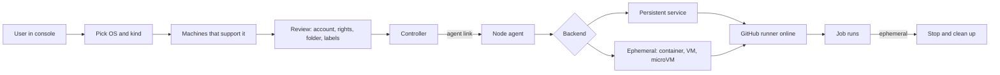
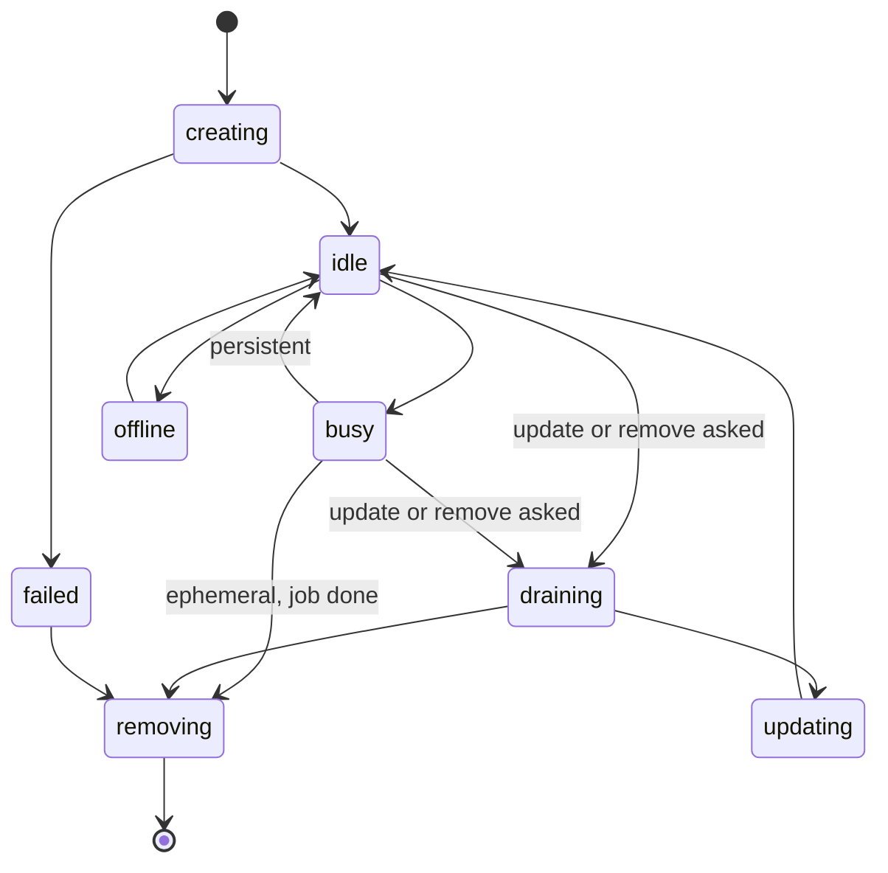
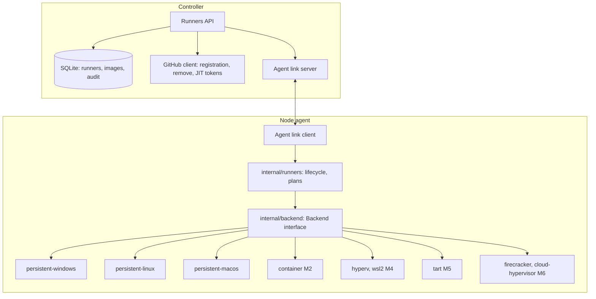

# Runners and isolation backends

**PARTLY BUILT (CRSP22).** The M1 persistent runner backends for Windows, Linux and macOS, the runner rules, the plan and apply flow and the runner API operations are built. Requirements not listed under "Built" in section 5 are **NOT YET IMPLEMENTED**. Each requirement names the milestone that builds it (M1 to M6, from [the product brief](../../overview/product.md#milestones)).

Related: [product brief](../../overview/product.md), [decision 0003, isolation backends](../../architecture/decisions/0003-isolation-backends.md), [decision 0004, agent link](../../architecture/decisions/0004-agent-link.md), [decision 0005, product boundary](../../architecture/decisions/0005-product-boundary.md).

## 1. In one paragraph

A runner is a GitHub Actions self-hosted runner that the product creates, watches and removes on one of the user's machines. The user creates runners in the web console or the CLI, per OS, and only on machines that support that OS and isolation. Milestone 1 builds persistent runners on Windows, Linux and macOS: each runs as an OS service under its own non-admin account (the agent that makes it runs as LocalSystem or root, machines R5.44). Later milestones add ephemeral runners: one fresh container, VM or microVM per job, started with a just-in-time (JIT) config and thrown away after the job. Every kind of runner sits behind one backend interface.

## 2. Why

**Problem.** Runners made by hand drift. They run as a strong account (NETWORK SERVICE or LocalSystem), carry project labels, keep state between jobs and are hard to remove cleanly. The dev-standards runner pool fixed this for one Windows PC with Docker Desktop, at the cost of many failures (the learnings in the product brief). This feature carries that work into the product, for every OS.

**Users.** One person or a small team that runs CI for many repositories on their own machines.

**Goals.**

- Create, update and remove runners from the console, with no manual steps on the machine after the agent is installed.
- Use the best isolation each machine supports, behind one interface (decision 0003).
- Keep each runner's rights as small as the job allows.
- Never cut a running job.

**Non-goals.**

- GitHub-hosted runners.
- Scheduling and the slot queue (the `scheduling` feature). This spec only says when a runner starts and stops.
- Caches and the registry mirror server (milestone 7, the `caching` feature). This spec only says how runners use them.
- Cloud machines.

## 3. How it works



The steps in words:

1. The user opens Runners and chooses Create. They pick the OS and the kind (persistent or ephemeral).
2. The console lists only machines whose agent reports that OS and an allowed backend for that kind. Other machines are shown with the reason they cannot take it.
3. Review shows what will happen on the machine: the account, its rights, the folder, the service, the labels and the runner version. Nothing has changed yet.
4. The controller sends the plan to the agent over the agent link. The agent runs it through the backend.
5. A persistent runner registers once and stays. Its service runs jobs until the user removes or updates it.
6. An ephemeral runner gets a JIT config for one job. It starts, takes one job, and is stopped and cleaned up when the job ends.
7. The agent streams setup logs and runner logs, and reports usage, to the controller.



## 4. Screens and states

No mocks yet. The Runners screen and the Create runner wizard follow design system v1.

- Runners list: one row per runner with machine, OS, backend, isolation, labels, state, current job and age. Rows compare more than three facts, so it is a table (design system UX-25). Age keeps ageing (UX-53).
- Isolation: every row and detail names the isolation, and a persistent runner says it keeps state between jobs (design system UX-61).
- State: each state is a word, a glyph and a colour (design system UX-58), read from one source (UX-19).
- Create runner: a wizard (design system UX-5) that ends with Review, Creating, Done (UX-30). A machine that cannot take the runner is shown disabled with its reason (UX-38).
- Remove runner, remove an image, replace an old runner: the question card names each item that goes, and a busy runner names its job and waits for the drain (design system UX-62, UX-9).
- Empty state: no machine supports the chosen OS. It says why and links to Machines (design system UX-6).
- Busy state: buttons that start work stay busy until the server answers (design system UX-13). A drain shows what it waits for and until when (UX-29).

## 5. Functional requirements

**Wired by CRSP41:** the controller passes the runners service to the API (`cmd/crsp/areas_wiring.go`), so the runner operations answer instead of 501. Records and plans are in memory until the SQL store lands. The controller's own machine runs the persistent backend of its OS. Another machine answers with a reason, because the agent does not carry `AddRunner` and `RemoveRunner` of the agent link yet. A test (`cmd/crsp/wiring_test.go`) builds the controller wiring and fails if a built operation answers 501. **Built by CRSP49:** R5.47, and R5.48 and R5.49 in part (see each). **Built by CRSP38:** R5.46. **Built by CRSP22:** R5.1 to R5.8, R5.10, R5.13 to R5.24, R5.36, R5.37, R6.1 to R6.4 and R6.8 and R5.40 (R5.39 is built by CRSP21 and CRSP26) (their store and agent link adapters are listed in section 11). **Built in part:** R5.5 (the finders are built; the console list that shows `not managed` is not), R5.9 (`Detect` is built; the allow list belongs to `machines`), R5.11 (`StreamLogs` takes a redactor; the secret list is not wired), R5.12 (`ReportUsage` is built; the 15-second sender is not). **Not built:** R5.38, R6.7, R6.9 (CI jobs). Every other requirement is **NOT YET IMPLEMENTED**. "Port" names the dev-standards source (repository `luis-mc/dev-standards`, spec `docs/features/runner-pool/spec.md`, requirement IDs as `DS R5.n`).

### 5.1 Lifecycle from the console

**R5.1** (M1) — **Create per OS, only where supported.** The console and the CLI create a runner from an OS, a kind (persistent or ephemeral) and a machine. The machine choice lists only machines whose agent reports that OS and a backend that is allowed on that machine and supports the kind. The controller refuses any other request with the reason (for example `machine mac-1: no allowed backend for Windows`).

**R5.2** (M1) — **One runner record.** Each runner has: id, name, machine, OS, architecture, kind, backend, isolation (`microVM`, `VM`, `container` or `persistent`), labels, scope (repository, or organization runner group), runner version, state and current job. The record lives in the controller's database.

**R5.3** (M1) — **States.** A runner is in one state: `creating`, `idle`, `busy`, `draining`, `updating`, `offline`, `failed` or `removing`. The agent reports changes; the controller stores them and pushes them to the console.

**R5.4** (M1) — **Remove with a yes and a drain.** Removing a runner lists what goes (the GitHub registration, the service, the account, the folder) and needs a yes (design system UX-62). A busy runner drains first: it takes no new job and is removed when its job ends, and keeps waiting past the machine's drain timeout (machines R5.33), with a warning. The idle check runs right before the removal. Removal from GitHub uses a remove token, never a registration token, and its result is checked (port DS R5.32, DL315).

**R5.5** (M1) — **Find runners already on a machine.** The agent lists existing runners from the OS service list, not only from folders: Windows `Win32_Service` entries named `actions.runner.*` (path gives the folder, `StartName` the account), Linux systemd units `actions.runner.*`, macOS launchd jobs `actions.runner.*`. A runner whose folder the agent cannot read is still reported, and the checks that need admin rights say so (port DS R5.38). The console shows a runner it did not create as `not managed`.

**R5.6** (M1) — **Replace a hand-made runner only after the new one is online.** When a repository already has a self-hosted runner for the same OS that the product did not create, the plan can add steps after the new runner: stop and delete the old service, remove the old runner from GitHub, delete its folder. Each step needs its own yes naming it. A step waits while the new runner is not online, the runner list cannot be read, or the old runner has a job (port DS R5.33).

**R5.7** (M1) — **Isolation is named.** The console, the CLI and the API name each runner's isolation. A persistent runner is marked as keeping state between jobs (design system UX-61).

### 5.2 Backend interface

**R5.8** (M1) — **One interface.** Every backend implements: `Detect` (is it present and usable here), `PrepareImage`, `Start` (with a JIT config, or a registration for a persistent runner), `StreamLogs`, `Stop`, `CleanUp` and `ReportUsage` (decision 0003). The agent calls backends only through this interface.

**R5.9** (M1) — **Detect and allow.** At start and every 10 minutes the agent reports which backends work on the machine and why the others do not (for example `firecracker: no /dev/kvm`). The user allows backends per machine. A backend that is present but not allowed is never used.

**R5.10** (M1) — **Clean up always.** After `Stop`, the agent calls `CleanUp`, also after an error or a timeout. `CleanUp` is safe to call twice. An ephemeral runner leaves no container, VM, overlay disk, network or temp folder behind. A persistent runner's `CleanUp` (on removal) removes the service, the account and the folder.

**R5.11** (M1, redactor and private log Built CRSP47; wiring of `StreamLogs` to the controller stays with the agent link) — **Logs.** `StreamLogs` sends the setup log and the runner's own log lines to the controller as they come. Known secrets (tokens, passwords, JIT configs) are replaced by `***` before they leave the agent.

*Built by CRSP47* (`internal/redact`): one redactor holds every one-time value a backend is given (registration, remove and JIT tokens, with their base64 forms) and also matches the shapes `ghp_`, `github_pat_`, private keys, JWTs, `Authorization:` and `Cookie:` lines, `--token` flags and `ACTIONS_RUNNER_INPUT_*` values. The three persistent backends teach it each value in `Start` before any log line is written, and the controller passes it to every backend (`sys.Deps.Redact`, `sys.Deps.Secret`). A *private log* (`redact.PrivateLog`) is the runner's setup log file: written after redaction, mode `0600` in a `0700` folder, so only the account that owns the runner folder reads it.

**R5.12** (M1) — **Usage.** `ReportUsage` gives, per runner and per job: CPU time, peak and median memory, disk used, and wall time. The agent sends it at least every 15 seconds while a job runs, and once at the end.

### 5.3 Persistent runners on Windows (M1)

**R5.13** (M1) — **A service with its own account.** Each Windows persistent runner is a Windows service that runs as its own local account, never NETWORK SERVICE, LocalSystem or an administrator. The account name is `crsp-<short slug>`: at most 20 characters, lower-case letters, digits and hyphens, the same for the same runner on every run; a name that does not fit or is taken gets a 4-character hash (port DS R5.31, `test_dl310_windows_runner.py` slug tests).

**R5.14** (M1) — **Account rights.** The account is a member of the local group `crsp-runners`, has "log on as a service", and is denied interactive and remote desktop logon. It gets "create symbolic links" (`SeCreateSymbolicLinkPrivilege`) only when the runner's settings ask for it (for example a tool layer that needs symlinks, such as cargo-xwin). A rerun adds or removes the right to match the settings (port DS R5.31, changed: dev-standards gives it to every account).

**R5.15** (M1) — **Password never kept.** The account password is random. It is made inside the process that registers the service, set on the account and passed only to the runner's service registration. It is never in the plan, the database, a log, the output or a file. A rerun makes a new one only when the service is registered again (port DS R5.31).

**R5.16** (M1) — **Folder locked to the account.** The runner folder grants Full control to its account, Administrators and SYSTEM only. Inheritance is off.

**R5.17** (M1) — **PowerShell hooks that call the all-users binary.** The runner `.env` sets `ACTIONS_RUNNER_HOOK_JOB_STARTED` and `ACTIONS_RUNNER_HOOK_JOB_COMPLETED` to `.ps1` files, never `.cmd` (the runner refuses `.cmd`). Each hook calls the `crsp` binary installed for all users (under `Program Files`), never a copy in a user profile. The `.env` also sets `PSExecutionPolicyPreference=RemoteSigned` for the runner's processes only; the machine policy is not changed (port DS R5.31, learnings 4).

**R5.18** (M1) — **No cmd quoting.** The agent registers services and scheduled tasks through the Windows service API or PowerShell cmdlets (`New-Service`, `Register-ScheduledTask`) with each argument passed on its own. It never builds a cmd-quoted command line, because PowerShell 5.1 mangles quotes to native programs (port DS R5.32, learning 5).

**R5.19** (M1) — **Remove the old registration before locking the folder.** When a runner is registered again in place (for example with another account), the agent first removes the old registration with a remove token and checks the exit code. On failure it stops and leaves the old runner and folder as they were. Only after a good removal does it lock the folder to the new account (port DS R5.32, DL315, `test_dl315_runner_remove_token.py`).

**R5.20** (M1) — **Reruns are safe.** A runner whose name, folder, labels, account, rights and `.env` all match is reported `already` and not touched. One with another account is registered again in place (R5.19). One with only a stale `.env` has the file rewritten and the service restarted, without a new password (port DS R5.32).

### 5.4 Persistent runners on Linux (M1)

**R5.21** (M1) — **A systemd unit with its own user.** Each Linux persistent runner is a systemd system unit that runs as its own system user `crsp-<short slug>` (same naming as R5.13). The user has no login shell, no password and no sudo rights, and is in the group `crsp-runners`.

**R5.22** (M1) — **Folder and unit hardening.** The runner folder is owned by its user, mode `0700`. The unit sets `NoNewPrivileges=yes`, `PrivateTmp=yes`, `ProtectSystem=strict` with the runner folder in `ReadWritePaths`, and `Restart=on-failure`. The hooks are `.sh` files that call `/usr/local/bin/crsp`.

### 5.5 Persistent runners on macOS (M1)

**R5.23** (M1) — **A launchd daemon with its own user.** Each macOS persistent runner is a launchd daemon in `/Library/LaunchDaemons` with `UserName` set to its own hidden user `crsp-<short slug>` (no login shell, not an admin, not shown at login). The folder is owned by that user, mode `0700`. The hooks are `.sh` files that call `/usr/local/bin/crsp`.

**R5.24** (M1) — **All three OS together.** Milestone 1 ships R5.13 to R5.23 for Windows, Linux and macOS in the same release. Each OS backend is built only into the binary for that OS.

### 5.6 Ephemeral JIT runners

**R5.25** (M2) — **One runner per job with a JIT config.** For an ephemeral runner the controller asks GitHub for a JIT config for one job and hands it to the agent. The runner takes one job and exits. The JIT config is passed in memory or in a file only the runner can read, and is deleted at start. It is never stored in the database or logged.

**R5.26** (M2) — **Nothing carries over.** After the job, the agent calls `Stop` and `CleanUp` (R5.10). The next job gets a new runner from the image. No state passes between jobs except the shared caches the user turned on.

**R5.27** (M2) — **Containers on Linux and WSL2.** The container backend uses rootless Podman, or Docker when Podman is not there. The job runs as a non-root user. The container never runs with `--privileged` and never gets the Docker socket. When the machine allows KVM for that runner, `/dev/kvm` is passed with `--device` only. Memory and CPU caps come from the machine's load budget.

**R5.28** (M4) — **Hyper-V and WSL2 VMs on Windows.** The Hyper-V backend starts a VM per job from a prepared disk with a differencing disk on top, and deletes the differencing disk after the job. The WSL2 backend starts a Linux microVM or container per job inside WSL2.

**R5.29** (M5) — **Tart VMs on macOS, at most two.** The Tart backend clones a VM per job from a prepared image. The agent never runs more than two macOS VMs on one Mac at once, counting VMs it did not start. A third job waits for a free VM and says why.

**R5.30** (M6) — **MicroVMs with snapshots.** On Linux with KVM, the Firecracker or Cloud Hypervisor backend boots an image once, takes a snapshot, and starts each job from that snapshot. The snapshot is keyed by image, kernel, vCPU count and memory; a change of any of them makes a new snapshot. After a restore the guest clock is set from the host and the guest random pool is reseeded (port DS R5.29).

**R5.31** (M2) — **Best backend first.** When the user does not choose, the agent uses the first allowed backend in the order of decision 0003 for that OS (for Linux with `/dev/kvm`: microVM, then container, then persistent).

### 5.7 Images

**R5.32** (M2) — **Base images with tool layers.** Each OS has a few base images. The user turns tool layers on per pool: build tools, browsers for Playwright, packaging tools, cross-compilers. The layer list of an image is shown with its size (port DS R5.9, R5.11).

**R5.33** (M2) — **Build once per machine, keep the newest few.** An image is keyed by its base, its layers and its pinned versions. A machine builds each key once and reuses it. It keeps the newest 3 images per OS (a setting) and deletes older ones that no runner uses.

**R5.34** (M2) — **Pull through the registry mirror.** When the pool has a registry mirror, image pulls go through it. When the mirror cannot be reached, pulls go to the upstream registry and the console says so once.

**R5.35** (M2) — **Rebuild with drain.** A rebuild builds the new image while the old one keeps serving jobs. Runners switch to the new image only when idle; the idle check runs right before the switch. A build failure keeps the old image and says `the rebuild failed: <reason>` (port DS R5.10, R5.13, R5.15; learning 1).

### 5.10 Runner caches (M1)

**R5.39** (M1) — **Cache folders, quotas and disk guard.** Each persistent runner has its own tool cache and Rust build cache folders under its folder, exported to its jobs as `CI_TOOLS_DIR` and `CARGO_TARGET_DIR`, with the quotas declared in configuration (default 20 GiB and 40 GiB). The job-completed hook evicts the oldest entries over a quota, between jobs only. The job-started gate holds new jobs while the volume has under 10% free, and the doctor reports it. The rules, the defaults and the tests are caches R5.36 to R5.39. Built (CRSP21, CRSP26). Replaces the milestone 7 plan for the cache cap.

### 5.8 Labels

**R5.36** (M1) — **Generic labels only.** A runner carries only `self-hosted`, its OS, its architecture, `docker`, `kvm`, `gpu` and the pool name. Each capability label is added only when the agent has checked it works (for example `kvm` only when `/dev/kvm` is usable by the runner). The controller refuses any other label with the reason (port DS R5.36, R5.37; learning 7).

### 5.9 Runner version

**R5.37** (M1) — **Pinned runner version with SHA-256.** The binary carries one pinned GitHub runner version per OS and architecture, each with its SHA-256. A download whose hash does not match is deleted and refused. A hash that is not 64 hex characters, or is one repeated character, is treated as wrong (port DS R5.14).

**R5.38** (M1) — **Auto-update with drain.** Persistent runners are registered with the runner's own self-update turned off. When a release of the product pins a newer runner version, or GitHub marks the running version as deprecated, the agent updates each runner: it drains it, replaces the runner files, and starts it again. The idle check runs right before the swap. An ephemeral runner uses the new version from its next job.

**R5.40** (M1) — **A missing or broken crsp never hides.** The `.ps1` and `.sh` hooks keep the job going when `crsp` is not installed, cannot start, or cannot be reached (a bad install must not fail CI), but each prints the GitHub Actions annotation `::warning title=crsp::...` on its own line. The text says what failed (`crsp is not installed at <path>` or `crsp at <path> could not run (...)`), that the job ran without the queue and the load gate, and what to do (reinstall crsp for all users on this machine, then run `crsp doctor --check runner.hooks`). The hook also writes the line to `crsp-hook-problem.txt` next to the scripts, which the agent reads into the runner's hook problems for the doctor (doctor R5.14). `CRSP_BIN` overrides the binary path, for tests. The same applies to every OS. Built.

### 5.11 Parity with the old pool (after v0.1.0)

The dev-standards runner pool covered these cases ([handover page](../../architecture/dev-standards-handover.md), section 4). Each requirement below targets a milestone after v0.1.0 and is **NOT YET IMPLEMENTED**. Until this is built, jobs that need it run on GitHub-hosted runners.

**R5.41** (after v0.1.0, NOT YET IMPLEMENTED) — **Linux containers with KVM.** A Linux runner in a container (R5.27) on a machine whose `/dev/kvm` the agent has checked as usable by the runner gets the `kvm` label (R5.36) and the device through `--device /dev/kvm`, never `--privileged`. A test VM boot job (the `vm_check.py` case of the handover page) runs in it. When `/dev/kvm` is missing or not usable the runner has no `kvm` label and the doctor says why (machines R5.53).

**R5.42** (after v0.1.0, NOT YET IMPLEMENTED) — **A Wine prefix per runner.** A Linux runner image that has the `wine` layer gives each runner its own Wine prefix in the runner's own folder, set by `WINEPREFIX`. `TMPDIR` is not set in the runner's job environment, because a set `TMPDIR` breaks Wine's startup. Two runners never share a prefix. A prefix is made on first use and removed with the runner.

**R5.43** (after v0.1.0, NOT YET IMPLEMENTED) — **LLVM and clang-cl for cargo-xwin.** A Linux image layer `llvm` holds a pinned LLVM (SHA-256 checked, R5.37 rule) with `clang-cl`, `lld-link` and `llvm-lib` on the `PATH`, so `cargo-xwin` builds Windows targets. The layer has a self-check that runs `clang-cl --version`. On a Windows runner the symlink right that `cargo-xwin` and Rust tooling need follows R5.14: given only when the machine or label setting asks for it.

**R5.44** (v0.4.0, Built CRSP55: `images/layers/browsers/Dockerfile`, `SelectLayers` and `NeverLower` in `internal/runners/layers.go`, CI job `image`) — **Playwright browsers in the image.** An image layer `browsers` (open question 14) holds the Chromium, Firefox and WebKit builds for one pinned Playwright version and their system packages, at a fixed path set by `PLAYWRIGHT_BROWSERS_PATH` (caches R5.41). The layer's self-check launches each browser headless once. A job that finds the browsers there downloads nothing. The layer is built on top of the base image (`FROM ${BASE_IMAGE}`), its Playwright version is pinned (`PlaywrightPin`) and chosen per pool, and **a rebuild never lowers a pool's Playwright version**: when the pool's current version is higher than the wanted one, the current one is kept (`NeverLower`). A version that is not dotted numbers is refused and nothing changes. CI builds the layer with `docker build` only, no push.

**R5.45** (after v0.1.0, NOT YET IMPLEMENTED) — **Postgres roles per runner.** Where a machine offers a Postgres server to jobs, each runner gets its own role and its own database owned by it, with a random password the agent keeps in the OS secret store and puts only in that runner's job environment. A role cannot connect to another runner's database. The role and database go with the runner when it is removed. No secret is written to a log (R6.2).

Section 5.11 continues with the requirements the [parity plan](../../architecture/parity-plan.md) adds so that crsp runs every job of the old pool (task CRSP39). Each names the release that builds it.

**R5.47** (M2, v0.3.0, Built CRSP49: engine detection and the `Engine` interface, `internal/backend/container/engine.go`) — **Containers run in WSL2 through Docker first.** On a Windows machine the container backend (R5.27) uses the Docker engine of WSL2 through the Windows `docker` CLI first, and `wsl docker` only when that CLI cannot run (machines R5.18). The agent detects the engine, its version and the WSL2 state, and reports the reason when the engine is not usable (R5.9). The backend interface hides the engine, so rootless Podman in a crsp-owned WSL2 distro can replace Docker later with no change to runners. The agent never edits the settings of Docker Desktop.

**R5.48** (M2, v0.3.0, Built in part CRSP49: the image holds a copy of the linux `crsp`; `container.CrspMountArgs` builds the read-only mount; `crsp vm` and `crsp db-env` are stubs that print NOT YET IMPLEMENTED and exit 3, until caches R5.46 and runners R5.54; starting the container with the mount is the pool lifecycle, the next wave) — **The `crsp` binary is inside every container job.** The agent mounts its own binary read-only at `/usr/local/bin/crsp` in each runner container, so a job can call `crsp vm` and `crsp db-env` (caches R5.46, runners R5.54). The version is the agent's. No socket is mounted (R6.1).

**R5.49** (M2, v0.3.0, Built in part CRSP49: `images/linux-base/Dockerfile` and the CI job `image`; the Actions runner and its pinned download are not in the image yet, see open question 10) — **A base image that is like a GitHub-hosted runner.** The Linux base image is an Ubuntu LTS image. It always holds: `git`, `curl`, `ca-certificates`, `python3`, `jq`, `zip`, `unzip`, `xz-utils`, `build-essential`, `pkg-config`, `libatomic1` (pnpm needs it), `postgresql-client`, `libicu`; the GitHub CLI `gh`; the Actions runner and its dependencies; and Node LTS with `corepack`. Every download is pinned and SHA-256 checked (R5.37 rule); a missing or wrong hash fails the build. Node is installed with its `bin` first on `PATH` for every user and before the build step that runs `corepack enable`. `corepack enable` runs once at build time as root, so the `pnpm` and `yarn` shims exist and an unprivileged job needs no write access; the shims pin no version. The job user is not root and has no `sudo`. A self-check at build time runs each tool (`node --version`, `corepack --version`, `gh --version`, the `pnpm` shim, `ldconfig -p` for `libatomic`) and fails the build when one is missing (port DS R5.26, R5.16 and the pool image of runner-pool).

**R5.50** (M2, v0.4.0 to v0.6.0, NOT YET IMPLEMENTED) — **Image layers carry fixed tool lists.** A layer is off until the user turns it on for a pool (R5.32), and a layer turned off in a repository setting is removed from an image only by an explicit drop. The layers and what each adds:
- `windows-packaging` (v0.5.0): `dotnet-sdk-8.0`, `wine`, `wine64`, `xvfb`, `xauth`, `msitools`. It includes the Wine rules of R5.42 and R5.52. About 1 GB.
- `linux-packaging` (v0.5.0): `dpkg-dev`, `rpm`, `make`, `checkpolicy`, `selinux-policy-dev`, `policycoreutils`, `gnupg`, `shellcheck`, `systemd`, `createrepo-c`, and `policycoreutils-python-utils` when the base image has it (a missing one is skipped without a failure).
- `llvm` (v0.5.0): R5.43. `playwright` (v0.4.0): R5.44.
- `kvm` (v0.6.0): `qemu-system-x86`, `qemu-utils`, `cloud-image-utils`, `openssh-client`, plus R5.41.
Each layer has a self-check that runs its main tools. The doctor probes the same tools in the running image (doctor R5.31). A layer name stays the same as the dev-standards name, so a project setting maps one to one (port DS R5.9, R5.11).

**R5.51** (M2, v0.5.0, NOT YET IMPLEMENTED) — **Extra packages per pool.** A pool may list extra distribution packages, one per line. A name has only letters, digits and `+ - .` and does not start with `-`; anything else is refused with the line number and nothing changes. The names are part of the image key (R5.33). A name that was added stays until the user drops it.

**R5.52** (M2, v0.5.0, NOT YET IMPLEMENTED) — **The Wine prefix is made once and kept.** With the `wine` tools in the image, the agent prepares the prefix of a cache lane (caches R5.43) before the first job that uses the lane: `wineboot --init` under `xvfb-run -a`, as the job user, with `WINEDEBUG=-all`, a 180 second timeout and `wineserver -w` after it. It skips a lane whose prefix already holds `system.reg`. A failure is logged and never stops the job from starting. The prefix lives in the lane's cache folder, so it outlives the container. The agent sets `WINEPREFIX` to it and also `POOL_WINE_PREFIX` to the same path, the name that existing workflows copy from, until the dev-standards scripts drop it. `TMPDIR` is unset for every Wine tool (R5.43). Port of DS R5.17 to R5.19.

**R5.53** (M2, v0.3.0, NOT YET IMPLEMENTED) — **The job environment is a contract.** A container job and a persistent runner job get these values and no others from the pool: `CI_TOOLS_DIR` and `CARGO_TARGET_DIR` (caches R5.39, R5.43), `CI_MAX_PARALLEL` (the runner's CPU count, machines R5.54), `PLAYWRIGHT_BROWSERS_PATH` (R5.44, caches R5.41), `WINEPREFIX` and `POOL_WINE_PREFIX` (R5.51), `RUNNER_TOOL_CACHE` kept in the lane (caches R5.43), and the database settings of R5.53. No project name and no pool path is set. The list is in the runner `.env` or the container environment, and the doctor reports a runner that lacks one that its image layers promise.

**R5.54** (M2, v0.4.0, NOT YET IMPLEMENTED) — **Postgres per runner, in detail.** This adds to R5.45. The Postgres server is a container the agent starts (PostgreSQL 16, its data in a named volume, no published port, reachable only on the pool network). Its admin password is made once and kept in the OS secret store. For each repository's runner lane the agent makes: a login role with a random password and a database it owns; `CREATEDB` for that login only when the repository setting `db_createdb` is on (so a test run can make `<base>_w<K>` databases, one per worker); and the repository's declared `NOLOGIN` roles (names are lowercase letters, digits and underscore, at most 63; `postgres`, `public` and `pg_*` are refused, and so is a role another repository declares, with both repositories named), each created behind an exists check and granted to the login `WITH ADMIN OPTION`. A rerun keeps the password, so a running job is not cut off. The job gets `DATABASE_URL`, `PGHOST`, `PGPORT`, `PGUSER`, `PGPASSWORD` and `PGDATABASE` through the step `crsp db-env`, which masks the secrets and appends the lines to `GITHUB_ENV`; outside a pool job it prints that it does nothing and exits 0 (port of `pool-db-env`, DS R5.27).

**R5.55** (M2, v0.6.0, NOT YET IMPLEMENTED) — **A VM counts against the runner's memory.** A job that boots a guest VM (caches R5.46) uses memory of the runner's cap. `crsp vm` prints a warning when the cap has less than the guest memory plus 1 GiB free, and the machine load budget (scheduling R5.40) already counts the guest because it is a process on the machine. A runner with the `kvm` label is sized for its guests (machines R5.54).

**R5.56** (M1, v0.2.0, Built CRSP47) — **A tool home per persistent runner.** The `.env` of each persistent runner sets `RUSTUP_HOME` and `CARGO_HOME` to folders under its own runner folder (`<runner folder>/cache/tools/rustup` and `.../cargo`), so two runner accounts never share a toolchain and a toolchain follows the runner when it is removed. They count in the tool cache quota (caches R5.36). On Windows the account needs no other setting for them. Port of DS R5.31 (`.env`).

**R5.57** (M1) — **A light runner per repository and OS.** (Lesson 22 of the old pool; scheduling R5.65.) For each repository with the pool on and the policy setting `light_runner` on, crsp keeps one persistent runner for each OS the repository serves, in the repository's own scope. Its name is `crsp-light-<repository>-<os>` (the job gate reads the prefix `crsp-light-` to give its jobs a light slot only), and it carries the generic labels `self-hosted`, the OS, the architecture and the extra generic label `crsp-light`. It is placed on an online, active machine of that OS with light slots above 0 that has an allowed backend; of several, the one with the fewest light runners for its light slots. Only the controller's own machine can host one until the runner messages of the agent link are built. When no machine fits, no runner is made, the reason is audited and the doctor shows it (`repo.light`); the next reconcile tries again. The runner is added with the same registration, token and account rules as any runner (R5.1, R6.2). Removing it (setting off, pool off) is an ordinary removal: it waits for the runner's own job, then deregisters it with a remove token (R5.4). Built (CRSP44).
**R5.58** (M1, Built OPS3) — **An account switch resets the runner folder.** When the service account of a Windows runner changes (for example from NETWORK SERVICE to its own account), the files in its `_work` tool cache keep the old owner and explicit entries, and every job that runs a tool from it fails with "Access is denied" (handover lesson 23). After the account exists and before the folder is locked (R5.16), the backend runs `takeown /F <folder> /R /D Y`, `icacls <folder> /setowner <account> /T /C` and `icacls <folder> /reset /T /C`, as fixed programs through the command runner, with the call's context. Each exit code is checked and each step is logged; a step that fails stops the change with the step and the reason, and the folder is not locked and the service is not registered. Linux already gives the folder to the account with `chown -R` before registration (R5.21); macOS needs no step. The doctor reports the same fault (doctor R5.35). Built (OPS3).

### 5.12 Supervising the listener (M1)

**R5.46** (M1) — **Supervise the listener, not its wrapper.** (Lesson 19 of the old pool.) GitHub allows one session per registered runner and refuses a second listener with "a session for this runner already exists". The process that holds the session is `Runner.Listener`, not the service wrapper around it (the systemd unit and `runsvc.sh`, the launchd daemon, the Windows service and `RunnerService.exe`). crsp therefore tracks the listener: after it stops a runner (a stop, a restart for a rewritten `.env`, the stop before a re-registration or a deregistration) it waits until no `Runner.Listener` that runs from the runner folder is alive, and it starts the service again only then. A listener that outlives its service for 30 seconds ends the step with an error that names the process ids, and no second listener is started; an unreadable process list is the same refusal, never a guess. The same rule holds on Linux (`pgrep` against `<folder>/bin/Runner.Listener`), macOS (the same, with `launchctl bootout` and `bootstrap`, not `kickstart -k`, so a restart never leaves two) and Windows (`Get-Process Runner.Listener` by its path). crsp never starts a listener of its own and never kills one, so a running job is never cut. The doctor checks the result (`runner.listener`, doctor R5.30). Built (CRSP38).

## 6. Non-functional requirements

All **NOT YET IMPLEMENTED**.

**R6.1** (M1) — **No privileged containers, KVM as a device.** No backend ever starts a container with `--privileged`, a host PID or network namespace, or the Docker or Podman socket mounted. KVM is passed only as `--device /dev/kvm`.

**R6.2** (M1) — **No secret is kept.** Registration tokens, remove tokens, JIT configs and account passwords are fetched or made when needed and dropped after use. None is written to the database, a log, a plan, the API output or the console.

**R6.3** (M1) — **Least rights.** The agent's admin work (making accounts, services, groups) runs in one install-time helper the user approves. Runner accounts are never administrators. A persistent runner's account can write only its own folder and the shared tool cache.

**R6.4** (M1) — **Never cut a running job.** Any change that stops a runner (remove, update, image switch, backend change) drains first and checks for an idle runner right before it acts, not earlier. The drain timeout is one setting per machine (default 60 minutes, machines R5.33). When it passes the change keeps waiting and warns "still draining, N jobs running, waited X"; it never stops the job.

**R6.5** (M2) — **Start times.** With a warm image, an ephemeral container runner is online in GitHub within 15 s of the job being assigned (median over 20 starts). A microVM from a snapshot is online within 5 s (M6).

**R6.6** (M5) — **Hard limit of two macOS VMs.** The two-VM limit per Mac (R5.29) cannot be raised by a setting.

**R6.7** (M1) — **Logs kept for a while.** Runner setup logs are kept for 14 days or 200 MB per machine, whichever comes first. Usage figures are kept for 90 days.

**R6.8** (M1) — **Audit.** Every create, update, remove and adopt of a runner writes an audit entry: who, what, when, which machine.

**R6.9** (M1) — **Tested on the real OS.** Each OS backend has build-tagged tests that run on that OS in CI. A Windows hook is tested as the service account runs it (product brief rule "Test as the real caller").

## 7. Design



**Packages (planned).**

- `internal/runners`: the runner record, states, plans (each step with its yes, deletions named), drain and the idle check, label rules, runner version pins.
- `internal/backend`: the `Backend` interface and one sub-package per backend. Windows, Linux and macOS code sits behind build tags.

**Interface (sketch, Go).**

```go
type Backend interface {
    Name() string
    Detect(ctx context.Context) (Support, error)
    PrepareImage(ctx context.Context, spec ImageSpec) (ImageRef, error)
    Start(ctx context.Context, r RunnerSpec, cfg StartConfig) (Handle, error) // JIT config or registration
    StreamLogs(ctx context.Context, h Handle, out chan<- LogLine) error
    Stop(ctx context.Context, h Handle) error
    CleanUp(ctx context.Context, h Handle) error // idempotent
    ReportUsage(ctx context.Context, h Handle) (Usage, error)
}
```

**Data (planned tables).** `runners` (the R5.2 record), `runner_events` (state changes), `images` (key, OS, layers, size, machine, last used), `runner_usage` (per job). Tokens and passwords have no column.

**Agent link.** The controller sends plans and tokens to the agent over the agent link (decision 0004). A token travels once, for one step.

## 8. Failure modes

| Dependency or failure | Behaviour | Why |
|---|---|---|
| GitHub API cannot be reached | Fail closed: no create, no remove; running runners keep running | A half-made registration is worse than a wait. |
| Remove token step fails | Fail closed: stop, keep the old runner and folder (R5.19) | A failed removal must leave a working runner. |
| Runner list cannot be read | Fail closed: no replace, no drain-based change (R5.6, R6.4) | Without the list the agent cannot know a job is running. |
| Image build fails | Keep the old image; runners keep working (R5.35) | Never break the working path. |
| Registry mirror down | Fail open: pull from upstream, say so once (R5.34) | The mirror is a speed-up, not a dependency. |
| Agent loses the controller | Persistent runners keep running jobs; no new ephemeral runner starts | GitHub assigns jobs to persistent runners directly. |
| Backend `CleanUp` fails | Retry at the next agent start; report the leftover in the doctor | Leftovers fill the disk. |
| Third macOS VM asked | Wait (R5.29) | Apple's licence. |
| Runner download hash differs | Fail closed: delete the file, refuse (R5.37) | A wrong binary runs with the runner's rights. |

## 9. How it is proven

Rows that name a test file are built and run in CI; rows that say `planned:` are not built yet. Ported tests name their dev-standards source.

| Requirement | Test |
|---|---|
| R5.1 | internal/runners/service_test.go TestCreateOnlyOnSupportingMachine; internal/api/handlers_runners_test.go TestPlanRefusalCarriesReason |
| R5.2 | internal/runners/service_test.go TestRunnerRecordFields |
| R5.3 | internal/runners/runners_test.go TestStateTransitions |
| R5.4 | internal/runners/service_test.go TestRemoveDrainsAndUsesRemoveToken, TestRemoveFailureKeepsRunner; internal/api/handlers_runners_test.go TestDeleteNeedsConfirmation |
| R5.5 | internal/backend/windows/windows_test.go TestFindFromServiceList, TestFindReportsUnreadableFolder (port of test_dl318_doctor_locked_runner.py); internal/backend/linux/linux_test.go TestFindFromUnitList; internal/backend/macos/macos_test.go TestFindFromLaunchd; internal/runners/service_test.go TestReportFoundStoresNotManaged |
| R5.6 | internal/runners/service_test.go TestReplaceOnlyAfterNewOnline, TestReplaceWithoutYesChangesNothing, TestReplaceRemovalFailureStops |
| R5.7 | internal/api/handlers_runners_test.go TestIsolationInResponse |
| R5.8 | internal/backend/registry/registry_test.go TestEveryBackendImplementsInterface |
| R5.9 | planned: internal/backend/detect_test.go TestDetectReportsReasons; TestNotAllowedNeverUsed |
| R5.10 | internal/backend/windows/windows_test.go TestCleanUpTwice; internal/backend/linux/linux_test.go TestCleanUpTwice; internal/backend/macos/macos_test.go TestCleanUpTwice; internal/runners/localagent_test.go TestLocalAgentRemoveOrder |
| R5.11 | internal/redact/redact_test.go TestSecretsRedacted, TestPrivateLogOwnerOnlyAndRedacted; internal/backend/linux/linux_test.go TestSecretsRedacted (CRSP47) |
| R5.12 | planned: internal/backend/usage_test.go TestUsageInterval |
| R5.13 | internal/runners/runners_test.go TestAccountName (port of the slug tests of test_dl310_windows_runner.py) |
| R5.14 | internal/backend/windows/windows_test.go TestAccountRights, TestSymlinkRightOnlyWhenAsked, TestSymlinkChangeUpdatesRightOnly |
| R5.15 | internal/backend/windows/windows_test.go TestNoPasswordInPlanOrLog (port of test_plan_holds_no_password_and_no_token) |
| R5.16 | internal/backend/windows/windows_test.go TestFolderAcl (port of test_folder_rights) |
| R5.17 | internal/backend/windows/windows_test.go TestPs1HooksCallAllUsersBinary (port of test_no_cmd_hook_and_no_second_machine_folder) |
| R5.18 | internal/backend/windows/windows_test.go TestNoCmdQuotedCommandLine |
| R5.19 | internal/backend/windows/windows_test.go TestRemoveBeforeLock, TestRemoveFailureStops (port of test_dl315_runner_remove_token.py); internal/backend/linux/linux_test.go and internal/backend/macos/macos_test.go TestReregisterRemovesFirstAndStopsOnFailure |
| R5.20 | internal/backend/persistent/persistent_test.go TestDecide; internal/backend/windows/windows_test.go TestRerunAlready, TestStaleEnvOnlyRewrites (port of the test_dl310 rerun tests) |
| R5.21 | internal/backend/linux/linux_test.go TestUnitUserAndGroup |
| R5.22 | internal/backend/linux/linux_test.go TestUnitHardeningAndFolderMode |
| R5.23 | internal/backend/macos/macos_test.go TestDaemonPlistUserAndFolder, TestHiddenUser |
| R5.24 | internal/backend/registry/registry_test.go TestRegistryHoldsOnlyThisOS; build-tagged files internal/backend/registry/registry_{windows,linux,darwin}.go (the CI matrix job is not added) |
| R5.25 | planned: internal/runners/jit_test.go TestJitConfigNotStored |
| R5.26 | planned: internal/backend/container/container_test.go TestNothingCarriesOver |
| R5.27 | planned: internal/backend/container/container_test.go TestNoPrivilegedNoSocketKvmDevice |
| R5.28 | planned: internal/backend/hyperv/hyperv_test.go TestDifferencingDiskDeleted; internal/backend/wsl2/wsl2_test.go |
| R5.29 | planned: internal/backend/tart/tart_test.go TestAtMostTwoVms |
| R5.30 | planned: internal/backend/microvm/snapshot_test.go TestSnapshotKeyAndRestore (port of test_dl281_vm_check.py) |
| R5.31 | planned: internal/backend/choose_test.go TestBestBackendFirst |
| R5.32 | planned: internal/runners/images_test.go TestLayersListed |
| R5.33 | planned: internal/runners/images_test.go TestBuildOnceKeepNewest |
| R5.34 | planned: internal/runners/images_test.go TestMirrorFallback |
| R5.35 | planned: internal/runners/images_test.go TestRebuildDrainsAndKeepsOldOnFailure (port of test_dl289_refresh_drain.py) |
| R5.36 | internal/runners/runners_test.go TestGenericLabelsOnly (port of test_dl316_windows_only_generic.py); internal/runners/service_test.go TestPlanRefusesProjectLabels |
| R5.37 | internal/runners/runners_test.go TestPinnedHash, TestValidSHA256 (port of the test_dl310 pin tests and test_dl165_pool_refresh_hash_result.py); internal/backend/windows/windows_test.go TestWrongHashRefused; linux and macos TestWrongHashRefused |
| R5.38 | planned: internal/runners/update_test.go TestUpdateDrainsThenSwaps |
| R5.39 | internal/runners/service_test.go TestAddPassesCacheQuotaToTheAgent; internal/backend/linux/linux_test.go and internal/backend/windows/windows_test.go (the runner env file holds CI_TOOLS_DIR); internal/runnercache/runnercache_test.go and internal/hooks/hooks_test.go (quota, eviction, disk guard: caches R5.36 to R5.38) |
| R5.40 | packaging/hooks/hooks_test.go TestShHookWarnsWhenCrspIsMissing, TestShHookWarnsWhenCrspCannotRun, TestShHookPassesCrspExitCodeAndStaysQuiet, TestPs1HookWarnsWhenCrspIsMissing |
| R5.41 | planned: internal/backend/linux/kvm_test.go TestKVMDeviceOnlyAndLabelNeedsUsable |
| R5.42 | planned: internal/backend/linux/wine_test.go TestPrefixPerRunnerAndTmpdirUnset |
| R5.43 | planned: internal/runners/images_test.go TestLLVMLayerSelfCheckAndPinnedHash; internal/backend/windows/symlink_test.go TestSymlinkRightOnlyWhenAsked |
| R5.44 | Built: internal/runners/layers_test.go TestPlaywrightLayerSelfCheck, TestSelectLayersOffUntilTurnedOn, TestSelectLayersRefusesUnknown, TestNeverLowerPlaywright, TestRebuildKeepsHigherPlaywright (fakes, no Docker); CI job `image` builds the layer |
| R5.45 | planned: internal/runners/postgres_test.go TestRolePerRunnerIsolatedAndRemoved |
| R5.46 | `internal/backend/persistent/listener_test.go` TestWaitNoListenerReturnsWhenTheListenerEnds, TestWaitNoListenerRefusesWhileAListenerLives, TestWaitNoListenerDoesNotGuess; `internal/backend/linux/linux_test.go` TestRestartNeverStartsASecondListener, TestStopWaitsForTheListenerNotTheUnit; `internal/backend/macos/macos_test.go` TestRestartNeverStartsASecondListener; `internal/backend/windows/windows_test.go` TestRestartNeverStartsASecondListener | new, from the 14 Nov runs of the old pool |
| R5.47 | internal/backend/container/engine_test.go TestWindowsCLIFirstThenWsl, TestWindowsCLIInstalledButEngineDownFallsBackToWsl, TestWindowsNothingUsableSaysWhy, TestWindowsWslWithoutDocker, TestLinuxNeverCallsWsl, TestDetectNeverEditsEngineSettings |
| R5.48 | internal/backend/container/mounts_test.go TestCrspMountedReadOnlyNoSocket; internal/jobcmd/jobcmd_test.go TestStubsSayNotYetImplementedAndFail; internal/runners/images_test.go TestBaseImageToolListAndSelfCheck (the copy); CI job `image` runs `crsp version` in the built image |
| R5.49 | internal/runners/images_test.go TestBaseImageToolListAndSelfCheck (port of test_dl215_pool_node.py, test_dl223_pool_path_order.py); CI job `image` of `.github/workflows/ci.yml` (docker build, no push, then a run of the tools) |
| R5.50 | planned: internal/runners/images_test.go TestLayerToolLists, TestLayerSelfChecks (v0.4.0 to v0.6.0; port of test_dl149_pool_layers.py, test_dl274_kvm_layers.py) |
| R5.51 | planned: internal/runners/images_test.go TestExtraPackageNamesChecked (v0.5.0) |
| R5.52 | planned: internal/backend/container/wine_test.go TestPrefixOnceAndKept (v0.5.0; port of test_dl179_wine_prefix.py) |
| R5.53 | planned: internal/backend/container/env_test.go TestJobEnvironmentContract (v0.3.0) |
| R5.54 | planned: internal/runners/postgres_test.go TestCreatedbOptInAndDeclaredRoles, TestRerunKeepsPassword, TestDbEnvMasksSecrets (v0.4.0; port of the roles part of test_runner_pool.py) |
| R5.55 | planned: internal/vmcheck/memory_test.go TestWarnsWhenCapIsShort (v0.6.0) |
| R5.56 | internal/backend/windows/windows_test.go TestToolHomesPerRunner; internal/backend/linux/linux_test.go TestToolHomesPerRunner (CRSP47) |
| R5.57 | `internal/runners/light_test.go` TestLightNamePrefixMatchesGate, TestEnsureLightPlacesOneRunnerPerOS, TestEnsureLightSaysWhyNot, TestRemoveLightDrainsEachRunner |
| R5.58 | internal/backend/windows/windows_test.go TestAccountSwitchResetsFolderACL, TestACLResetFailureStopsBeforeLock |
| R6.1 | no backend in M1 starts a container; nothing to test until M2 |
| R6.2 | internal/runners/service_test.go TestNoTokenOrPasswordStoredOrLogged; internal/backend/linux/linux_test.go TestTokenOnlyInEnvAndUpdateOff |
| R6.3 | internal/backend/windows/windows_test.go TestAccountRights (never in Administrators); internal/backend/linux/linux_test.go TestUnitUserAndGroup; internal/backend/macos/macos_test.go TestHiddenUser |
| R6.4 | internal/runners/runners_test.go TestIdleCheckRightBeforeAct, TestTimeoutWarnsNeverKills, TestDrainFailsClosed; internal/runners/service_test.go TestRemoveFailsClosedAndTimeoutAsks |
| R6.5 | planned: internal/backend/container/perf_test.go TestStartTime (M2); microvm perf_test.go (M6) |
| R6.6 | planned: internal/backend/tart/tart_test.go TestLimitNotConfigurable |
| R6.7 | planned: internal/runners/retention_test.go TestLogAndUsageRetention |
| R6.8 | internal/runners/service_test.go TestAuditEntries |
| R6.9 | planned: CI job runners-windows-service runs hooks as the service account; build tags checked in internal/backend |

## 10. Decisions

| ID | Question | Chosen | Date |
|---|---|---|---|
| RN-1 | Isolation model | Backend plugins behind one interface, chosen per machine and label (decision 0003) | 2026-11-13 |
| RN-2 | What milestone 1 builds | Persistent runners on Windows, Linux and macOS together | 2026-11-14 |
| RN-3 | Where runners are created | From the web console (and CLI), per OS, only on machines that support it | 2026-11-14 |
| RN-4 | Windows runner account | Own local non-admin account; log on as a service; interactive logon denied; folder locked to it | 2026-11-13 |
| RN-5 | Labels | Generic only; workflows target runners by `RUNS_ON_*` repository variables | 2026-11-14 |
| RN-6 | Containers | Never privileged; KVM as a device | 2026-11-13 |
| RN-7 | Tart limit | At most two macOS VMs per Mac, enforced | 2026-11-13 |

Open questions for the owner (proposed answers are in the requirements until decided):

0. R5.11 (CRSP47): the spec does not define "private logs" beyond redaction. The conservative reading is built: setup logs are owner-only files (`0600`), redacted first. Alternatives: (a) also keep logs in memory only and send them to the controller, never to disk; (b) let the console show a runner's log to admins only, even after redaction (observability R6.4 already limits logs to admins). Which one?
0b. R5.11: the mask is `***` here and `[redacted:<kind>]` in observability R6.5. `***` is built, as this spec says. Confirm one form for both.
0c. R5.56 (CRSP47): the tool homes are set for every persistent runner (Windows, Linux, macOS), not Windows only, because the spec says "each persistent runner". They sit inside `cache/tools`, so the tool cache quota counts them. Alternative: a separate folder with its own quota.
1. R5.14: the symlink right only when asked (brief), while dev-standards gives it to every account (DL319). Confirm "only when asked".
2. R5.13, R5.21, R5.23: account prefix `crsp-` and group `crsp-runners` are built (`internal/runners/account.go`). Confirm names.
3. R5.33: keep the newest 3 images per OS. Confirm the default.
4. R6.4: drain timeout default 60 minutes, one per machine. Decided by the owner (2026-11-14).
5. R6.7: log retention 14 days or 200 MB per machine; usage 90 days. Confirm.
6. R5.5: should the product offer to adopt a hand-made runner, or only replace it (R5.6)?
7. R5.21: Linux runners as systemd system units (admin needed at install). Confirm against user units.
8. R5.25: JIT configs per job through the runner scale set client (`actions/scaleset`), or the plain `generate-jitconfig` API? The proposal is scale sets.
9. R6.5: start-time budgets (15 s container, 5 s microVM). Confirm.
10. R5.49 (CRSP49): the Actions runner is not in the base image yet. Proposed: the pool lifecycle (next wave) installs the pinned runner of R5.37 into the image by a second layer. Alternative: bake it into the base Dockerfile with the same hash check.
11. R5.49 (CRSP49): Node. The newest LTS on nodejs.org (v26.13.1) has no `corepack` in its tarball, so the image installs `corepack` 0.36.0 from a SHA-256 checked npm tarball and runs `corepack enable`. Alternative: pin an older LTS that still ships corepack.
12. R5.49 (CRSP49): `gh` is pinned at 2.83.0 (the version whose checksums could be read when the image was written). Confirm, or name a newer version and hash.
13. R5.49 (CRSP49): the job user is `runner`, uid 1001. Confirm the name and id.
14. R5.44 (CRSP55): the layer is named `browsers` (the task brief and the cache folder of caches R5.43) while R5.50 and dev-standards name it `playwright`. `browsers` is built; renaming is one constant. Confirm the name.
15. R5.44 (CRSP55): the pinned Playwright version is 1.56.1, taken as a recent release; the build installs it from npm without a hash because `playwright-core` fetches its browsers itself. Alternative: pin a hash per browser download. Confirm the version and whether a hash is wanted.
16. R5.44 (CRSP55): parity plan row 30 says a per-repository pool needs no merge of layers across repositories. The never-lower rule is built for a rebuild of one pool only. Confirm that is enough.

## 11. Not built yet

Built by CRSP22: the three persistent backends, the runner rules, plan and apply, and the runner API operations. Still to do in M1: the store adapter for `runners.Store` (the tables exist; CRSP18 owns `internal/store`), the agent link adapter for `runners.Agent` (CRSP20; `runners.LocalAgent` already runs each call on a machine), the GitHub adapter and scope resolver (CRSP19), the secret redactor for logs (R5.11), the 15-second usage sender (R5.12), auto-update (R5.38), log and usage retention (R6.7), the `crsp hook` command the hooks call (CLI), the CI matrix jobs (R5.24, R6.9) and the Runners screen. The scripts that create accounts, folders ACLs and services were written without a Windows, Linux or macOS machine to run them on; the first real run is the CI matrix job. The seams that change:

- M1: `internal/runners` and `internal/backend` with the three persistent backends; Runners screen; runner API in `packages/contract/openapi.yaml`; agent link messages in `packages/contract/proto`.
- M2: container backend, JIT flow, images and layers.
- M4: Hyper-V and WSL2 VM backends.
- M5: Tart backend.
- M6: Firecracker and Cloud Hypervisor backends with snapshots.
- M7: the registry mirror server that R5.34 uses.
- After v0.1.0: the parity requirements R5.41 to R5.56 (Linux containers with KVM, Wine prefix, LLVM, Playwright browsers, Postgres roles, the WSL2 engine, the base image, layers, the job environment). The release order is in the [parity plan](../../architecture/parity-plan.md).

## 12. Code map

- `internal/runners/`: labels (`labels.go`), pinned versions and SHA-256 (`version.go`), account names (`account.go`), states (`state.go`), drain and idle check (`drain.go`), plans, apply, replace, remove and found runners (`service.go`, `types.go`), the agent-side executor (`localagent.go`).
- `internal/backend/`: the `Backend` interface (`backend.go`), the optional `Finder` and `Deregisterer` (`ext.go`).
- `internal/backend/sys/`: the command, file and download seams, with fakes in `sys/sysfake`.
- `internal/backend/persistent/`: shared .env, meta file, rerun decision, pinned download.
- `internal/runnercache/`: the per-runner cache quota, eviction, disk guard and cache environment (R5.39).
- `internal/backend/windows/`, `linux/`, `macos/`: one persistent backend each. `registry/` holds the build-tagged files that put one of them in each binary.
- `internal/api/handlers_runners.go`: the runner operations of `packages/contract/openapi.yaml`.
- `internal/backend/container/`: the `Engine` interface and the Docker engine (R5.47), the crsp mount (R5.48).
- `internal/jobcmd/`: the `crsp vm` and `crsp db-env` stubs (R5.48).
- `images/linux-base/Dockerfile`: the Linux base job image (R5.49).
- `packaging/hooks/`: the .ps1 and .sh hook scripts.

Source: internal/runners/service.go, internal/backend/windows/windows.go, internal/backend/linux/linux.go, internal/backend/macos/macos.go, internal/api/handlers_runners.go

## Versions
