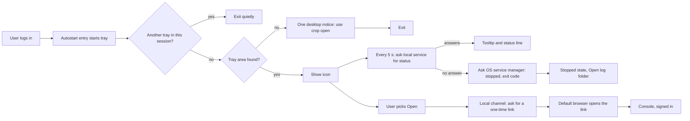
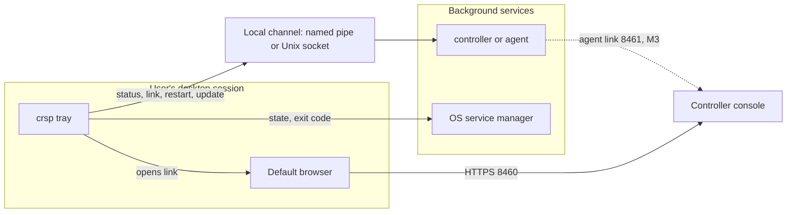

# Tray

PARTLY BUILT (CRSP26). The tray side of M1 is built: menu, status, Open, stopped state, log folder, autostart, single instance, Linux tray-host probe, `crsp tray --smoke`, CI smoke. NOT YET IMPLEMENTED: the service side of the local channel (R5.8, R6.8), the one-time link endpoint and bindings (R5.7, R5.9, R6.1), the installer rule (R5.22), the idle-resource check (R6.4) and the content-words guard (R6.7). Everything marked (M3) and (M8) is planned.

## 1. In one paragraph

The tray is a small icon on each desktop machine in the pool. It shows whether the local service is fine, how many jobs run and wait, and why the service stopped if it did. **Open** starts the web console in the browser, already signed in, through a one-time link. Later, the tray also restarts and updates the service, after it names the jobs that would stop and the user says yes, and it shows notices such as "machine offline". The tray is the `tray` mode of the one `crsp` binary (decision [0001](../../architecture/decisions/0001-stack.md)). Headless Linux has no tray; `crsp open` prints the same one-time link (decision [0005](../../architecture/decisions/0005-product-boundary.md)).

## 2. Why

**Problem.** The controller and the agent run as background services. A service cannot draw anything on the desktop. The user still needs a quick way to see if the pool on this machine works, and to reach the console without typing a URL and signing in again.

**Users.** The person who sits at a machine in the pool: the owner, or an admin on their own computer.

**Goals.**

- One click from the desktop to the signed-in console.
- The state of the local service at a glance, in words, not only a colour.
- When the service has stopped, say so, say why (exit code), and open the log folder.
- Restart and update never cut a running job without a yes.
- Works the same way on Windows, macOS and Linux desktops.

**Non-goals.**

- The tray is not a second console. Settings, machines, runners and jobs live in the web console only.
- The tray never runs runners or jobs, and holds no secret.
- No tray on headless machines; the CLI covers them.

### Milestones

| Milestone | What the tray does |
|---|---|
| M1 (one machine, persistent runners) | Open, status in the tooltip and the menu, service-stopped state with exit code, Open log folder, Quit, autostart, single instance, GNOME fallback, CI smoke on Windows, Linux and macOS. Runs on the controller's machine. `crsp open` on headless Linux. |
| M3 (more machines, agent auto-update) | Open and status on agent-only machines. Restart and Update with drain. |
| M8 (product polish) | Notices. |

## 3. How it works

The steps in words:

1. The user logs in to the desktop. The per-user autostart entry starts `crsp tray`.
2. If a tray already runs in this logon session, the new one exits at once.
3. On Linux, if the desktop has no tray area (stock GNOME without the AppIndicator extension), the tray shows one desktop notice that points to `crsp open`, then exits.
4. The tray shows its icon. Every 5 seconds it asks the local service for its status over a local channel that only this machine can reach.
5. If the service answers, the tooltip and the first menu line show the state and the job counts.
6. If the service does not answer, the tray asks the OS service manager. It shows that the service stopped, when, and its exit code, and offers Open log folder.
7. When the user picks **Open**, the tray asks the service for a one-time sign-in link over the local channel. It opens that link in the default browser. The console signs the user in and drops the link.
8. Later milestones: **Restart** and **Update** open the console at a Review step that names the running jobs; nothing happens without a yes. Notices pop up once per change; a click opens the console at that notice.

## 4. Screens and states

The tray has an icon, a tooltip and one menu. It has no window of its own. Status words follow UX-58; the state is always a word and a glyph, never a colour alone (UX-17, UX-26). Times follow UX-18. Words not yet in `docs/design-system/v1/content.md` are listed in section 11 for the owner to add.

**Menu (M1).**

| Item | Kind | Notes |
|---|---|---|
| Status line, for example `✓ ok · 2 running · 1 waiting` | Text, not pressable | Same text as the tooltip. |
| Open | Action | Opens the console, signed in. Word from content.md. |
| Open log folder | Action | Opens the service's log folder in the file manager. |
| Start at login | Switch with a tick | Turns the autostart entry on or off. On by default. |
| Quit | Action | Closes the tray only. The service keeps running. |

**Menu (later).** Restart (M3), Update to `<version>` (M3, shown only when an update exists), and a Notices item with a count (M8).

**States.**

| State | Icon glyph | Tooltip text (example) |
|---|---|---|
| Healthy | `✓` | `crsp: ✓ ok · 2 running · 1 waiting` |
| Waiting (jobs wait over the limit, or load is over budget) | `◷` | `crsp: ◷ waiting · 0 running · 4 waiting` |
| Failed (service runs and reports a fault) | `✕` | `crsp: ✕ failed · GitHub not reachable` |
| Stopped | `✕` | `crsp: ✕ stopped at 14:30 · exit code 3` |
| Starting (no answer yet) | `▶` | `crsp: ▶ starting` |

- Empty: no runners yet reads `✓ ok · no runners yet`, and Open leads to the console's first-run wizard (UX-6).
- Waiting: the tray never blocks on the service; a slow answer keeps the last state for up to 15 s, then shows Starting or Stopped.
- Error: Open that fails shows one desktop notice in the Problem tone: what failed, why, what next (UX-26).

**Confirmation for Restart and Update (M3).** The tray does not draw its own question. It opens the console at a Review step through a one-time link. The Review step names each running job on this machine and says "Nothing has changed yet." (UX-30, UX-62). The question card follows UX-9.

## 5. Functional requirements

### Menu and status

**R5.1** — The tray menu MUST hold, in this order: the status line, Open, Open log folder, Start at login, Quit. (M1)

**R5.2** — The status line and the tooltip MUST show the same text: product name, state word with its UX-58 glyph, running job count and waiting job count. A stopped service shows the stop time and exit code instead of counts. (M1)

**R5.3** — The tray MUST ask the local service for status every 5 seconds and update the icon, tooltip and status line within 10 seconds of a change. (M1)

**R5.4** — The icon MUST differ per state by shape (glyph), not by colour alone. (M1)

**R5.5** — Quit MUST close only the tray. It MUST NOT stop the service or any job. (M1)

### Open and the one-time sign-in link

**R5.6** — Open MUST ask the local service, over the local channel (R5.8), for a one-time sign-in link and open it in the default browser. (M1)

**R5.7** — The console MUST sign the user in from a one-time link, then redirect to a URL without the link's code. A used, expired or unknown code MUST show the normal sign-in page with a Problem message that says the link expired and offers sign-in with GitHub (UX-6). (M1)

**R5.8** — The local channel MUST be a named pipe on Windows and a Unix socket on Linux and macOS. It MUST refuse callers from other machines, and MUST read the calling OS user from the OS (pipe client identity or peer credentials), never from the request. (M1)

**R5.9** — A one-time link MUST sign in as the GitHub user bound to the calling OS user on this machine. When the OS user is not bound yet, Open MUST open the console's sign-in with GitHub and, after sign-in, bind that GitHub user to this machine and OS user. The console MUST list these bindings and let the owner remove one. (M1; see open question 1)

**R5.10** — `crsp open` MUST print a one-time sign-in link to standard output, made the same way as R5.6, and open it in a browser when one is available. On headless Linux it only prints. (M1)

**R5.11** — On a machine that runs only the agent, the agent MUST ask the controller for the one-time link over the agent link, and the link MUST point to the controller's console URL. (M3)

### Service stopped

**R5.12** — When the service does not answer, the tray MUST read the service state from the OS service manager (Windows service control manager, macOS launchd, Linux systemd) and show Stopped with the stop time and exit code. (M1)

**R5.13** — Open log folder MUST open the folder that holds the service's logs, in the OS file manager, whether the service runs or not. (M1)

**R5.14** — While the service is stopped, Open MUST show a Problem notice that says the service stopped, its exit code, and that the log folder has the reason; it MUST NOT open a dead link. (M1)

### Restart and update with drain

**R5.15** — Restart MUST open the console at the restart Review step through a one-time link. The Review step MUST name each job running on this machine (repository, workflow, run number) and say how long the drain may wait. (M3)

**R5.16** — The service's restart and update endpoints MUST refuse a request without `confirmed=true`, and answer with the list of running jobs. (M3)

**R5.17** — After a yes, the service MUST drain: start no new job here, wait for running jobs to end or for the drain timeout, then restart or install. It MUST never stop a running job before the timeout (product learning 1). (M3)

**R5.18** — The tray MUST show Update to `<version>` only when the controller reports a newer signed release. The update MUST install only after a yes on the Review step, and the tray MUST come back on the new version within 30 seconds of the install. (M3)

### Notices

**R5.19** — The tray MUST show each notice from the service (machine offline, job waiting longer than N minutes, disk nearly full, runner version outdated, update ready) as one OS notification, once per change of that notice. A notice that has not changed MUST NOT be shown again, also after the tray restarts. (M8)

**R5.20** — Clicking a notice MUST open the console at that notice through a one-time link. (M8)

### Autostart

**R5.21** — Install and Start at login MUST write a per-user autostart entry: Windows, a value under `HKCU\Software\Microsoft\Windows\CurrentVersion\Run`; macOS, a LaunchAgent plist in `~/Library/LaunchAgents` with `RunAtLoad`; Linux desktop, a `.desktop` file in `$XDG_CONFIG_HOME/autostart` (default `~/.config/autostart`). Turning Start at login off MUST remove that entry. (M1)

**R5.22** — On headless Linux the installer MUST NOT write an autostart entry, and MUST print how to use `crsp open`. (M1)

### Single instance

**R5.23** — Only one tray MUST run per logon session. Windows uses a named mutex in the `Local\` namespace; macOS and Linux use a lock file in the user's runtime folder. A second tray in the same session MUST exit with code 0 and no window. A tray in another session (fast user switching, remote desktop) MUST still start. (M1)

### Linux desktops without a tray area

**R5.24** — On Linux the tray MUST look for a StatusNotifierItem host on the session D-Bus before it shows the icon. With none (stock GNOME without the AppIndicator extension), it MUST show one desktop notice that names `crsp open` and the AppIndicator extension, then exit with code 2. It MUST show this notice once per version, not at every login. (M1)

**R5.25** — With no graphical session at all (no display and no session D-Bus), `crsp tray` MUST print one line that names `crsp open` and exit with code 3. (M1)

### CI smoke of the built binary

**R5.26** — CI MUST build the release binary on Windows, Linux and macOS (macOS on a macOS runner with cgo, decision 0001), then start `crsp tray --smoke`. The smoke MUST start the real tray loop, wait until the icon is ready, and exit 0 within 20 seconds. A crash, hang or non-zero exit MUST fail the build. (M1)

**R5.27** — The CI smoke MUST also start a second tray while the first runs and check that the second exits 0 at once (R5.23). (M1)

## 6. Non-functional requirements

**R6.1** — A one-time link code MUST be at least 128 random bits, valid for 60 seconds, usable once, stored only as a hash, and never written to a log. (M1)

**R6.2** — The tray MUST hold no secret and no GitHub token. It MUST keep only its own small state (shown notices, the GNOME notice flag) in the user's config folder. (M1)

**R6.3** — The tray MUST run as the logged-in user, never as admin or root, and MUST NOT open a network port. (M1)

**R6.4** — At rest the tray MUST use at most 50 MB of memory and under 1% of one CPU core, measured over 5 minutes. (M1)

**R6.5** — The tooltip text MUST fit 127 characters (the Windows limit) and cut the end with `…` when longer. (M1)

**R6.6** — The tray MUST stay responsive when the service is slow: a status call times out after 3 seconds and never blocks the menu. (M1)

**R6.7** — Every word the tray shows MUST come from `docs/design-system/v1/content.md` (UX-1). (M1)

**R6.8** — The local channel MUST be reachable only by local users: on Windows the pipe rejects remote clients; on Linux and macOS the socket file is mode 0660, owned by the service user and the `crsp` group. (M1)

## 7. Design

- **Package.** `internal/tray` holds the menu, the status poller, the autostart writers per OS (build tags), the single-instance lock, and the Linux tray-host probe. `fyne.io/systray` draws the icon and menu.
- **Local channel.** One small request-response protocol (JSON lines) on the named pipe `\\.\pipe\crsp-tray` or the socket `/run/crsp/tray.sock` (Linux) or `/var/run/crsp/tray.sock` (macOS). Calls: `status`, `link` (returns a one-time URL), `notices` (M8), `restart` and `update` (M3, need `confirmed=true`). The service reads the caller's OS user from the pipe or the socket.
- **One-time link.** The controller stores `link_codes(hash, github_user_id, purpose, target_path, expires_at, used_at)`. The URL is `https://<host>:8460/auth/link?code=<code>`. The console marks the code used in the same transaction that makes the session, then redirects to `target_path`.
- **Bindings.** The controller stores `tray_bindings(machine_id, os_user_id, github_user_id, created_at)`. `os_user_id` is the Windows SID or the Unix uid.
- **Service state.** Windows: `QueryServiceStatusEx` (exit code from `dwWin32ExitCode` or `dwServiceSpecificExitCode`). macOS: `launchctl print` (last exit code). Linux: `systemctl show -p ActiveState,ExecMainStatus,ExecMainExitTimestamp`. None of these needs admin.
- **Exit codes of `tray`.** 0 normal, also when another tray runs; 2 no tray area on Linux; 3 no graphical session.

## 8. Failure modes

| Dependency | When it fails | Fail open or closed | Why |
|---|---|---|---|
| Local service | No answer to `status` | Open: show Stopped from the service manager | The user must see the state; the tray never guesses "ok". |
| Local channel | Caller identity cannot be read | Closed: no link | A link without a known OS user could sign in the wrong person. |
| One-time link | Expired or used | Closed: normal GitHub sign-in | A code is never reused. |
| Binding | OS user not bound | Closed: normal GitHub sign-in, then bind | Never sign in as a guessed user. |
| Restart or update | No `confirmed=true` | Closed: refuse, list jobs | Never cut a running job (product learning 1). |
| Drain | Timeout reached | The service restarts and names the jobs it stopped | The user set the timeout and said yes. |
| Tray area (Linux) | No StatusNotifierItem host | Exit after one notice | The console and `crsp open` still work. |
| Notification service | OS refuses a notice | Open: the notice stays in the menu count | A missing toast must not hide the notice. |
| Browser | No default browser | Show the link in a notice and copy it to the clipboard | The user can still paste it. |

## 9. How it is proven

Rows marked built have tests that exist and run in CI. Rows marked planned are not built yet.

| Requirement | Test |
|---|---|
| R5.1 | built: internal/tray/tray_test.go, TestMenuOrderM1 |
| R5.2 | built: internal/tray/tray_test.go, TestStatusTextPerState |
| R5.3 | built: internal/tray/tray_test.go, TestPollerUpdatesWithin10s (injected clock) |
| R5.4 | built: internal/tray/tray_test.go, TestIconPerStateDiffersByGlyph |
| R5.5 | built: internal/tray/tray_test.go, TestQuitLeavesServiceRunning (the client has no stop call) |
| R5.6 | built: internal/tray/tray_test.go, TestOpenAsksLinkAndLaunchesBrowser, TestClientStatusAndLink (fake channel and browser) |
| R5.7 | planned: internal/api/link_test.go, TestLinkSignsInOnceAndStripsCode, TestLinkExpiredShowsSignIn |
| R5.8 | planned: internal/tray/channel_windows_test.go and internal/tray/channel_unix_test.go, TestChannelRejectsRemoteAndReadsPeerUser |
| R5.9 | planned: internal/api/binding_test.go, TestUnboundUserGetsSignInThenBinding, TestOwnerRemovesBinding |
| R5.10 | built (client side): internal/tray/tray_test.go, TestOpenCommandPrintsLink; the service side of the `link` call is not built |
| R5.11 | planned: internal/agent/link_test.go, TestAgentAsksControllerForLink |
| R5.12 | built: internal/tray/tray_test.go, TestStoppedStateWithExitCode, TestPollerKeepsLastThenAsksOS (Linux parser tested; Windows and macOS readers built, run only in CI smoke) |
| R5.13 | built: internal/tray/tray_test.go, TestLogFolderPathPerOS |
| R5.14 | built: internal/tray/tray_test.go, TestOpenWhileStoppedShowsProblem |
| R5.15 | planned: e2e/tray-restart-review.spec.ts, restart Review names running jobs |
| R5.16 | planned: internal/api/restart_test.go, TestRestartRefusedWithoutConfirmed, TestUpdateRefusedWithoutConfirmed |
| R5.17 | planned: internal/api/drain_test.go, TestDrainWaitsForJobsThenRestarts |
| R5.18 | planned: internal/tray/update_test.go, TestUpdateItemOnlyWhenNewer; CI smoke of update on each OS |
| R5.19 | planned: internal/tray/notices_test.go, TestNoticeShownOncePerChangeAcrossRestart |
| R5.20 | planned: internal/tray/notices_test.go, TestNoticeClickOpensLink |
| R5.21 | built: internal/tray/tray_test.go, TestAutostartOnOff (XDG and LaunchAgent writers; the Windows Run-key writer is built, not unit tested) |
| R5.22 | planned: internal/install/headless_test.go, TestHeadlessWritesNoAutostart |
| R5.23 | built: internal/tray/single_unix_test.go, TestSecondInstanceExits0; CI smoke second-instance step. Windows mutex built, proven by CI smoke only |
| R5.24 | built: internal/tray/sni_linux_test.go (probe); CI smoke "no tray area exits 2" under a private session D-Bus. The notice-once-per-version flag: internal/tray/tray_test.go, TestNoticeOncePerVersion |
| R5.25 | built: internal/tray/sni_linux_test.go, TestNoSessionExit3 |
| R5.26 | built: .github/workflows/tray-smoke.yml, job smoke on ubuntu-latest (xvfb, SNI host), windows-latest and macos-latest |
| R5.27 | built: .github/workflows/tray-smoke.yml, second-instance step |
| R6.1 | planned: internal/api/link_test.go, TestLinkCodeEntropyExpiryHashNotLogged |
| R6.2 | built: internal/tray/tray_test.go, TestTrayStateHoldsNoSecret |
| R6.3 | planned: internal/tray/privilege_test.go, TestTrayOpensNoPort; CI tray-smoke checks no listening port |
| R6.4 | planned: CI job tray-smoke, idle memory and CPU sample over 5 minutes (nightly) |
| R6.5 | built: internal/tray/tray_test.go, TestTooltipCutAt127 |
| R6.6 | built: internal/tray/tray_test.go, TestSlowServiceTimesOutIn3s |
| R6.7 | planned: guards/content-words test over internal/tray strings |
| R6.8 | planned: internal/tray/channel_unix_test.go, TestSocketMode0660; internal/tray/channel_windows_test.go, TestPipeRejectsRemote |

## 10. Decisions

| ID | Question | Chosen | Date |
|---|---|---|---|
| T1 | How does the tray reach the service? | A named pipe or Unix socket, not a TCP loopback port: the OS tells the service who calls, and no port opens. Proposed. | 2026-11-14 |
| T2 | Where does the user say yes to Restart and Update? | In the console's Review step, opened by a one-time link, so the question follows UX-9 and UX-30 on every OS. Proposed; open question 2. | 2026-11-14 |
| T3 | Scope of single instance | Per logon session (`Local\` on Windows), so fast user switching and remote desktop each get a tray. From the comics-organizer tray. | 2026-11-14 |
| T4 | Linux desktop with no tray area | One notice, then exit 2; no fallback window. Proposed; open question 4. | 2026-11-14 |
| T5 | Who does a one-time link sign in? | The GitHub user bound once to this machine and OS user. Proposed; open question 1. | 2026-11-14 |
| T6 | How is the tray proven? | CI starts the built binary on each OS (smoke), because two trays once passed every test and crashed at start (comics-organizer). | 2026-11-14 |

## 11. Not built yet

Built in CRSP26: the tray process and everything it runs in the user's session. Not built: the service side of the local channel, the link endpoint and the bindings (another task owns them), so `crsp tray` and `crsp open` need a service that answers `status` and `link` as JSON lines on the channel (`internal/tray/channel.go` defines the lines).

Seams that will change:

- M3 adds the agent-only path (R5.11) and Restart and Update (R5.15 to R5.18); the local channel gains `restart` and `update`.
- M8 adds notices (R5.19, R5.20); the channel gains `notices`.

Open owner questions:

1. **Who may get a one-time link?** Proposed: each OS user binds once to a GitHub user by signing in from the tray; the owner can remove a binding. Alternative: any member of a local `crsp` group signs in as the owner.
2. **Restart and Update confirmation:** in the console (proposed), or a native yes/no dialog in the tray (needs a dialog helper per OS, for example zenity on Linux)?
3. **New words for content.md:** Restart, Update, Quit, Open log folder, Start at login. Quit is new because Stop means ending running work.
4. **GNOME without AppIndicator:** one notice then exit (proposed), or a small fallback window?
5. **Milestones:** Restart and Update in M3 with agent auto-update, notices in M8 (proposed)?
6. **Start service from the tray** when stopped: needs an admin prompt. Proposed: not in M1; the tray shows the exit code and the log folder only.

## 12. Code map

Source: internal/tray/status.go
Source: internal/tray/poller.go
Source: internal/tray/channel.go
Source: internal/tray/channel_unix.go
Source: internal/tray/channel_windows.go
Source: internal/tray/open.go
Source: internal/tray/open_cmd.go
Source: internal/tray/menu.go
Source: internal/tray/icon.go
Source: internal/tray/run.go
Source: internal/tray/autostart.go
Source: internal/tray/single_unix.go
Source: internal/tray/single_windows.go
Source: internal/tray/svcstate_linux.go
Source: internal/tray/sni_linux.go
Source: internal/tray/state.go
Source: internal/tray/logfolder.go
Source: cmd/crsp/main.go
Source: .github/workflows/tray-smoke.yml
Source: packaging/autostart/README.md

Also: autostart_windows.go, autostart_other.go, svcstate_darwin.go, svcstate_windows.go, notify_*.go and sni_other.go are the per-OS parts; internal/tray/testdata/snihost is the StatusNotifierWatcher stand-in for the Linux smoke.
