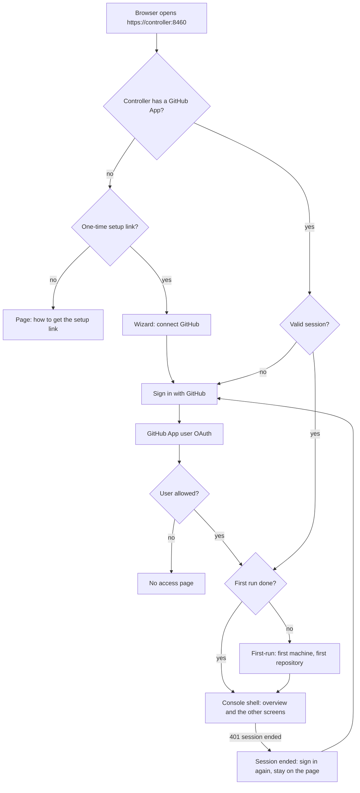
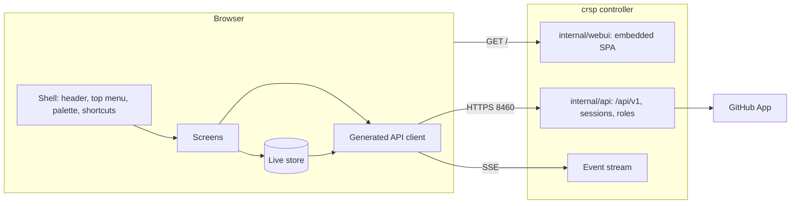

# Web console

The top half (sections 1 to 4) is for every reader: product, design, UX. The bottom half (5 to 12) is for engineers.

The M1 console is built (CRSP24): the shell, the auth states, first run, the overview, repositories, machines, runners and the settings sub-pages Users and roles, Appearance, Retention and Backups. Requirements marked (built, CRSP24) are built. Everything else in this spec is **NOT YET IMPLEMENTED**: the jobs, images and caches and doctor screens, the later settings sub-pages, and the server side of serving (R5.1, R5.2, R6.1 to R6.5, R6.12, R6.13).

## 1. In one paragraph

The web console is the browser app of CI Runners Shared Pool. The controller serves it on the local network over HTTPS, on port 8460. Every user signs in with GitHub. The console has a header, a top menu, a command palette and keyboard shortcuts. It has nine screens: sign-in and first-run, overview, repositories, machines, runners, jobs, images and caches, doctor, and settings. The owner uses it to set the pool up and to change it. Admins change it too. Viewers watch it.

## 2. Why

**Problem.** The pool runs on several machines and serves many repositories. Without one place to look, the user cannot see what runs where, why a job waits, or what to fix.

**Users.**

- The **owner**: the first person to sign in. Sets up the GitHub App, adds machines, allows other users.
- **Admins**: change repositories, machines, runners, images and settings.
- **Viewers**: read everything that holds no secret. Change nothing.

**Goals.**

- One place to set up the pool, from a fresh controller to a first green job.
- A live view of machines, the queue, runners and jobs.
- Every command in one place, reachable by mouse and by keyboard.
- The same look and behaviour on every screen, from design system v1.

**Non-goals.**

- Managing GitHub-hosted runners.
- Being reachable from the internet. The console is for the local network.
- Holding the behaviour of each feature. This spec covers the console: its shell, its auth states and what each screen shows and does. How a feature works is in that feature's spec: `github-integration`, `machines`, `runners`, `scheduling`, `caches`, `doctor`, `observability`, `notifications` and `operations` (folders under `docs/features/`).
- A CLI. The CLI has the same powers, through the same API (decision 0001).

## 3. How it works

The steps in words:

1. The user opens `https://<controller>:8460`. The controller serves the console and its API from one binary (decision 0001).
2. A fresh controller has no GitHub App yet, so nobody can sign in with GitHub. The setup page opens only through a one-time setup link. The tray's Open, `crsp open` and the controller's first start each give one.
3. The first wizard creates the controller's own GitHub App with GitHub's manifest flow (decision 0002).
4. The user signs in with GitHub through the App's user OAuth flow. The first person to sign in becomes the owner. Later users get in only when the owner has added their GitHub login.
5. The first-run checklist then leads through two more wizards: add the first machine, and turn the pool on for the first repository.
6. After that, the console opens on the overview. A live event stream keeps every screen current.
7. When the session ends, the console says so over the current page. The user signs in again and comes back to the same page.

## 4. Screens and states

Every screen is built from [design system v1](../../design-system/v1/README.md): its [UX rules](../../design-system/v1/ux-rules.md), [components](../../design-system/v1/components.md), [content](../../design-system/v1/content.md) and [tokens](../../design-system/v1/tokens.md). This section names the parts and cites rules and components by ID. It holds no UX rule of its own. Gaps in the design system are listed as owner questions in section 10.

Each screen lists its milestone: **M1** (milestone 1) or **later** (with the milestone when the product brief names it). The API operations named here do not exist yet. They are added to `packages/contract/openapi.yaml` with the screen that needs them. Section 7 lists them all.

The states named for every list follow the design system: loading (component 16, UX-29), empty and could-not-load (component 19, UX-6, UX-28), and live (UX-19, UX-53). Every action that changes something is busy until the server answers (UX-13) and gives its result in one line (UX-27). Every destructive action asks first in a question card that names each item that goes (UX-9, UX-62).

### 4.0 The shell

- **Purpose:** the frame around every signed-in screen.
- **Header:** the product name, the pool status as a word, glyph and colour (UX-58), the live-update state, a button that opens the command palette (it shows `Ctrl+K`, or `Cmd+K` on macOS), and the user menu (GitHub login, role, sign out).
- **Top menu (component 2):** Overview, Repositories, Machines, Runners, Jobs, Images and caches, Doctor, Settings. The current area is marked. Detail pages show breadcrumbs (component 2).
- **Page header (component 1):** one headline per screen (UX-3), with the screen's one primary action (UX-4).
- **Banner slot (component 18):** the one app-wide slot (UX-27). It carries "Live updates paused", "First run is not finished" and "A new version is ready".
- **Activity strip (component 27):** running work that the console started, such as a drain, an image rebuild or an update (UX-34).
- **Command palette:** opens with `Ctrl+K` or `Cmd+K` (UX-57). It lists the areas, the detail pages found by name (a machine, a repository, a runner), and the commands the user's role allows. A command opens the one place where it lives (UX-52). It uses the overlay of component 9 and the search bar of component 21. It is not a component of v1 yet (owner question Q1).
- **Shortcut list:** `?` opens the list of every shortcut (UX-57), in the overlay of component 9.
- **Shortcuts:** `/` moves to the page's search bar (UX-31). `j` and `k` move down and up a list. `Enter` opens the row. None fires while typing in a field (UX-57).
- **Theme:** dark by default; system, dark or light is set in Settings, Appearance (UX-60, UX-55).
- **States:** loading the session (an unknown-total bar, component 16); live; live updates paused (a Note message in the banner slot, UX-26, while the last data stays on screen with its age, UX-53); not found (component 19, with a link to the overview); page fault ("This page hit a fault.", UX-28).
- **Milestone:** M1.

### 4.1 Sign-in and first run

**Sign-in page** (`/sign-in`)

- **Purpose:** let a user in with their GitHub account.
- **Data:** `getSession`, `startSignIn`, `completeSignIn` (the GitHub callback).
- **States:**
  - signed out: one primary, "Sign in with GitHub" (UX-4);
  - signing in: the button is busy until GitHub answers (UX-13);
  - sign-in failed: a Problem message that says what failed and offers Try again (UX-26, UX-28);
  - no access: "Signed in as `<login>`. This GitHub account has no access. Ask the owner to add it." with Sign out;
  - session ended: over the current page, a dialog (component 9) says the session ended and offers "Sign in with GitHub". The page and its unsaved input stay under it. After sign-in the user is back on the same page (owner question Q3).
- **Components:** 1, 7, 9, 18, 19.
- **Milestone:** M1.

**Setup page** (`/setup`)

- **Purpose:** take a fresh controller to a working pool.
- **Without a setup link:** a page that says how to get one: the tray's Open, or `crsp open` on the controller's machine. No other action.
- **With a setup link:** the first-run checklist. It shows three wizards in order. A later one is greyed until the one before it is done (UX-5). Each is a wizard (component 4) whose behaviour comes from the shared wizard (UX-54). Each ends with Review, then its work, then Done (UX-30). The step and state words are those of content.md.

| Wizard | Steps | Work step | Done shows |
|---|---|---|---|
| Connect GitHub | Reading the controller; Account (personal account or organization, App name); Review | Creating the App: off to GitHub with the manifest, back with the App's keys | The App's name and account, the permissions it got, and one primary: "Sign in with GitHub" |
| Add the first machine | Machine (OS); Review (the install command, how long the join code lasts) | Joining: waits for the agent to connect, with the code's time left (UX-29) | The machine's name, OS, CPU, memory and the isolation backends found |
| Turn on the first repository | Reading repositories; Repositories (a one-choice or multi-choice list, component 13, with Select all N and Clear, UX-12); Review (the repositories, the variables to write, the labels) | Turning on: n of N repositories, with the one in hand (UX-30) | Each repository turned on, its variables written, and what failed with its reason |

- **Harness states:** each of the three wizards has all ten states of the wizard harness (UX-30): loading, first-run, planning, ready-to-review, running, paused, stopped, failed, done, done-after-reload. Stop on "Joining" withdraws the join code. A failed or stopped run still ends at Done and says what is left. Done and Stopped offer Start again (content.md, wizard state words).
- **Review** says "Nothing has changed yet." and counts again after a change to an earlier step (UX-30).
- **Data:** `getSetupState`, `redeemSetupLink`, `startAppManifest`, `completeAppManifest`, `createJoinCode`, `getJoinCode`, `revokeJoinCode`, `listInstallations`, `listRepositories`, `planRepositoryChanges`, `applyRepositoryChanges`.
- **Detail:** the App manifest, permissions and callback are in `github-integration`. Join codes and the install command are in `machines`. Repository variables are in `github-integration`.
- **Components:** 4, 5, 13, 14, 16, 18, 19, 34.
- **Milestone:** M1.

### 4.2 Overview

- **Purpose:** see the pool at a glance and jump to what needs you.
- **Data:** `getOverview`, then `streamEvents`.
- **Shows:** a card per machine (component 8, UX-10) with its state word (UX-58) and three level bars for memory, CPU and slots against its budget (UX-41, owner question Q4); the queue count; the running jobs (component 15); today's minutes saved as a lettered figure (component 31). Each item links to its screen.
- **Actions:** none. The overview only shows and links (UX-52).
- **States:** loading; empty (no machine yet: "No machines yet. Add a machine to start." links to Machines, content.md); could not load; live; live updates paused.
- **Components:** 1, 8, 15, 17, 19, 27, 31.
- **Milestone:** M1. Minutes saved: later (milestone 8).

### 4.3 Repositories

- **Purpose:** choose which repositories use the pool, and with which limits.
- **Data:** `listInstallations`, `listRepositories`, `getRepository`, `updateRepositoryPolicy`, `planRepositoryChanges`, `applyRepositoryChanges`, `getAppInstallUrl`.
- **List:** a table (component 15) of name, owner, pool on or off, labels, maximum parallel jobs, priority, and repository variable status (`RUNS_ON_LINUX`, `RUNS_ON_WINDOWS`, `RUNS_ON_MACOS`) as a status word (UX-58). Search and filters (components 11, 21, UX-31): on or off, owner, variable status. Long lists page (component 10, UX-11).
- **Detail:** the policy form (component 14): on or off, runner groups and labels, maximum parallel jobs, priority, jobs from public forks. A form ends with Cancel and Save (UX-24). Turning fork jobs on shows a Needs-you message with the risk, and asks first (UX-9).
- **Actions and confirmations:**
  - turn the pool on for chosen repositories: the "Turn on the pool" wizard, the same as in first run (component 4, UX-30); the selection bar names the count (component 20, UX-7);
  - turn it off: a question card that names each repository and the variables that go (UX-62);
  - add a repository that is not listed: opens GitHub's App install page (`getAppInstallUrl`);
  - fix a variable that is wrong: shown in the row, applied through the same wizard.
- **States:** loading; empty (the App is installed on no repository: "No repositories yet. Install the App on a repository to start."); could not load (GitHub not answering: the last list stays with its age, UX-53, and a Problem message); live.
- **Role:** turning the pool on also needs admin rights on that repository in GitHub; a row without them shows the action disabled with that reason (UX-38).
- **Detail:** policies are in `github-integration` and `scheduling`.
- **Components:** 1, 4, 10, 11, 13, 14, 15, 17, 19, 20, 21, 22, 34.
- **Milestone:** M1.

### 4.4 Machines

- **Purpose:** add machines and set what each one gives the pool.
- **Data:** `listMachines`, `getMachine`, `updateMachine`, `drainMachine`, `resumeMachine`, `removeMachine`, `createJoinCode`, `getJoinCode`, `revokeJoinCode`, `getInstallCommand`.
- **List:** a card per machine (component 8) or a table (component 15): name, OS, CPU and architecture, state (online, offline, drained, draining; UX-58), backends, load bars, slots used of total, last seen (UX-53).
- **Detail:** the facts list (component 8); backends found and allowed (component 22); the load budget (memory and CPU percent, with the number keypad, component 37, UX-56); job slots; cache size cap; maintenance windows (time picker, component 36); the drain timeout; the agent's log (component 26).
- **Add a machine:** the page's one primary opens the "Add a machine" wizard, the same as in first run. The install command sits in a monospace block with a Copy button (owner question Q2). The join code shows once, with its time left (UX-29).
- **Actions and confirmations:**
  - drain: a question card that names the running jobs it waits for (UX-62); the drain then shows in the activity strip (component 27);
  - resume: no question;
  - change the budget, slots or allowed backends: Save; if runners restart, the question card names the jobs they wait for (UX-62);
  - remove: a question card that names the machine, its runners and its running jobs (UX-62).
- **States:** loading; empty ("No machines yet. Add a machine to start."); could not load; live; an offline machine stays listed with its last-seen time.
- **Detail:** joining, the budget, drain and backends are in `machines`; the load measures are in `scheduling`.
- **Components:** 1, 4, 6, 7, 8, 9, 14, 15, 17, 19, 22, 26, 27, 36, 37.
- **Milestone:** M1 for the list, detail, add, budget, slots, drain and remove (owner question Q13). Maintenance windows, quiet hours and the cache cap: later (milestones 3 and 7).

### 4.5 Runners

- **Purpose:** see every runner and create runners per OS on machines that support it.
- **Data:** `listRunners`, `getRunner`, `planRunners`, `createRunners`, `deleteRunner`, `streamRunnerLog`.
- **List:** a live table (component 15): name, machine, OS, backend, isolation (UX-61), labels, state (UX-58), current job, age (UX-53). Search and filters by machine, OS, isolation and state (components 11, 21).
- **Add runners:** a wizard (component 4): OS; machine (only machines whose backends support the OS; others are greyed with the reason, UX-38); count and labels; Review; Registering (n of N); Done.
- **Actions and confirmations:** delete a runner, or the selected runners: a question card that names each runner and the job it runs, and waits for the drain (UX-62).
- **States:** loading; empty ("No runners yet. Add runners to start.", or "Add a machine first." when there is none); could not load; live.
- **Detail:** runner life, JIT config and labels are in `runners`.
- **Components:** 1, 4, 9, 11, 15, 17, 19, 20, 21, 26.
- **Milestone:** M1 basic: persistent runners, list, add, delete. Later: ephemeral runners and the live setup log (milestone 2).

### 4.6 Jobs

- **Purpose:** see the queue and the job history, and why a job waits.
- **Data:** `listJobs` (queued, running, done; filters by repository, machine, result, time range), `getJob`, `exportJobs`.
- **Queue:** a table (component 15) of queued jobs with repository, labels, wait time and the reason it waits ("waits for a free slot on any Linux machine"; UX-29).
- **History:** a time axis list (component 24, UX-33): repository, workflow and job name, result (UX-58), machine, backend, wait time, run time. Each row opens the detail, with a link to the run on GitHub.
- **Actions:** export the history (component 29, UX-39). No command changes a job.
- **States:** loading; empty ("No jobs yet. Jobs show here when a workflow runs on the pool."); could not load; live; an empty period offers to widen the range (component 24).
- **Detail:** placement and waits are in `scheduling`; history and minutes saved are in `observability`.
- **Components:** 1, 11, 12, 15, 17, 19, 21, 24, 29.
- **Milestone:** later (milestone 2). M1 shows the queue and running jobs on the overview.

### 4.7 Images and caches

- **Purpose:** see what each machine keeps, and rebuild or wipe it.
- **Data:** `listImages`, `getImage`, `updateImageLayers`, `rebuildImage`, `listCaches`, `wipeCache`.
- **Tabs (component 3):** Images, Caches.
- **Images:** per machine and OS, the base image, its tool layers (check box rows, component 22, saved with Save), size, built at, and the newest kept.
- **Caches:** the Actions cache, git mirrors, the tool cache and the registry mirror, each with its size against its cap (component 31 for sizes over time).
- **Actions and confirmations:**
  - rebuild an image: a question card that names the machine and the runners and jobs it waits for; the rebuild drains first (UX-62) and shows in the activity strip (component 27);
  - wipe a cache: a question card that names the cache and its size (UX-62).
- **States:** loading; empty ("No images yet. Images are built when a runner first needs one."); could not load; live; rebuilding (component 16).
- **Detail:** images are in `runners`; caches are in `caches`.
- **Components:** 1, 3, 7, 9, 15, 16, 19, 22, 27, 31.
- **Milestone:** later (images: milestone 2; caches: milestone 7).

### 4.8 Doctor

- **Purpose:** list every problem the pool has, with its fix.
- **Data:** `listDoctorFindings`, `runDoctor`, `getDoctorRun`.
- **Shows:** findings grouped by area (machines, backends, runners, GitHub registration, repository variables, workflow labels), each with a status word (UX-58), what is wrong, and its fix. A fix that is a command links to the one place that command lives (UX-52). The time of the last run (UX-53).
- **Actions:** "Run the doctor" is the page's one primary (UX-4). It is busy while the run lasts and shows its progress (UX-13, UX-29).
- **States:** loading; no findings (a Done message: "No problems found." with the time of the run); could not load; running; live.
- **Detail:** the checks and fixes are in `doctor`.
- **Components:** 1, 6, 7, 16, 17, 18, 19.
- **Milestone:** later (milestone 2).

### 4.9 Settings

Settings hold configuration only (UX-52). Sub-pages sit under one Settings area, each a form that ends with Cancel and Save (UX-24), or switches saved at once (UX-22).

| Sub-page | Purpose | Data | Actions and confirmations | Milestone |
|---|---|---|---|---|
| Users and roles | Who may sign in, as owner, admin or viewer | `listUsers`, `addUser`, `updateUserRole`, `removeUser` | Add a GitHub login with a role; change a role; remove a user (question card naming the login, UX-62) | M1 |
| Appearance | The user's theme: system, dark or light (UX-60) | `getPreferences`, `updatePreferences` | A one-choice list saved at once (component 13) | M1 |
| Budgets | The pool's default load budget, slots and drain timeout for new machines | `getPoolSettings`, `updatePoolSettings` | Save; a change that restarts runners names the jobs it waits for (UX-62) | later |
| Notifications | Channels (email, webhook, desktop) and the events each one gets | `listNotificationChannels`, `createNotificationChannel`, `updateNotificationChannel`, `deleteNotificationChannel`, `testNotificationChannel` | Add, edit, delete (question card), send a test | later (milestone 8) |
| Updates | The runner version and the agent version, and when they update | `getUpdateStatus`, `updateUpdatePolicy`, `startUpdate` | Update now: a question card that names the machines and the jobs the drain waits for (UX-62) | later (milestone 3) |
| Audit log | Who changed what, and when | `listAuditEvents`, `exportAuditEvents` | Export (component 29, UX-39) | later |
| Config export | The configuration as a file, without secrets | `exportConfig` | Export, named for what it holds then the file stamp (UX-39) | later (milestone 8) |

- **Users and roles:** a table (component 15) of GitHub login, role, added by, added at, last sign-in. There is one owner. The owner's own row has no Remove. The roles are in section 5.
- **States:** each sub-page has loading, could not load and, for lists, empty ("No other users yet. Add a GitHub login to let someone in.").
- **Detail:** budgets are in `machines` and `scheduling`; notifications in `notifications`; updates, backup and config export in `operations`; the audit log in `observability`.
- **Components:** 1, 3, 7, 8, 9, 13, 14, 15, 17, 19, 22, 24, 29, 37.

## 5. Functional requirements

Requirements marked (built, CRSP24) are built. The others are **NOT YET IMPLEMENTED**.

### Serving and the shell

**R5.1** — The controller serves the console and its API on one HTTPS port, 8460 by default, set in config. It serves no plain-HTTP console.

**R5.2** — Any path that is not under `/api/` returns the console, so a deep link opens its screen after sign-in. An unknown console path shows the not-found state with a link to the overview.

**R5.3** (built, CRSP24) — Every signed-in screen sits in the shell of section 4.0: header, top menu with the eight areas, page header, banner slot and activity strip.

**R5.4** (built, CRSP24) — `Ctrl+K` (`Cmd+K` on macOS) opens the command palette from any screen. It finds areas, items by name and commands. It lists only the commands the user's role allows. Choosing an item goes to its page; choosing a command goes to the one place where that command lives.

**R5.5** (built, CRSP24) — The shortcuts `/`, `j`, `k`, `Enter` and `?` work as section 4.0 says, and none fires while focus is in a text field.

**R5.6** (built, CRSP24) — The console opens one live event stream (`streamEvents`) per tab. One store holds what it brings, and every screen reads that store for live state.

**R5.7** (built, CRSP24) — When the live stream drops, the console keeps the last data on screen with its age, shows "Live updates paused" in the banner slot, and reconnects with backoff. On reconnect it loads the shown data again before it trusts new events.

### Signing in and sessions

**R5.8** (built, CRSP24) — With no valid session, every console path except `/sign-in` and `/setup` goes to `/sign-in` and keeps the path it came from.

**R5.9** (built, CRSP24) — After sign-in the console returns to the kept path. It accepts only a path on the same origin; anything else goes to the overview.

**R5.10** (built, CRSP24) — A GitHub user who is not on the user list gets the no-access state, with their login and Sign out. No API data is sent to them.

**R5.11** (built, CRSP24) — When an API call answers that the session ended, the console shows the session-ended dialog over the current page. It keeps the page and unsaved input. After sign-in it returns to that page with the input still there. It does not resend the call that failed.

**R5.12** (built, CRSP24) — Sign out ends the session on the server and goes to `/sign-in`.

**R5.13** (built, CRSP24) — The console shows each user what their role allows:

| Role | Can |
|---|---|
| viewer | read every screen; no command; no join code or install command |
| admin | everything a viewer can, and every command on repositories, machines, runners, images, caches, doctor and the settings Budgets, Notifications and Updates; read the audit log |
| owner | everything an admin can, and Users and roles, config export, and the GitHub App |

A command the role does not allow is shown disabled with its reason. The API refuses it too (R6.5).

### First run

**R5.14** (built, CRSP24) — While the controller has no GitHub App, `/setup` opens only with a valid one-time setup link (`redeemSetupLink`). Without one, it shows how to get one. A link works once and expires.

**R5.15** (built, CRSP24) — The setup page shows the three first-run wizards of section 4.1 in order. A wizard opens only when the one before it is done. The first-run checklist stays reachable from the banner slot until all three are done.

**R5.16** (built, CRSP24) — The Connect GitHub wizard creates the App through GitHub's manifest flow and stores what GitHub returns through `completeAppManifest`. Its Done step offers Sign in with GitHub. The first user who then signs in becomes the owner.

**R5.17** (built, CRSP24) — The Add a machine wizard shows the install command and a one-time join code, then waits on `getJoinCode` until the agent joins, the code expires, or the user stops. Stop withdraws the code (`revokeJoinCode`). Done shows the machine as the agent reported it.

**R5.18** (built, CRSP24) — The Turn on the pool wizard plans the change with `planRepositoryChanges`, shows that plan at Review, applies it with `applyRepositoryChanges`, and shows at Done what was really done and what failed.

**R5.19** (built, CRSP24) — Each wizard (Connect GitHub, Add a machine, Turn on the pool, Add runners) has all ten harness states, and done-after-reload shows the outcome stored on the server, not the plan.

### Screens

**R5.20** (built, CRSP24) — The overview shows the machines with their load bars, the queue count, the running jobs and today's minutes saved, all live. It has no command; each item links to its screen.

**R5.21** (built, CRSP24) — The repositories screen lists the repositories from GitHub with pool state, labels, limits and variable status. It turns the pool on and off, and edits a repository's policy. A repository where the user lacks GitHub admin rights shows the turn-on action disabled with that reason.

**R5.22** (built, CRSP24) — The machines screen lists the machines with state, backends, load and slots. It adds a machine, edits the budget, slots and allowed backends, drains, resumes and removes.

**R5.23** (built, CRSP24) — The runners screen lists runners live with their isolation word, labels, state, job and age. It adds runners only on machines whose backends support the chosen OS, and deletes runners.

**R5.24** — The jobs screen shows the queue with each job's wait reason, and the history with filters by repository, machine, result and time range. Export holds every row of the filter, in the order shown.

**R5.25** — The images and caches screen shows images with layers and sizes, and caches with size and cap. It changes layers, rebuilds an image after a drain, and wipes a cache.

**R5.26** — The doctor screen lists every finding with its status and fix, and runs the doctor on demand.

**R5.27** (built, CRSP24) — The settings area has the seven sub-pages of section 4.9.

**R5.28** (built, CRSP24) — Users and roles adds a GitHub login with a role, changes a role and removes a user. There is always exactly one owner, and the owner cannot remove themselves or lose the owner role.

**R5.29** — Config export downloads the configuration without any secret, in a file named for what it holds and the file stamp.

**R5.30** (built, CRSP24) — Every destructive action (delete a runner, remove a machine, wipe a cache, turn the pool off, remove a user, a drain, a rebuild, an update) first shows a question card that names each item that goes and each running job it waits for. Nothing changes until the user says yes.

**R5.31** (built, CRSP24) — Every list and detail screen has the loading, empty and could-not-load states of section 4, and the empty state offers the action that fills it when the user's role allows it.

**R5.32** (built, CRSP24) — Every date, time, number, size and percent on screen comes from the one formatter (component 28).

## 6. Non-functional requirements

Requirements marked (built, CRSP24) are built. The others are **NOT YET IMPLEMENTED**.

**R6.1** — The session lives in a cookie that is `HttpOnly`, `Secure`, `SameSite=Lax` and host-only. Its value is a random 256-bit id. The controller stores only its hash. Idle and total lifetimes are set in config (owner question Q12).

**R6.2** — Every request that changes something carries a per-session CSRF token, and the controller refuses a request whose `Origin` is not the console's own.

**R6.3** — The console loads nothing from outside the controller: no CDN, font host, analytics or avatar image. The controller sends a Content Security Policy with `default-src 'self'`, no inline script, and `frame-ancestors 'none'`.

**R6.4** — No secret reaches the browser: not the App private key, the webhook secret, a GitHub token or an agent key. A join code shows only in its wizard, once, and never in a URL, log or audit entry.

**R6.5** — The API checks the role on every operation (its `x-auth`), whatever the console shows. A viewer's change request gets 403.

**R6.6** — Every screen, in the dark and the light theme, has no serious or critical accessibility violation (axe), one `h1`, landmarks, and a visible focus (UX-17, UX-59).

**R6.7** (built, CRSP24) — Every screen works from 360 px wide to desktop with no sideways page scroll and 44 px touch targets (UX-16, UX-49).

**R6.8** (built, CRSP24) — App code uses only the shared components: no raw buttons or inputs, no app stylesheet, no native date, time or number input (UX-2, UX-56).

**R6.9** (built, CRSP24) — Every text-on-fill token pair meets WCAG 2.2 AA in both themes (UX-17).

**R6.10** (built, CRSP24) — No retired word of content.md is drawn as a label, button or message.

**R6.11** (built, CRSP24) — Under `prefers-reduced-motion` nothing in the console moves (UX-36, UX-59).

**R6.12** — Proposed budgets (owner question Q14): the first screen is usable within 2 s on the local network; the console's first JavaScript is at most 300 KB gzipped; a live event shows on screen within 2 s of the controller sending it.

**R6.13** — The console keeps working when the internet is down: local screens load, and screens that need GitHub say so (UX-28).

## 7. Design

**Parts.**

- `apps/web/src/shell/`: header, top menu, command palette, shortcut list, banner slot, activity strip host.
- `apps/web/src/auth/`: session state, sign-in page, session-ended dialog, the kept return path.
- `apps/web/src/live/`: the one event stream and the store (UX-19), and the shared clock (UX-53).
- `apps/web/src/screens/<area>/`: one folder per screen.
- `packages/ui/src/`: the shared components of design system v1. A screen extends a component there and never copies it (UX-2).
- `packages/contract/`: the OpenAPI contract and the generated client (decision 0001).
- `internal/webui/`: serves the built console with `go:embed`, with the SPA fallback of R5.2 and the headers of R6.3.

**Routes.**

| Path | Screen |
|---|---|
| `/sign-in` | Sign-in |
| `/setup` | First run |
| `/` | Overview |
| `/repositories`, `/repositories/:owner/:name` | Repositories |
| `/machines`, `/machines/add`, `/machines/:id` | Machines |
| `/runners`, `/runners/add`, `/runners/:id` | Runners |
| `/jobs`, `/jobs/:id` | Jobs |
| `/images`, `/caches` | Images and caches |
| `/doctor` | Doctor |
| `/settings/users`, `/settings/appearance`, `/settings/budgets`, `/settings/notifications`, `/settings/updates`, `/settings/audit`, `/settings/export` | Settings |

**API operations to add** (all under `/api/v1`, each with `x-auth` and `x-rate-limit`). The owning spec fixes each one's shape.

| Area | Operations | Owning spec |
|---|---|---|
| Session | `getSession`, `startSignIn`, `completeSignIn`, `signOut`, `redeemSetupLink` | `github-integration` |
| First run | `getSetupState`, `startAppManifest`, `completeAppManifest` | `github-integration` |
| Live | `streamEvents` | `observability` |
| Overview | `getOverview` | `observability` |
| Repositories | `listInstallations`, `listRepositories`, `getRepository`, `updateRepositoryPolicy`, `planRepositoryChanges`, `applyRepositoryChanges`, `getAppInstallUrl` | `github-integration` |
| Machines | `listMachines`, `getMachine`, `updateMachine`, `drainMachine`, `resumeMachine`, `removeMachine`, `createJoinCode`, `getJoinCode`, `revokeJoinCode`, `getInstallCommand` | `machines` |
| Runners | `listRunners`, `getRunner`, `planRunners`, `createRunners`, `deleteRunner`, `streamRunnerLog` | `runners` |
| Jobs | `listJobs`, `getJob`, `exportJobs` | `scheduling`, `observability` |
| Images and caches | `listImages`, `getImage`, `updateImageLayers`, `rebuildImage`, `listCaches`, `wipeCache` | `runners`, `caches` |
| Doctor | `listDoctorFindings`, `runDoctor`, `getDoctorRun` | `doctor` |
| Users | `listUsers`, `addUser`, `updateUserRole`, `removeUser`, `getPreferences`, `updatePreferences` | `web-console` (this spec) |
| Settings | `getPoolSettings`, `updatePoolSettings` | `machines` |
| Notifications | `listNotificationChannels`, `createNotificationChannel`, `updateNotificationChannel`, `deleteNotificationChannel`, `testNotificationChannel` | `notifications` |
| Updates and export | `getUpdateStatus`, `updateUpdatePolicy`, `startUpdate`, `exportConfig` | `operations` |
| Audit | `listAuditEvents`, `exportAuditEvents` | `observability` |

**Errors.** Every error uses the `ErrorEnvelope` of the contract. The console reads its `code`: `session_expired` opens the session-ended dialog (R5.11), `forbidden` refreshes the role, and anything else shows could-not-load with the message (UX-28).

**Data kept in the browser.** Only per-person view choices, such as the activity strip being open (component 27) and the last filter. No API data and no secret is stored in the browser.

## 8. Failure modes

| Dependency | When it fails | Fail open or closed | Why |
|---|---|---|---|
| Controller API | Could not load, with what, why and Try again (UX-28) | closed | Nothing to show without it |
| Live stream | Last data stays with its age; banner says paused; reconnect (R5.7) | open, read-only data | Old data with its age beats a blank screen |
| GitHub, at sign-in | Sign-in failed message; no session | closed | No identity without GitHub |
| GitHub, while signed in | Local screens work; repository lists show their last copy and age | open for reads | Machines and runners do not need GitHub to be seen |
| Session | Session-ended dialog; input kept (R5.11) | closed | No action without a valid session |
| Role changed mid-session | Next call gets 403; the console reloads the session and hides what the new role cannot do | closed | The server decides, not the page |
| A page fault | "This page hit a fault." with Details (UX-28) | closed | A code fault is not a lost connection |
| An agent offline | The machine shows offline with last-seen time | open | The rest of the pool keeps working |

## 9. How it is proven

A row with a path has that test. A row that says NOT YET IMPLEMENTED names the path where its test will live.

| Requirement | Kind | Test |
|---|---|---|
| R5.1 | Go test | NOT YET IMPLEMENTED: `internal/webui/serve_tls_test.go` |
| R5.2 | Go test, Playwright e2e | NOT YET IMPLEMENTED: `internal/webui/webui_test.go` (SPA fallback), `e2e/tests/web-console/deep-link.spec.ts` |
| R5.3 | Vitest | `apps/web/src/shell/Shell.test.tsx` |
| R5.4 | Vitest, Playwright e2e | `apps/web/src/shell/Shell.test.tsx`, `e2e/tests/web-console/keyboard.spec.ts` |
| R5.5 | Vitest, Playwright e2e | `apps/web/src/shell/shortcuts.test.ts`, `e2e/tests/web-console/keyboard.spec.ts` |
| R5.6 | Vitest | `apps/web/src/live/store.test.ts` |
| R5.7 | Vitest | `apps/web/src/live/store.test.ts` (reconnect), `apps/web/src/shell/Shell.test.tsx` (paused banner) |
| R5.8 | Vitest, Playwright e2e | `apps/web/src/shell/Shell.test.tsx`, `e2e/tests/web-console/deep-link.spec.ts` |
| R5.9 | Vitest | `apps/web/src/shell/Shell.test.tsx` (return path) |
| R5.10 | Vitest, Playwright e2e | `apps/web/src/shell/Shell.test.tsx`, `e2e/tests/web-console/deep-link.spec.ts` |
| R5.11 | Vitest, Playwright e2e | `apps/web/src/shell/Shell.test.tsx`, `e2e/tests/web-console/flows.spec.ts` |
| R5.12 | Vitest | `apps/web/src/shell/Shell.test.tsx` |
| R5.13 | Vitest | `apps/web/src/screens/machines/Machines.test.tsx`, `apps/web/src/screens/repositories/Repositories.test.tsx`, `apps/web/src/screens/runners/Runners.test.tsx` (a viewer sees commands disabled with their reason) |
| R5.14 | Vitest | `apps/web/src/screens/setup/Setup.test.tsx` (the Go side stays NOT YET IMPLEMENTED: `internal/api/setup_link_test.go`) |
| R5.15 | Vitest | `apps/web/src/screens/setup/Setup.test.tsx` |
| R5.16 | Vitest, design kit guard | `apps/web/src/screens/setup/Setup.test.tsx`, `apps/web/src/screens/wizards.test.tsx` |
| R5.17 | Vitest, Playwright e2e | `apps/web/src/screens/wizards.test.tsx`, `e2e/tests/web-console/flows.spec.ts` |
| R5.18 | Vitest, Playwright e2e | `apps/web/src/screens/wizards.test.tsx`, `e2e/tests/web-console/flows.spec.ts` |
| R5.19 | design kit guard | `scripts/design/wizard-behaviour.ts` driven by `apps/web/src/screens/wizards.test.tsx`, one driver per wizard |
| R5.20 | Vitest | `apps/web/src/screens/overview/Overview.test.tsx` |
| R5.21 | Vitest | `apps/web/src/screens/repositories/Repositories.test.tsx` |
| R5.22 | Vitest | `apps/web/src/screens/machines/Machines.test.tsx` |
| R5.23 | Vitest | `apps/web/src/screens/runners/Runners.test.tsx` |
| R5.24 | Vitest | NOT YET IMPLEMENTED: `apps/web/src/screens/jobs/Jobs.test.tsx` |
| R5.25 | Vitest | NOT YET IMPLEMENTED: `apps/web/src/screens/images/ImagesAndCaches.test.tsx` |
| R5.26 | Vitest | NOT YET IMPLEMENTED: `apps/web/src/screens/doctor/Doctor.test.tsx` |
| R5.27 | Vitest | `apps/web/src/screens/settings/Settings.test.tsx` (M1 sub-pages: Users and roles, Appearance, Retention, Backups) |
| R5.28 | Vitest | `apps/web/src/screens/settings/Settings.test.tsx` (the Go side stays NOT YET IMPLEMENTED: `internal/api/users_test.go`) |
| R5.29 | Vitest | NOT YET IMPLEMENTED: `apps/web/src/screens/settings/ConfigExport.test.tsx` |
| R5.30 | Vitest, Playwright e2e | the question-card tests in each screen test file, `e2e/tests/web-console/flows.spec.ts` |
| R5.31 | Vitest | the loading, empty and could-not-load tests in each screen test file |
| R5.32 | Vitest | `packages/ui/src/components/format.test.ts` |
| R6.1 | Go test | NOT YET IMPLEMENTED: `internal/api/session_cookie_test.go` |
| R6.2 | Go test | NOT YET IMPLEMENTED: `internal/api/csrf_test.go` |
| R6.3 | Go test, Playwright e2e | NOT YET IMPLEMENTED: `internal/webui/headers_test.go`, `e2e/tests/web-console/no-external-requests.spec.ts` |
| R6.4 | Go test, Playwright e2e | NOT YET IMPLEMENTED: `internal/api/no_secrets_test.go`, `e2e/tests/web-console/no-secrets.spec.ts` |
| R6.5 | Go test | NOT YET IMPLEMENTED: `internal/api/route_coverage_test.go` (x-auth on every route) and `internal/api/roles_test.go` |
| R6.6 | Playwright e2e | NOT YET IMPLEMENTED: `e2e/tests/web-console/a11y.spec.ts` (axe, both themes) |
| R6.7 | design kit guard (Playwright) | `e2e/tests/design-layout.spec.ts` on `scripts/design/dom-layout.ts` at 360, 393 and 1300 px |
| R6.8 | design kit guard | `scripts/design/raw-controls.test.ts`, `scripts/design/no-app-css.test.ts`, `scripts/design/raw-inputs.test.ts` |
| R6.9 | design kit guard | `scripts/design/contrast.test.ts` |
| R6.10 | design kit guard | `scripts/design/design-system-follow.test.ts` |
| R6.11 | design kit guard | `packages/ui/src/components.css` (a `prefers-reduced-motion` rule); no automated check yet |
| R6.12 | Playwright e2e, Vitest | NOT YET IMPLEMENTED: `e2e/tests/web-console/perf.spec.ts`, `apps/web/src/bundle-size.test.ts` |
| R6.13 | Playwright e2e | NOT YET IMPLEMENTED: `e2e/tests/web-console/offline-internet.spec.ts` |

## 10. Decisions

| ID | Question | Chosen | Date |
|---|---|---|---|
| WC-D1 | How does a fresh controller let the first user in, before a GitHub App exists? | A one-time setup link from the tray, `crsp open` or the controller's first start; `/setup` needs it (R5.14). Proposed; owner to confirm (Q11). | 2026-11-14 |
| WC-D2 | Is first run one wizard or several? | Three wizards in a checklist (Connect GitHub, Add a machine, Turn on the pool), each ending Review, work, Done (UX-30). Proposed; owner to confirm (Q10). | 2026-11-14 |
| WC-D3 | How do screens get live data? | One server-sent event stream per tab into one store (R5.6, UX-19). | 2026-11-14 |
| WC-D4 | Where are the app's routes? | Client routes with an SPA fallback in `internal/webui`; the API stays under `/api/v1`. | 2026-11-14 |

**Open owner questions.**

For the design system next version (`docs/design-system/next-version/`); this spec does not invent these rules:

- **Q1.** UX-57 names a command palette and a shortcut list, but no component describes them. Add components for the command palette and the shortcut list?
- **Q2.** No component shows a command to copy, such as the install command, with a Copy button, and content.md has no "Copy" word. Add a copyable command block and the word?
- **Q3.** No rule covers a session that ends while the user works: how the page is kept, and what the user sees. Add one?
- **Q4.** The progress bar (component 16) is for waits. Memory, CPU and slots against a budget need a level bar (a meter) with its limit marked. Add a meter component?
- **Q5.** content.md has no words for Sign in with GitHub, Sign out, Drain, Resume, Turn on, Turn off, Rebuild, Wipe, Export and Copy. Add them to the action vocabulary?
- **Q6.** No component or rule covers a one-time secret shown once with a time limit (the join code). Add one?
- **Q7.** Component 2 (top menu) does not say how eight areas fold at 360 px. Add the narrow form?
- **Q8.** UX-52 says Settings hold configuration only, but the product brief puts the audit log and config export under Settings. Allowed, or do they move?
- **Q9.** The Source paths of components 35 to 37 say `apps/web/src/ui/pickers/`, but the files are in `packages/ui/src/pickers/`. Fix in the next version?

For the product:

- **Q10.** Confirm WC-D2: first run as three wizards in a checklist.
- **Q11.** Confirm WC-D1: a one-time setup link guards first run, so nobody else on the network can claim the owner role.
- **Q12.** Session idle lifetime and total lifetime: which values?
- **Q13.** Milestone 3 in the brief lists join codes, but milestone 1 needs a first machine. Is the join code in milestone 1?
- **Q14.** Confirm the budgets of R6.12, or give others.
- **Q15.** The console is HTTPS on the local network with a certificate the controller makes. Browsers warn on it. Accept the warning, offer a local CA to install, or let the user bring a certificate? (`operations`)
- **Q16.** Answered (D300): the variables are `RUNS_ON_LINUX`, `RUNS_ON_WINDOWS`, `RUNS_ON_MACOS`; decision 0002 uses the same names.
- **Q17.** The GitHub App's callback URL is the controller address used at first run. When users open the console by another host name or IP, sign-in fails. Redirect every other host name to the first one?

## 11. Not built yet

Built by CRSP24: the shell, the auth states, first run, the overview, repositories, machines, runners and the settings sub-pages Users and roles, Appearance, Retention and Backups (all against the M1 contract and a mocked API in tests).

**NOT YET IMPLEMENTED:**

- the jobs, images and caches and doctor screens (R5.24 to R5.26): their menu entries open a page that says in which milestone they arrive;
- the later settings sub-pages: Budgets, Notifications, Updates, Audit log, Config export (R5.29);
- the serving side: `internal/webui/webui.go` serves over TLS and sends the headers of R6.3 (R5.1, R6.3), the session cookie and CSRF checks (R6.1, R6.2), the role checks (R6.5);
- an automated axe check in both themes (R6.6), the performance budgets (R6.12), the offline check (R6.13);
- a way to stop a repository or runner plan that is applying: the contract has no operation for it, so those wizards offer Stop only on Joining.

## 12. Code map

Source: apps/web/src/App.tsx
Source: apps/web/src/main.tsx
Source: apps/web/src/api/api.tsx
Source: apps/web/src/api/hooks.ts
Source: apps/web/src/auth/session.tsx
Source: apps/web/src/auth/SignIn.tsx
Source: apps/web/src/live/store.ts
Source: apps/web/src/live/LiveProvider.tsx
Source: apps/web/src/shell/Shell.tsx
Source: apps/web/src/shell/shortcuts.ts
Source: apps/web/src/screens/overview/Overview.tsx
Source: apps/web/src/screens/repositories/Repositories.tsx
Source: apps/web/src/screens/repositories/TurnOnPool.tsx
Source: apps/web/src/screens/machines/Machines.tsx
Source: apps/web/src/screens/machines/AddMachine.tsx
Source: apps/web/src/screens/runners/Runners.tsx
Source: apps/web/src/screens/runners/AddRunners.tsx
Source: apps/web/src/screens/settings/Settings.tsx
Source: apps/web/src/screens/setup/Setup.tsx
Source: packages/ui/src/index.ts
Source: packages/ui/src/components/Wizard.tsx
Source: packages/ui/src/components.css
Source: packages/contract/openapi.yaml
Source: internal/webui/webui.go
